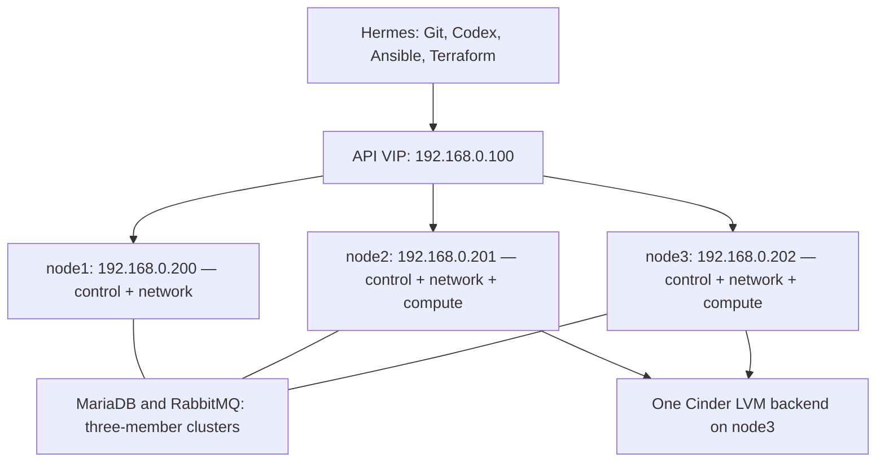

# OpenStack IaC Lab

A three-controller OpenStack learning lab on Ubuntu 24.04, using Kolla-Ansible, Cinder LVM, Ansible roles, Terraform modules, a Flask application, and monitoring.

**Status: implementation ready for review and lab validation, not a record of a completed deployment.** Nothing in this repository has been run on the physical nodes. Read each stage's prerequisites before running its commands. The code deliberately stops at unknown environment inputs instead of guessing.

## Start here on Hermes

```bash
cd ~/git
git clone https://github.com/DinosaurKeys/openstack-iac-lab.git
cd openstack-iac-lab
bash scripts/discover.sh
```

If the clone already exists, use `git pull --ff-only` inside it instead. Discovery is read-only: it records the existing IP/NIC/disk layout before reinstalling. Keep build/discovery-* reports private and share only the portions needed for review. It never opens a browser, reads email, installs packages on nodes, or wipes storage.

Copy config/lab.yml.example to private/lab.yml and fill verified provider MACs, DNS, data-disk identity/health, and a floating-IP range excluded from router DHCP and all existing LAN devices. Proposed workload CIDRs also need overlap review. HCP organization/local execution is an explicit setup choice; no external state is uploaded merely by cloning this repository.

## Staged execution after input review

These are **separate steps**, not an instruction to paste the entire sequence before the checks pass. Run Stage 0's node reinstalls and SSH identity checks at the appropriate point. Keep Hermes intact.

```bash
bash scripts/bootstrap-hermes.sh
source ~/venvs/kolla-iac/bin/activate
python scripts/labctl.py doctor
mkdir -p private
chmod 700 private
cp config/lab.yml.example private/lab.yml
```

Edit private/lab.yml, then run:

```bash
python scripts/labctl.py configure --hosts-only
python scripts/labctl.py --ask-become-pass preflight
python scripts/labctl.py --ask-become-pass base
python scripts/labctl.py netplan
```

The Netplan step writes candidate files on Hermes. Review/install/confirm them at the node consoles as explained in Stage 2. Confirm the fresh-install flag only after all three OS reinstalls. For a blank, verified Cinder disk, the storage step asks you to type its host and serial; old Ceph signatures cause a refusal pending an exact cleanup review.

```bash
python scripts/labctl.py --ask-become-pass storage
python scripts/labctl.py init-config
python scripts/labctl.py --ask-become-pass kolla bootstrap-servers
python scripts/labctl.py --ask-become-pass kolla prechecks
python scripts/labctl.py --ask-become-pass kolla pull
python scripts/labctl.py --ask-become-pass kolla deploy
python scripts/labctl.py --ask-become-pass kolla post-deploy
python scripts/labctl.py --ask-become-pass kolla check
```

Load the generated **new cloud's admin credentials** and check the service lists. The cloud-init entry point below seeds provider networking, image, flavor, and your SSH public key; it does not mean the Linux cloud-init daemon:

```bash
python scripts/labctl.py init-cloud
```

Then create a project-scoped IaC identity/application credential as Stage 3 explains. Put its private configuration in private/clouds.yaml, using config/clouds.yaml.example as the shape; do not commit its credential. Authenticate HCP Terraform in your own session and set the three named workspaces to Local execution. With the new IaC identity active:

```bash
export OS_CLIENT_CONFIG_FILE="$PWD/private/clouds.yaml"
export OS_CLOUD=iac-lab
terraform login
python scripts/labctl.py configure
python scripts/labctl.py terraform first init
python scripts/labctl.py terraform first validate
python scripts/labctl.py terraform first plan
python scripts/labctl.py terraform first apply
```

Each apply requires the saved plan and a typed workload confirmation. Stage 3 supplies the disposable destroy/recreate exercise. For the app, prepare its vault and the guest data filesystem exactly as Stage 4 explains:

```bash
python scripts/labctl.py terraform app init
python scripts/labctl.py terraform app plan
python scripts/labctl.py terraform app apply
python scripts/labctl.py application
```

For monitoring, first create its private Grafana vault as Stage 5 explains:

```bash
python scripts/labctl.py terraform monitor init
python scripts/labctl.py terraform monitor plan
python scripts/labctl.py terraform monitor apply
python scripts/labctl.py --ask-become-pass monitoring
```

The wrapper transfers actual Terraform outputs into generated Ansible inventories. Monitoring gets the actual app private IP from the application state; it is not hardcoded. It offers no automatic full-cluster destroy or disk-wipe action. To use lower-level commands and learn each component, follow the six guides below.

## The learning path

Linux and networking establish the hosts. Ansible prepares their operating systems. Kolla-Ansible deploys OpenStack. Terraform creates cloud resources. Ansible configures applications. Prometheus and Grafana show how they behave.

| Stage | Guide | Finish line |
|---|---|---|
| 0 | [Keep Hermes, install Codex, reset the nodes](docs/00-hermes-codex-and-node-reset.md) | Same Hermes; three clean Ubuntu nodes with their original IPs |
| 1 | [Three-controller OpenStack with Cinder LVM](docs/01-openstack-foundation.md) | Healthy control services, a reachable VM, and a verified volume |
| 2 | [Reusable Ansible roles](docs/02-ansible-roles.md) | YAML inventory, common/netplan roles, and a documented node rebuild |
| 3 | [Terraform modules and remote state](docs/03-terraform-modules.md) | Reproducible first workload using network and compute modules |
| 4 | [PostgreSQL, Flask, Gunicorn, and Nginx](docs/04-application-deployment.md) | A working application and persistent database test |
| 5 | [Prometheus and Grafana](docs/05-monitoring.md) | Three dashboards and two tested alert rules |

## Fixed addresses

These values preserve the previous project's address plan. They are targets for the rebuild, not a claim about current reachability.

| Host | Management address | Initial roles |
|---|---|---|
| node1 | 192.168.0.200/24 | Controller, network, local Glance image store |
| node2 | 192.168.0.201/24 | Controller, network, compute |
| node3 | 192.168.0.202/24 | Controller, network, compute, proposed Cinder LVM host |
| API VIP | 192.168.0.100 | Movable API address; never configure it statically on all hosts |
| Hermes | Keep its existing address | Deployment tools and Codex; excluded from node reset |

All three hosts are controllers. Compute on node2/node3 is the initial resource allocation; additional dedicated compute nodes can be added later. The storage host is **provisional until its dedicated disk passes health and ownership review**. No disk device name or serial has been invented.

The previous lab recorded gateway 192.168.0.1 and management NIC enp0s31f6. Verify both locally. A fresh two-NIC layout uses enp0s31f6 for management and a MAC-matched ext0 for the Neutron provider network. This removes the old br-mgmt/veth plumbing while preserving the IPs. If the actual interfaces differ, edit the examples before deployment.



## What is and is not redundant

Three controllers give control services redundant peers. A correctly configured, healthy three-member quorum can tolerate one member failure. Three controllers do not copy local VM disks, Cinder LVM volumes, or image files.

| Layer | Initial choice | Consequence |
|---|---|---|
| APIs, database, messaging | Three controllers | Test one-controller loss after the foundation is healthy |
| Network agents / API load balancers | Three network nodes | Placement and failover must be verified separately |
| Glance images | One file-backed service on node1 | Image upload/download has a single-host dependency |
| Nova instance root disks | Local compute disks | No automatic recovery of a lost compute host's local disks |
| Cinder volumes | One LVM storage host | No replicated storage; host or disk loss affects its volumes |

Kolla's Cinder guide still flags multi-controller LVM issues. This guide deliberately confines the volume backend to one host, keeps prechecks enabled, and requires a cross-compute volume test. This is a proposed lab layout, not a promise that a documentation example has been runtime-validated.

## Work in small steps

Every guide explains the cause, the change, the expected effect, the checks, and how to stop or recover. Example output describes an acceptance condition; it is never presented as observed output.

Keep secrets outside Git: Kolla passwords, OpenStack application credentials, SSH private keys, Terraform state/plan files, and database passwords. AGENTS.md carries the same working rules into Codex sessions.

## GitHub workflow

The project repository is [DinosaurKeys/openstack-iac-lab](https://github.com/DinosaurKeys/openstack-iac-lab). Clone it once on Hermes; use `git pull --ff-only` inside the clone for later reviewed updates. Public clone access does not itself grant write access.

After making an intentional local change on Hermes, review exactly what will be committed:

```bash
git add .
git diff --cached --stat
git diff --cached
git commit -m "Describe the reviewed change"
git push
```

Use the existing verified GitHub authentication/SSH alias on Hermes for writes. Never add private/, build/, backend settings, Terraform state/plans, or credentials to Git. There is no need to delete the old project from Hermes to use this one.

## Validation limits

Local syntax and consistency checks are recorded in VALIDATION.md. Infrastructure deployment, disk health, floating-IP allocation, application behavior, and controller failover require execution in the lab. Unresolved environment values are listed explicitly in the relevant stages.

## Primary references

- [Kolla 2026.1 production architecture](https://docs.openstack.org/kolla-ansible/2026.1/admin/production-architecture-guide.html)
- [Kolla 2026.1 Cinder guide](https://docs.openstack.org/kolla-ansible/2026.1/reference/storage/cinder-guide.html)
- [Kolla 2026.1 multinode guide](https://docs.openstack.org/kolla-ansible/2026.1/user/multinode.html)
- [Codex CLI](https://learn.chatgpt.com/docs/codex/cli)
