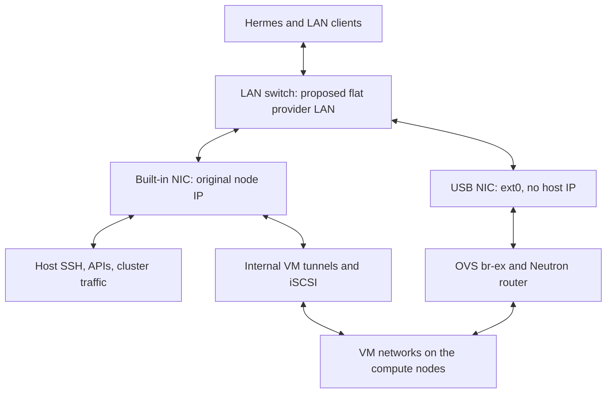
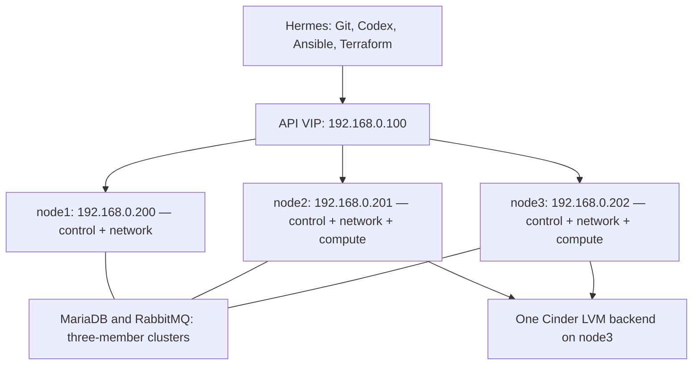

# OpenStack IaC Lab

Three controllers on Ubuntu 24.04, Cinder LVM, Ansible, Terraform, an application, and monitoring.

**Current step: Stage 0 — remove the recorded old Ceph allocations.** Ubuntu reinstall, SSH and storage collection are already complete. OpenStack has not been deployed in this rebuild.

[Read the cleanup lesson before running it](docs/00-hermes-codex-and-node-reset.md#7-remove-the-recorded-old-ceph-allocations). Joe has confirmed that the old Ceph contents can be discarded. The script checks current use, shows the exact commands and asks for each node/serial confirmation.

## Two NICs per node

Both NICs were detected in the supplied discovery. **Provider cable/link operation is still unverified.**

| Node | Built-in NIC: management | USB NIC now | Intended name after Netplan |
|---|---|---|---|
| node1 | `enp0s31f6` — `192.168.0.200/24` | `enx00e04c557e58` | `ext0` |
| node2 | `enp0s31f6` — `192.168.0.201/24` | `enx00e04c2c1678` | `ext0` |
| node3 | `enp0s31f6` — `192.168.0.202/24` | `enx00e04c304688` | `ext0` |



The built-in NIC carries host management **and internal OpenStack traffic**. The USB NIC supplies the external/provider connection used for VM floating-IP traffic. This separates host and provider interfaces; it does not provide NIC failover or dedicated storage bandwidth.

**Design to verify:** both NICs reach the intended untagged LAN for the proposed flat network. Switch ports, VLAN configuration, link speed and USB adapter stability need checking. If the cabling reaches a different network, review that topology before applying Netplan. The API VIP `.100` belongs on the management side through Keepalived.

## Execution map: what runs, when and why

Follow this table **from top to bottom**, reviewing the result at each stop. Commands run from `~/git/openstack-iac-lab` on Hermes unless the lesson says node console. This is a sequence of lessons, not one unattended installation.

| Order / chapter | What we run | Why we need it | Finish check |
|---|---|---|---|
| 1 · Stage 0 — **done** | Ubuntu install, discovery and `check-storage.sh` | Establish actual host, disk and NIC identities | Three reports reviewed; IPs preserved |
| 2 · Stage 0 — **run now** | `bash scripts/reset-ceph.sh joe --node all --apply` | Old Ceph still owns the SATA SSDs after the OS reinstall | `CLEANED` or `ALREADY_BLANK` for all three |
| 3 · Stage 0 — next review | Two-NIC link/switch review; remaining disk-health findings; DNS and address reservations | Prevent a disconnected provider uplink or duplicate IP from becoming an OpenStack failure | Link evidence and confirmed network inputs |
| 4 · Stage 1 | `bash scripts/bootstrap-hermes.sh`, activate its environment, then `python scripts/labctl.py doctor` | Install the isolated deployment tools on Hermes | Required tools found; Terraform needed by Stage 3 |
| 5 · Stages 1 + 2 | Review `private/lab.yml`; prepare Hermes SSH-key access; `labctl configure --hosts-only`, `preflight`, `base` | Give Ansible verified values and a repeatable Ubuntu baseline | Correct three-node inventory, SSH and time service |
| 6 · Stages 1 + 2 | `labctl netplan`, then the console procedure in Stage 2, one node at a time | Bind each USB MAC to `ext0` and retain the original management address | SSH, DNS, default route and provider link checked |
| 7 · Stage 1 | `labctl --ask-become-pass storage` | Create **one** `cinder-volumes` VG on the reviewed blank node3 SATA disk | node3 SATA owns Cinder; Ubuntu VG stays separate |
| 8 · Stage 1 | `labctl init-config`, then the Kolla phases below | Deploy the control, networking, compute and volume services | Kolla checks and service lists pass |
| 9 · Stage 1 | `labctl init-cloud` using the new cloud's admin credentials | Seed the external network, verified Ubuntu cloud image, flavor and public key | Expected resources and API responses |
| 10 · Stage 2 | Repeat the common role and study the inventory/roles | Prove the same desired configuration does not accumulate changes | Configuration tasks are repeatable; physical-node rebuild exercise waits for a healthy cloud |
| 11 · Stage 3 | HCP state setup, project-scoped cloud credential, full `labctl configure`; Terraform `first` phases | Build `01-first-workload` from reusable network/compute modules | Reach VM by floating IP; disposable destroy/recreate exercise passes |
| 12 · Stages 1 + 3 acceptance | Disposable Cinder attach → write → detach → reattach across node2/node3 | A running volume service alone does not prove usable storage | Same file/checksum readable on both computes; pass before database deployment |
| 13 · Stage 4 | Terraform `app` phases; private app vault; `labctl application` | Create app/DB VMs and deploy PostgreSQL, Flask, Gunicorn and Nginx | HTTP health succeeds, logs inspected, database persistence tested |
| 14 · Stage 5 | Terraform `monitor` phases; private Grafana vault; `labctl --ask-become-pass monitoring` | Deploy exporters, Prometheus, blackbox probe and Grafana | Six exporter targets, one probe, three dashboards, two alerts tested |

`labctl` above means `python scripts/labctl.py`. Use `--ask-become-pass` **before** the action when sudo needs a password. The exact sequences and required private inputs are in the linked stage guides. Stage 1 borrows the Stage 2 roles for host preparation; Stage 2 then explains and verifies them.

<details>
<summary>Command reference: OpenStack deployment phases</summary>

### Inside the OpenStack deployment step

Each phase is a separate command: `python scripts/labctl.py --ask-become-pass kolla PHASE`.

| Phase, in order | Effect | Stop condition |
|---|---|---|
| `bootstrap-servers` | Prepare hosts and container runtime | Host-preparation error |
| `prechecks` | Check release prerequisites, inventory and backend constraints | Any failed precheck; diagnose rather than skip |
| `pull` | Download the selected container images | Pull failure |
| `deploy` | Configure/start the OpenStack services | Failed deployment task |
| `post-deploy` | Generate client access configuration | Missing/failed client configuration |
| `check` | Run the release's service checks | Failed check; inspect its service/log |

</details>

<details>
<summary>Command reference: each Terraform workload</summary>

### Inside each Terraform step

For `first`, `app` or `monitor`, run `python scripts/labctl.py terraform NAME ACTION` with these actions individually:

| Action | Why | Check before continuing |
|---|---|---|
| `init` | Connect the correct remote state and install providers | Correct organization/workspace; Local execution on Hermes |
| `validate` | Check configuration structure | No validation error |
| `plan` | Calculate and save the proposed cloud changes | Read the actual resources, addresses and any deletions |
| `apply` | Apply that saved plan after the workload confirmation | Read real outputs; verify the running workload |

</details>

### Inputs we still need before later rows can run

| Input | Why it cannot be guessed |
|---|---|
| USB cabling/switch/VLAN and working links | A detected NIC does not establish a usable provider path |
| Working DNS and unused/reserved `.100` | Existing configuration is evidence of settings, not proof of service/address availability |
| Router DHCP exclusions, floating-IP start/end, Hermes address and other LAN allocations | Prevent assigning an IP already used by another device |
| Reviewed node3 disk reuse and unresolved diagnostic limitations | Deleting Ceph does not repair hardware or resolve a failed NVMe log query |
| Hermes public-key access to `joe` on all nodes | Password-only discovery does not establish unattended Ansible SSH |
| Non-overlapping tenant CIDRs, HCP organization/workspaces and scoped cloud credentials | These depend on your network and accounts |

**For this run, stop after row 2 and review `build/ceph-reset-report.txt`.** Later rows are ordered, but are not claimed ready until their inputs/checks pass. Hermes and the Ubuntu NVMe disks are outside the cleanup targets.

<details>
<summary>Reference: first checkout and initial discovery</summary>

Run on Hermes for a first checkout:

```bash
mkdir -p ~/git
cd ~/git
git clone https://github.com/DinosaurKeys/openstack-iac-lab.git
cd openstack-iac-lab
```

For an existing checkout, use `git pull --ff-only` inside it. Preserve Hermes and the previous project. Read Stage 0's SSH identity instructions before trusting reinstalled nodes. Initial discovery uses `bash scripts/discover.sh joe`; append an IP for a targeted retry. It supports normal password login. The current rebuild has already completed discovery.

Reports remain in Git-ignored build/ directories. Do not commit raw reports, passwords, private keys, application credentials, or Terraform state. The preparation and generated Kolla inventories use the confirmed account `joe`.

Copy config/lab.yml.example to private/lab.yml only when preparing the reviewed configuration. Provider MACs, verified DNS, a selected healthy data disk, available VIP/floating IPs, workload CIDR review and the HCP state setup need actual inputs. The source refuses unknown values instead of choosing devices or addresses for you.

</details>

<details>
<summary>Reference: later-stage command sequence — follow its lesson first</summary>

## Staged execution after input review

These are **separate steps**, not an instruction to paste the entire sequence before the checks pass. Run Stage 0's node reinstalls and SSH identity checks at the appropriate point. Keep Hermes intact.

```bash
bash scripts/bootstrap-hermes.sh
source ~/venvs/kolla-iac/bin/activate
python scripts/labctl.py doctor
mkdir -p private
chmod 700 private
cp config/lab.yml.example private/lab.yml
```

Edit private/lab.yml, then run:

```bash
python scripts/labctl.py configure --hosts-only
python scripts/labctl.py --ask-become-pass preflight
python scripts/labctl.py --ask-become-pass base
python scripts/labctl.py netplan
```

The Netplan step writes candidate files on Hermes. Review/install/confirm them at the node consoles as explained in Stage 2. Confirm the fresh-install flag only after all three OS reinstalls. For a blank, verified Cinder disk, the storage step asks you to type its host and serial; old Ceph signatures cause a refusal pending an exact cleanup review.

```bash
python scripts/labctl.py --ask-become-pass storage
python scripts/labctl.py init-config
python scripts/labctl.py --ask-become-pass kolla bootstrap-servers
python scripts/labctl.py --ask-become-pass kolla prechecks
python scripts/labctl.py --ask-become-pass kolla pull
python scripts/labctl.py --ask-become-pass kolla deploy
python scripts/labctl.py --ask-become-pass kolla post-deploy
python scripts/labctl.py --ask-become-pass kolla check
```

Load the generated **new cloud's admin credentials** and check the service lists. The cloud-init entry point below seeds provider networking, image, flavor, and your SSH public key; it does not mean the Linux cloud-init daemon:

```bash
python scripts/labctl.py init-cloud
```

Then create a project-scoped IaC identity/application credential as Stage 3 explains. Put its private configuration in private/clouds.yaml, using config/clouds.yaml.example as the shape; do not commit its credential. Authenticate HCP Terraform in your own session and set the three named workspaces to Local execution. With the new IaC identity active:

```bash
export OS_CLIENT_CONFIG_FILE="$PWD/private/clouds.yaml"
export OS_CLOUD=iac-lab
terraform login
python scripts/labctl.py configure
python scripts/labctl.py terraform first init
python scripts/labctl.py terraform first validate
python scripts/labctl.py terraform first plan
python scripts/labctl.py terraform first apply
```

Each apply requires the saved plan and a typed workload confirmation. Stage 3 supplies the disposable destroy/recreate exercise. For the app, prepare its vault and the guest data filesystem exactly as Stage 4 explains:

```bash
python scripts/labctl.py terraform app init
python scripts/labctl.py terraform app plan
python scripts/labctl.py terraform app apply
python scripts/labctl.py application
```

For monitoring, first create its private Grafana vault as Stage 5 explains:

```bash
python scripts/labctl.py terraform monitor init
python scripts/labctl.py terraform monitor plan
python scripts/labctl.py terraform monitor apply
python scripts/labctl.py --ask-become-pass monitoring
```

The wrapper transfers actual Terraform outputs into generated Ansible inventories. Monitoring gets the actual app private IP from the application state; it is not hardcoded. The wrapper offers no automatic full-cluster destroy. Stage 0 has a separate, target-specific Ceph removal helper with current-use checks and per-node command confirmation. To use lower-level commands and learn each component, follow the six guides below.


</details>

## The learning path

Linux and networking establish the hosts. Ansible prepares their operating systems. Kolla-Ansible deploys OpenStack. Terraform creates cloud resources. Ansible configures applications. Prometheus and Grafana show how they behave.

| Stage | Guide | Finish line |
|---|---|---|
| 0 | [Understand and verify the nodes](docs/00-hermes-codex-and-node-reset.md) | Original IPs, working SSH, reviewed disk layout and health findings |
| 1 | [Three-controller OpenStack with Cinder LVM](docs/01-openstack-foundation.md) | Healthy control services, a reachable VM, and a verified volume |
| 2 | [Reusable Ansible roles](docs/02-ansible-roles.md) | YAML inventory, common/netplan roles, and a documented node rebuild |
| 3 | [Terraform modules and remote state](docs/03-terraform-modules.md) | Reproducible first workload using network and compute modules |
| 4 | [PostgreSQL, Flask, Gunicorn, and Nginx](docs/04-application-deployment.md) | A working application and persistent database test |
| 5 | [Prometheus and Grafana](docs/05-monitoring.md) | Three dashboards and two tested alert rules |

## Fixed addresses

The three node addresses and SSH access are confirmed by the user's reports. The API VIP remains part of the planned address scheme; its availability still needs checking.

| Host | Management address | Planned OpenStack roles |
|---|---|---|
| node1 | 192.168.0.200/24 | Controller, network, local Glance image store |
| node2 | 192.168.0.201/24 | Controller, network, compute |
| node3 | 192.168.0.202/24 | Controller, network, compute, proposed Cinder LVM host |
| API VIP | 192.168.0.100 | Movable API address; never configure it statically on all hosts |
| Hermes | Keep its existing address | Deployment tools and Codex; excluded from node reset |

All three hosts are planned as controllers. Compute on node2/node3 is the initial resource allocation; additional dedicated compute nodes can be added later. The storage host is **provisional until its dedicated disk passes health and ownership review**. No disk device name or serial has been invented.

The current reports show gateway 192.168.0.1 and management NIC enp0s31f6 on all three nodes. A fresh two-NIC layout uses enp0s31f6 for management and a MAC-matched ext0 for the Neutron provider network. This removes the old br-mgmt/veth plumbing while preserving the IPs. If the actual interfaces differ, edit the examples before deployment.

The following is the **planned OpenStack architecture**. This rebuild has not deployed its OpenStack services yet.



## What is and is not redundant

Three controllers give control services redundant peers. A correctly configured, healthy three-member quorum can tolerate one member failure. Three controllers do not copy local VM disks, Cinder LVM volumes, or image files.

| Layer | Initial choice | Consequence |
|---|---|---|
| APIs, database, messaging | Three controllers | Test one-controller loss after the foundation is healthy |
| Network agents / API load balancers | Three network nodes | Placement and failover must be verified separately |
| Glance images | One file-backed service on node1 | Image upload/download has a single-host dependency |
| Nova instance root disks | Local compute disks | No automatic recovery of a lost compute host's local disks |
| Cinder volumes | One LVM storage host | No replicated storage; host or disk loss affects its volumes |

Kolla's Cinder guide still flags multi-controller LVM issues. This guide deliberately confines the volume backend to one host, keeps prechecks enabled, and requires a cross-compute volume test. This is a proposed lab layout, not a promise that a documentation example has been runtime-validated.

## Work in small steps

Every guide explains the cause, the change, the expected effect, the checks, and how to stop or recover. Example output describes an acceptance condition; it is never presented as observed output.

Each learning session names the current stage, explains the cause using observed evidence, describes its script or role, then runs one consolidated stage command and reviews its report. Repeated operations belong in the repository instead of per-node terminal instructions.

Keep secrets outside Git: Kolla passwords, OpenStack application credentials, SSH private keys, Terraform state/plan files, and database passwords. AGENTS.md carries the same working rules into Codex sessions.

## GitHub workflow

The project repository is [DinosaurKeys/openstack-iac-lab](https://github.com/DinosaurKeys/openstack-iac-lab). Clone it once on Hermes; use `git pull --ff-only` inside the clone for later reviewed updates. Public clone access does not itself grant write access.

After making an intentional local change on Hermes, review exactly what will be committed:

```bash
git add .
git diff --cached --stat
git diff --cached
git commit -m "Describe the reviewed change"
git push
```

Use the existing verified GitHub authentication/SSH alias on Hermes for writes. Never add private/, build/, backend settings, Terraform state/plans, or credentials to Git. There is no need to delete the old project from Hermes to use this one.

## Validation limits

Local syntax and consistency checks are recorded in VALIDATION.md. Infrastructure deployment, disk health, floating-IP allocation, application behavior, and controller failover require execution in the lab. Unresolved environment values are listed explicitly in the relevant stages.

## Primary references

- [Kolla 2026.1 production architecture](https://docs.openstack.org/kolla-ansible/2026.1/admin/production-architecture-guide.html)
- [Kolla 2026.1 Cinder guide](https://docs.openstack.org/kolla-ansible/2026.1/reference/storage/cinder-guide.html)
- [Kolla 2026.1 multinode guide](https://docs.openstack.org/kolla-ansible/2026.1/user/multinode.html)
- [Codex CLI](https://learn.chatgpt.com/docs/codex/cli)
