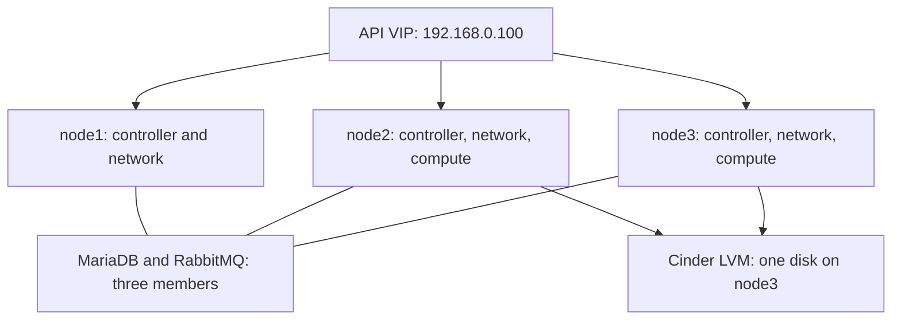

# OpenStack IaC Lab

Build a three-controller OpenStack lab on Ubuntu 24.04 with Cinder LVM. Then learn Ansible roles, Terraform modules, application deployment and monitoring.

**Current stage: [1 — Install OpenStack](docs/01-openstack-foundation.md). Kolla-Ansible deployment has not started.** Ansible has already connected to the nodes and run host checks/basic configuration. The common role has now passed on all three nodes. The next step is one deployment-input review.

## Where we are

| Status | Work |
|---|---|
| Complete | Fresh Ubuntu on all three nodes; old Ceph allocations removed; USB physical link tests passed |
| Complete | Hermes tools, SSH-key access, Ansible sudo checks and common-role preview |
| Complete | Common apply and verification on all three nodes; hostname correction confirmed |
| **Current → next** | **Review deployment settings → configure networking and node3 LVM → run Kolla-Ansible** |

**Latest lab evidence:** Joe's report starting `2026-10-22T12:31:45Z` ends `COMMON_APPLIED_OK for all`. All three passed packages, hostname, preserved management IP, exact name resolution and Chrony checks. The earlier hostname stop is resolved; no common-role retry is needed.

Continue at **[Stage 1, Step 2](docs/01-openstack-foundation.md#2-review-one-deployment-configuration)**. Local configuration/inventory/Netplan simulation also passed; the short results and limits are in that lesson. Completed setup is reference material, not a list to run again.

## Execution map: what runs, when and why

The active instructions stay in Stage 1 until OpenStack is installed. Later stages teach and extend what we built.

| Stage | Guide | Result |
|---|---|---|
| 0 · completed preparation | [Understand the nodes](docs/00-hermes-codex-and-node-reset.md) | Known disks/NICs, original IPs preserved, old Ceph allocations removed |
| **1 · current** | **[Install OpenStack](docs/01-openstack-foundation.md)** | **Host settings applied, Cinder VG created, Kolla deployment and service/API checks passed** |
| 2 | [Understand reusable Ansible roles](docs/02-ansible-roles.md) | Learn the existing inventory/common/netplan structure; plan a later controlled node rebuild |
| 3 | [Terraform modules and remote state](docs/03-terraform-modules.md) | First VM from network/compute modules, floating-IP access, volume and destroy/recreate exercises |
| 4 | [PostgreSQL, Flask and Nginx](docs/04-application-deployment.md) | Working application and persistent database test |
| 5 | [Prometheus and Grafana](docs/05-monitoring.md) | Three dashboards and two tested alerts |

HCP Terraform, application secrets and monitoring settings are later inputs. They do not block the hosts-only OpenStack configuration.

## Fixed addresses

This is the planned service placement. OpenStack services have not been deployed in this rebuild.

| Host | Preserved address | Planned services |
|---|---|---|
| node1 | `192.168.0.200/24` | Controller, network, local Glance image store |
| node2 | `192.168.0.201/24` | Controller, network, compute |
| node3 | `192.168.0.202/24` | Controller, network, compute, one Cinder LVM backend |
| API VIP | `192.168.0.100` | Shared API address; DHCP binding/current lease still needs review |
| Hermes | Keep its existing address | Git, Ansible, Kolla-Ansible and Terraform |

A **controller** manages cloud requests, authentication, scheduling and shared records. A **compute** runs VMs. The **Cinder backend** supplies persistent VM disks. One physical node can do several jobs.

Three controllers provide peers for control services. They do not replicate local VM disks, node1's Glance files or node3's LVM volumes. [Read the redundancy comparison](#what-is-and-is-not-redundant).

## Two NICs per node

Both NICs connect to the same mini switch on `192.168.0.0/24`.

| Node | Built-in NIC: management | USB NIC now | Intended provider name |
|---|---|---|---|
| node1 | `enp0s31f6`: `.200/24` | `enx00e04c557e58` | `ext0` |
| node2 | `enp0s31f6`: `.201/24` | `enx00e04c2c1678` | `ext0` |
| node3 | `enp0s31f6`: `.202/24` | `enx00e04c304688` | `ext0` |

The built-in NIC keeps the node's IP and carries management/internal OpenStack traffic. The USB NIC will have no host IP; Neutron/OVS uses it for external VM traffic. This does not provide NIC failover or a separate storage network.

**Already tested:** USB carrier at 1 Gb/s full duplex on all three, then restored DOWN. Persistent configuration and VM forwarding are later checks.

**Initial external pool:** use the offered `192.168.0.150–152` for the first workload. DHCP is `.2–.149`; `.100` is reserved, with its binding still unresolved. Expand the pool or remove the disposable first workload before keeping all later workloads together; the current combined design needs five external addresses. [Address budget](docs/00-hermes-codex-and-node-reset.md#reviewed-windows-ping-and-address-budget).

What is and is not redundant

## What is and is not redundant

| Layer | Initial choice | Consequence |
|---|---|---|
| APIs, database, messaging | Three controllers | Test one-controller loss after the cloud is healthy |
| Network agents and API load balancers | Three network nodes | Placement and failover need their own verification |
| Glance images | Local files on node1 | Image operations depend on node1 |
| VM root disks | Local compute disks | A lost compute disk is not recovered by controller quorum |
| Cinder volumes | One LVM host, node3 | Storage is not replicated; host/disk loss affects its volumes |

Kolla's Cinder guide flags multi-controller LVM limitations. Keep prechecks enabled and validate volume access from both computes before deploying the database. One backend host does not prove away every limitation.

## How to use this guide

Each active step says **why → what changes → one command or phase → expected result**. A failed command is diagnosed at that step. We do not restart completed preparation or create a new chapter for every error.

Joe runs infrastructure commands on Hermes. Documentation and local tests are not proof of a live deployment. Source checks and historical results are in [VALIDATION.md](VALIDATION.md).

GitHub workflow and private files

## GitHub workflow

Clone [this repository](https://github.com/DinosaurKeys/openstack-iac-lab) once on Hermes. From the existing checkout, `git pull --ff-only` retrieves published changes. Keep the old project and Hermes intact.

Before committing a local edit, stage only the intended paths and inspect the staged diff. Keep `private/`, `build/`, SSH private keys, Kolla passwords, cloud credentials and Terraform state/plans out of Git. Public repository access does not grant write access.

## Validation limits

Local checks establish source/fixture behavior. Real service health, address ownership, disk health, VM connectivity and failover need lab evidence.

## Primary references

- [Kolla 2026.1 architecture](https://docs.openstack.org/kolla-ansible/2026.1/admin/production-architecture-guide.html)
- [Kolla 2026.1 Cinder guide](https://docs.openstack.org/kolla-ansible/2026.1/reference/storage/cinder-guide.html)
- [Kolla 2026.1 multinode guide](https://docs.openstack.org/kolla-ansible/2026.1/user/multinode.html)
