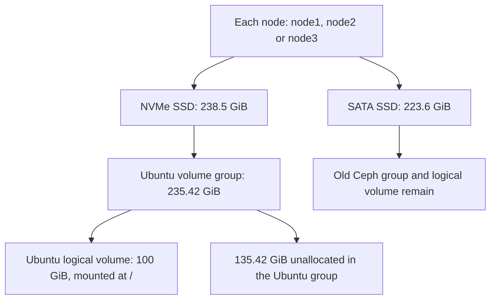

# Stage 0 — Understand and verify the three nodes

**Today's lesson:** read the storage inspection you already ran.

| Step | Status |
|---|---|
| Reinstall Ubuntu, keep the original IPs | Completed |
| Log in as `joe` and run discovery | Completed |
| Collect storage information from all three nodes | Completed; results explained below |
| Resolve diagnostic warnings and review disk reuse | Pending |
| Clean old Ceph / deploy OpenStack | Pending |

## Storage inspection: one script for all three nodes

Your pasted file is a **diagnostic transcript**. It is long because the script printed installation progress and full health reports for six drives. The collection already ran; start with the diagram below and read one lesson at a time.

### The architecture: two separate disks in every node



**Cause:** the installer replaced Ubuntu on the NVMe disk. The separate SATA disk retained its Ceph metadata.

**VMware comparison:** reinstalling ESXi on a boot disk can leave a separate datastore disk intact.

### 1. SSH: how one script reaches all three nodes

| Where | What happened |
|---|---|
| Hermes | Started the script and kept its output files |
| node1 — `192.168.0.200` | Logged in as `joe`, inspected its disks |
| node2 — `192.168.0.201` | Ran the same inspection on its disks |
| node3 — `192.168.0.202` | Ran the same inspection on its disks |

The loop uses **SSH** to carry commands to each node. **Sudo** gives those commands access to protected disk information. That explains the two password prompts per node.

`smartmontools` was installed on all three nodes during this run. The storage commands inspected existing metadata and health logs. They did not remove the Ceph volumes.

### 2. Disks, mounts and LVM: what owns the space

**Learn these four words first:**

| Word | Plain meaning | Example in your output |
|---|---|---|
| PV — physical volume | Disk or partition prepared for LVM | `/dev/nvme0n1p3` or `/dev/sda` |
| VG — volume group | A pool of storage space | `ubuntu-vg` or a `ceph-...` group |
| LV — logical volume | A disk-like allocation from a VG | `ubuntu-lv` or `osd-block-...` |
| Mountpoint | Directory exposing a filesystem's files | `/` is Ubuntu's root filesystem |

**Read just these numbers from your report:**

| Observed value, on every node | Meaning |
|---|---|
| NVMe disk: **238.5 GiB** | Physical OS disk capacity |
| `ubuntu-vg`: **235.42 GiB** | LVM pool after the separate boot partitions |
| `ubuntu-lv`: **100 GiB**, mounted at `/` | Space allocated to Ubuntu's root filesystem |
| Ubuntu VG `VFree`: **135.42 GiB** | Space in the pool not yet assigned to an LV |
| SATA Ceph VG `VFree`: **0** | The old Ceph LV already occupies the pool |

VG free space describes **allocation**. It does not tell us the free space inside Ubuntu's filesystem or how much user data Ceph stored.

**Why does Ceph have no mountpoint?** BlueStore uses its block device directly. An empty mountpoint column does not establish that the disk is empty or available.

<details>
<summary>Which command supplied each part of the diagram?</summary>

| Command | Question it answers |
|---|---|
| `lsblk` | Which disks, partitions, filesystems and LVs exist? |
| `findmnt`, `swapon` | What backs mounted filesystems and active swap? |
| `/dev/disk/by-id/` links | Which stable identity corresponds to each disk? |
| `pvs` | Which device supplies each volume group? |
| `vgs` | How much space is allocated or unallocated in each group? |
| `lvs` | Which logical volume uses which underlying device? |
| `wipefs --no-act` | What storage signatures are present? This mode suppresses writes. |

LVM storage ownership here means which VG/LV already allocates a device. Current device use still needs checking before any later cleanup.

</details>

### 3. SMART: what the drive reports about its health

SMART is the drive's built-in health reporting. The collector read both disks in each node. **All six drives reported overall `PASSED`; the detailed readings still require interpretation.**

**SATA disks — these still contain Ceph:**

| Node | Data SSD | What the report actually says |
|---|---|---|
| node1 | Kingston UV400 | `PASSED`; `Runtime_Bad_Block` raw count **11**; review this finding |
| node2 | ADATA SU630 | `PASSED`; reallocated-sector count **0**; ATA error log unsupported |
| node3 | Kingston A400 | `PASSED`; reported-uncorrectable count **0**; no ATA errors logged |

All three SATA disks have a **previous** extended self-test recorded as completed without error. This run read those old results; it did not start fresh self-tests.

**NVMe disks — these contain Ubuntu:**

| Node | Critical warning | Media/data-integrity errors | Reported percentage used |
|---|---|---|---|
| node1 | `0x00` | **0** | **4%** |
| node2 | `0x00` | **0** | **0%** |
| node3 | `0x00` | **0** | **7%** |

These are reported health fields. They do not resolve every diagnostic warning or guarantee future reliability.

<details>
<summary>SMART columns: categories, thresholds and raw values</summary>

| SMART column | How to read it |
|---|---|
| `TYPE: Pre-fail` | Attribute category; the label alone is not a failure report |
| `VALUE` / `THRESH` | Normalized value and the device's failure threshold |
| `WHEN_FAILED` | Whether that attribute crossed its threshold |
| `RAW_VALUE` | Vendor-specific raw data; units and encoding depend on the model |

For example, node1 shows `SSD_Life_Left` with normalized value 98 and raw value 2. We have not interpreted that raw number as a remaining-life percentage. Node1's bad-block count also needs its model-specific meaning and trend reviewed.

</details>

### 4. Reports: where the results go and how to read them

**Why did all three nodes finish with `REVIEW`?** Each NVMe self-test-log request was rejected:

| Node | NVMe log-read message | Command exit code |
|---|---|---|
| node1 | `Invalid Field in Command (0x002)` | **4** |
| node2 | `Invalid Namespace or Format (0x00b)` | **4** |
| node3 | `Invalid Field in Command (0x002)` | **4** |

`4` marks a failed SMART command. The main health page was readable, but the self-test log query failed. The exact device/firmware/tool interaction remains unresolved. This is different evidence from a firmware health-failure indication.

| Finding | What we conclude now |
|---|---|
| SSH and sudo worked on all three nodes | The collector reached all three machines |
| NVMe health pages report warning `0x00` and media errors `0` | These main health fields show no warning in this snapshot |
| NVMe self-test log queries failed | Diagnostic follow-up remains; `REVIEW` is appropriate |
| Node1 SATA reports runtime bad-block raw count 11 | Keep this as a separate health-review item |
| Ceph VG/LV exists on every SATA disk | Ceph cleanup has not happened |

<details>
<summary>Extra finding: the UMIS NVMe error-log rows look inconsistent</summary>

Node1 and node3 report `Error Information Log Entries: 0`, yet their detailed error-log tables contain unusual large counts/rows. Those table rows need further interpretation. We have not treated them as confirmed media failures or dismissed them as a proven firmware bug.

</details>

**Your report files are on Hermes:**

| File | Purpose |
|---|---|
| `build/storage-health-report.txt` | Latest combined report; your run has already been reviewed for this lesson |
| `build/storage-health-20261021T145723Z-TjNzzA/report.txt` | Combined report preserved for this run |
| Same directory, `<node-IP>.txt` | Individual node log for focused review |

The files contain hardware identifiers and stay in the Git-ignored `build/` directory. The public guide records interpreted findings rather than copying your raw report.

### 5. One script, with a node selector

**Already completed:** your all-node run. The following is a command reference for future focused checks.

| Lesson target | Script argument | Actual node |
|---|---|---|
| Study node1 | `--node node1` | `192.168.0.200` |
| Compare node2 | `--node node2` | `192.168.0.201` |
| Compare node3 | `--node node3` | `192.168.0.202` |
| Inspect the whole lab | `--node all` or omit `--node` | All three, sequentially |

Example for a later node1-only inspection, started from the repository on Hermes:

```bash
bash scripts/check-storage.sh joe --node node1
```

| Option or effect | Meaning |
|---|---|
| `joe` | Node login account |
| `--node node1` | Inspect only node1; node2/node3 are skipped |
| `--install-tools` | Optional: install missing `smartmontools`/`lvm2`; omit it for inspection only |
| Report output | Latest combined file covers only the selected nodes; old timestamped runs remain |
| Disk operations | Read layout/signatures/health; no erase, LVM creation, or new SMART self-test |

The [script source](../scripts/check-storage.sh) implements this table. SSH host-key checks stay enabled, and passwords are entered at normal terminal prompts.

Your earlier disk table clipped labels such as `LVM2_m` because of the SSH terminal width. The full identities are available elsewhere in the report. The updated script uses a wider table for future collections.

### 6. Stop point for this lesson

| We now understand | Still pending before deployment |
|---|---|
| NVMe holds Ubuntu; SATA retains old Ceph | Exact cleanup targets and current device-use review |
| Root LV allocation differs from VG free space | Node1's bad-block finding and NVMe log-query warnings |
| `REVIEW` requires reading the reason | USB provider-link checks and reviewed network inputs |

**Current checkpoint:** understand this layout and the three-node findings. The next lesson will build on this record; there is no need to repeat the completed collection to understand it.

## Earlier setup — reference only

<details>
<summary>Original objective, Ubuntu reinstall, and SSH host-key verification</summary>

The rebuild keeps Hermes intact and uses three Ubuntu Server 24.04 nodes. All three nodes were reinstalled and SSH access as `joe` has been demonstrated. The addresses remain .200, .201 and .202. This is a lab rebuild, not a data migration.

Reinstalling an OS removes configuration from the chosen OS disk. Separate storage needs its own reviewed cleanup. Old Terraform resource IDs belong to the old cloud and must not be reused against the replacement cloud.

For a future reinstall, record disk identities and export any required data before replacing the OS. Generalization tools such as Sysprep, virt-sysprep or cloud-init clean do not perform this full rebuild.

## 2. Reinstall Ubuntu — at each node's console

1. Download Ubuntu Server 24.04 LTS from [Ubuntu](https://ubuntu.com/download/server) and verify the published image checksum.
2. Boot the USB installer. Choose the intended node's **OS disk by model/serial**. Recreate its OS layout. Check that the installer is not selecting the separate data disk.
3. Set the hostname and static management address from the table below. The recorded gateway was 192.168.0.1; verify the router address. Use verified DNS servers from the existing network.
4. Create a normal user, enable OpenSSH, and retain normal sudo access. The completed rebuild uses `joe` on all three nodes, and both Ansible inventories use that confirmed account. If a future rebuild chooses another name, update the inventory source and Kolla inventory generator before running Ansible. Do not reinstall or create another account just to run discovery. Do not copy a shared SSH host key or machine-id between nodes.
5. Reboot, remove the installer, and inspect disk/mount/network state again.

| Hostname | Management IP |
|---|---|
| node1 | 192.168.0.200/24 |
| node2 | 192.168.0.201/24 |
| node3 | 192.168.0.202/24 |

The old cluster becomes unavailable during this full rebuild. Reinstalling only node1 leaves node2/node3's old deployment state in place, so it does not achieve the requested three-node clean start.

Separate data disks can retain Ceph signatures after the OS reinstall. Their erase/provisioning commands must be written after the actual serials and device relationships are reviewed. This repository intentionally has no generic wipe-all-disks script.

## 3. Verify the new SSH identities

On each node's console, confirm the login username and show its host fingerprint:

```bash
whoami
sudo ssh-keygen -lf /etc/ssh/ssh_host_ed25519_key.pub
```

On Hermes, inspect the existing known-host entry for that IP. Once the new fingerprint has been compared with the console, remove the obsolete entry and reconnect. Example for node1, whose account is `joe`:

```bash
ssh-keygen -f /home/joe/.ssh/known_hosts -F 192.168.0.200
ssh-keygen -f /home/joe/.ssh/known_hosts -R 192.168.0.200
ssh joe@192.168.0.200
```

At SSH's trust prompt, compare the fingerprint with the console output before accepting it. Use the actual node account's installation password. `Permission denied` is a login failure; removing a remembered host identity does not fix a wrong username or password.

Repeat for .201/.202, checking each node's own username and fingerprint; do not reuse node1's fingerprint for another host. Remove/check hostname aliases too if SSH reports an old key under `node1` rather than its IP. Do not disable host-key checking to suppress the warning. Later, `ssh-copy-id` can install Hermes's public key for unattended Ansible access; it is not required for this initial discovery and does not recreate the old host identity.


</details>

<details>
<summary>Optional reference: install and start Codex on Hermes</summary>

## 4. Install Codex on Hermes — run these yourself

Codex CLI runs the terminal tools on Hermes and uses the selected model provider for AI responses. It can create YAML, Ansible roles, Terraform files, and documentation in your project. This is a local client setup; the project instructions live in README.md and AGENTS.md.

Install prerequisites and download the official installer as your normal Hermes user:

```bash
sudo apt update
sudo apt install -y curl ca-certificates bubblewrap
curl -fsSL https://chatgpt.com/codex/install.sh -o /tmp/codex-install.sh
less /tmp/codex-install.sh
sh /tmp/codex-install.sh
```

Follow the installer's PATH instructions, then open a new terminal and verify:

```bash
codex --version
codex login --device-auth
codex login status
```

For device authentication, enable device-code login in your ChatGPT security settings if required. Open the URL printed by Codex in **your own browser** and complete the ChatGPT sign-in there. Do not paste the code or credentials into chat. If device authentication is unavailable, `codex login` provides the regular browser flow. ChatGPT sign-in uses your plan access; API-key sign-in uses separately billed API usage.

Ubuntu 24.04 may need the additional AppArmor profile if Codex reports a user-namespace error after bubblewrap installation. Only in that case:

```bash
sudo apt install -y apparmor-profiles apparmor-utils
sudo install -m 0644 /usr/share/apparmor/extra-profiles/bwrap-userns-restrict /etc/apparmor.d/bwrap-userns-restrict
sudo apparmor_parser -r /etc/apparmor.d/bwrap-userns-restrict
```

Keep the restriction in place if that profile is unavailable; inspect the error with the official documentation rather than disabling AppArmor globally.

## 5. Start Codex inside this project

After cloning or extracting the repository to `~/git/openstack-iac-lab`:

```bash
cd ~/git/openstack-iac-lab
codex --sandbox workspace-write --ask-for-approval on-request
```

First prompt:

> Read README.md and AGENTS.md. Inspect only this repository. Explain Stage 0. You may edit project files and run local syntax checks. Do not SSH to the nodes, change networking, run infrastructure deployments, or erase anything. Show your proposed diff.

Those permission flags allow project work with approval boundaries; they do not guarantee that every file read is confined to the project. The ordinary Linux account can have access to other files. Keep unrelated data and unnecessary credentials out of the account used for infrastructure work. Running Codex as root is unnecessary.


</details>

## Sources

- [Official Codex installation](https://learn.chatgpt.com/docs/codex/cli)
- [Codex authentication](https://learn.chatgpt.com/docs/auth)
- [Codex CLI flags](https://learn.chatgpt.com/docs/cli/reference)
- [Linux sandbox and Ubuntu AppArmor](https://learn.chatgpt.com/docs/sandboxing)
- [virt-sysprep purpose](https://libguestfs.org/virt-sysprep.1.html)
- [cloud-init CLI](https://docs.cloud-init.io/en/latest/reference/cli.html)
- [SMART status bitmask definitions](https://github.com/smartmontools/smartmontools/blob/main/src/smartctl.h)
- [wipefs inspection mode](https://github.com/util-linux/util-linux/blob/master/misc-utils/wipefs.8.adoc)
- [OpenSSH remote commands and terminals](https://man.openbsd.org/ssh.1)
- [BlueStore raw block-device use](https://docs.ceph.com/en/latest/rados/configuration/bluestore-config-ref/)

- [SMART attributes, normalized/raw values and command status](https://github.com/smartmontools/smartmontools/blob/main/src/smartctl.8.in)

Next, when Stage 0 checks are resolved: [Stage 1](01-openstack-foundation.md).
