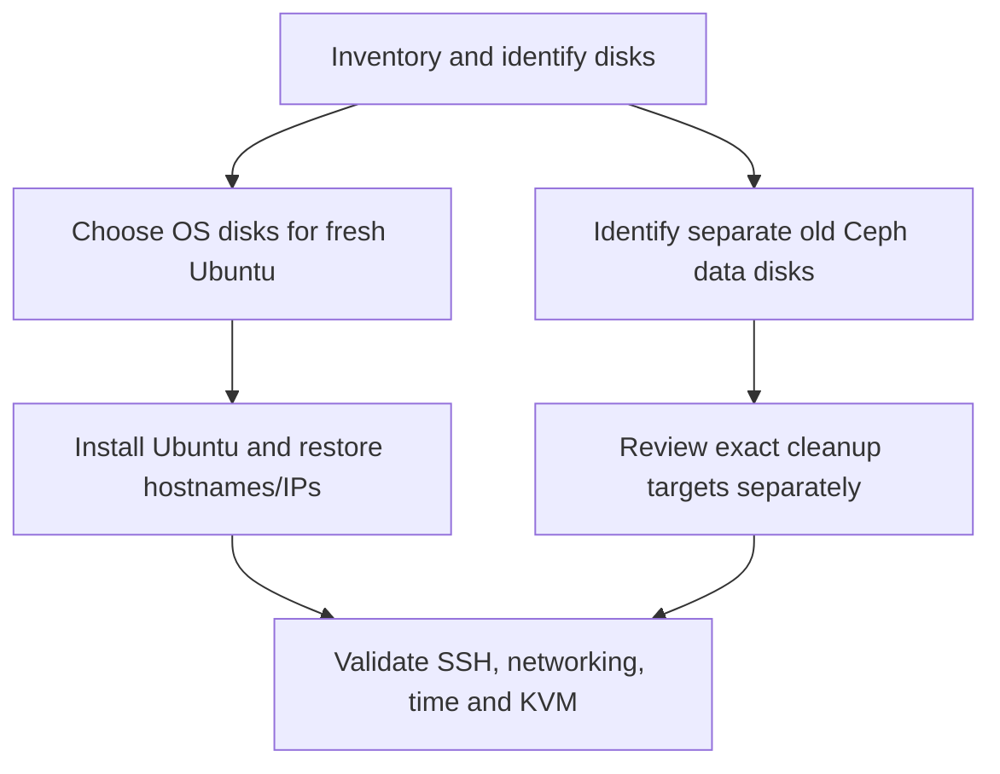

# Stage 0 — Keep Hermes, install Codex, reset the three nodes

## Purpose and effect

Keep the existing Hermes VM. Replace the operating systems on node1, node2, and node3 with clean Ubuntu Server 24.04 LTS installations. This removes the previous host configuration from the selected OS disks. Reusing each hostname/IP does not preserve its old SSH identity or OpenStack data.

This is a destructive rebuild of a disposable lab, not a Ceph-to-LVM data migration. Decide whether any files, VM data, or private configuration need exporting before starting. Old Terraform state must not be reused against the new cloud: resource IDs belong to the old installation.

## Is this like Windows Sysprep?

| Operation | What it does | Fits this rebuild? |
|---|---|---|
| Sysprep / virt-sysprep | Generalizes a prepared OS image for cloning; installed software can remain | No: the aim is to remove old deployment state |
| cloud-init clean | Clears cloud-init state so initialization can run again | No: it does not uninstall OpenStack or erase Ceph |
| Kolla destroy | Removes managed containers/volumes and related configuration | An alternative cleanup method, not a vanilla OS reinstall |
| Boot Ubuntu installer and reinstall | Recreates the chosen OS installation | Yes: clearest baseline for this learning exercise |
| Separately clean a selected data disk | Removes old storage ownership/metadata | Required before reusing an old Ceph disk for LVM |

Do not run image-generalization tools against these running physical nodes. Do not erase Hermes.



## 1. Inspect first — on Hermes

After pulling this repository, verify SSH access with the account actually created during Ubuntu installation. The script takes that username as its first argument and optional node IPs afterward. Node1's reinstalled account is confirmed as `joe`; on Hermes run:

```bash
bash scripts/discover.sh joe 192.168.0.200
```

SSH may ask for node1's `joe` password. No characters appear while typing. The script permits password login as well as existing SSH keys; it does not require `ssh-copy-id`, passwordless sudo, or executable permission when run through `bash`. Keep SSH host-key checking enabled. If the key changed after reinstalling, follow section 3 before trying again.

It writes private reports under build/discovery-*. With no IP arguments it visits all three nodes, using the specified account. Only after confirming that account on each node and checking the new host fingerprints, collect all three:

```bash
bash scripts/discover.sh joe
```

If usernames differ, run the collector separately for each IP with its actual username. You can also use `python scripts/labctl.py discover --ssh-user joe 192.168.0.200`. Discovery skips privileged disk details if passwordless sudo is unavailable; ordinary hardware/network reports are still collected. A failed connection prints the account/IP and exits unsuccessfully; any report for that failed node may be incomplete.

The user's discovery reports from 2026-10-21 confirm successful `joe` logins on all three nodes, Ubuntu 24.04.5 LTS, preserved management IPs on enp0s31f6, gateway and configured DNS 192.168.0.1, synchronized clocks, and the presence of /dev/kvm. Both preparation and generated Kolla inventories now use `joe`.

The NVMe disks hold Ubuntu, with 100 GiB root logical volumes. Each separate 223.6 GiB SATA disk still contains an old Ceph LVM volume. Reinstalling the OS did not erase those separate data disks. Storage ownership/mount inspection and SMART health review remain pending before selecting exact cleanup commands or preparing Cinder. The USB provider interfaces are administratively DOWN; their physical link has not yet been tested. No storage cleanup, Netplan change, or OpenStack deployment has been performed in this rebuild.

Record the current OS/NIC/disk information before reinstalling when possible. If the reinstalls are already complete, collect the fresh layout now; do not reinstall again merely to run discovery. The script only inspects the nodes.

Make a private record with one row per disk: host, model, serial, stable by-id path, size, current partitions/mounts, intended OS/data use. The old README reports prior disk-health findings; a new use as Cinder storage does not make an unhealthy disk safe.

Before reuse, run read-only SMART reporting for each **identified** physical data disk, for example `sudo smartctl -a /dev/disk/by-id/VERIFIED_ID`. The suffix is deliberately unknown. Do not replace it with a guessed `/dev/sda`. Review SMART errors and any completed self-test results before selecting the storage disk.

## 2. Reinstall Ubuntu — at each node's console

1. Download Ubuntu Server 24.04 LTS from [Ubuntu](https://ubuntu.com/download/server) and verify the published image checksum.
2. Boot the USB installer. Choose the intended node's **OS disk by model/serial**. Recreate its OS layout. Check that the installer is not selecting the separate data disk.
3. Set the hostname and static management address from the table below. The recorded gateway was 192.168.0.1; verify the router address. Use verified DNS servers from the existing network.
4. Create a normal user, enable OpenSSH, and retain normal sudo access. The completed rebuild uses `joe` on all three nodes, and both Ansible inventories use that confirmed account. If a future rebuild chooses another name, update the inventory source and Kolla inventory generator before running Ansible. Do not reinstall or create another account just to run discovery. Do not copy a shared SSH host key or machine-id between nodes.
5. Reboot, remove the installer, and inspect disk/mount/network state again.

| Hostname | Management IP |
|---|---|
| node1 | 192.168.0.200/24 |
| node2 | 192.168.0.201/24 |
| node3 | 192.168.0.202/24 |

The old cluster becomes unavailable during this full rebuild. Reinstalling only node1 leaves node2/node3's old deployment state in place, so it does not achieve the requested three-node clean start.

Separate data disks can retain Ceph signatures after the OS reinstall. Their erase/provisioning commands must be written after the actual serials and device relationships are reviewed. This repository intentionally has no generic wipe-all-disks script.

## 3. Verify the new SSH identities

On each node's console, confirm the login username and show its host fingerprint:

```bash
whoami
sudo ssh-keygen -lf /etc/ssh/ssh_host_ed25519_key.pub
```

On Hermes, inspect the existing known-host entry for that IP. Once the new fingerprint has been compared with the console, remove the obsolete entry and reconnect. Example for node1, whose account is `joe`:

```bash
ssh-keygen -f /home/joe/.ssh/known_hosts -F 192.168.0.200
ssh-keygen -f /home/joe/.ssh/known_hosts -R 192.168.0.200
ssh joe@192.168.0.200
```

At SSH's trust prompt, compare the fingerprint with the console output before accepting it. Use the actual node account's installation password. `Permission denied` is a login failure; removing a remembered host identity does not fix a wrong username or password.

Repeat for .201/.202, checking each node's own username and fingerprint; do not reuse node1's fingerprint for another host. Remove/check hostname aliases too if SSH reports an old key under `node1` rather than its IP. Do not disable host-key checking to suppress the warning. Later, `ssh-copy-id` can install Hermes's public key for unattended Ansible access; it is not required for this initial discovery and does not recreate the old host identity.

## 4. Install Codex on Hermes — run these yourself

Codex CLI runs the terminal tools on Hermes and uses the selected model provider for AI responses. It can create YAML, Ansible roles, Terraform files, and documentation in your project. This is a local client setup; the project instructions live in README.md and AGENTS.md.

Install prerequisites and download the official installer as your normal Hermes user:

```bash
sudo apt update
sudo apt install -y curl ca-certificates bubblewrap
curl -fsSL https://chatgpt.com/codex/install.sh -o /tmp/codex-install.sh
less /tmp/codex-install.sh
sh /tmp/codex-install.sh
```

Follow the installer's PATH instructions, then open a new terminal and verify:

```bash
codex --version
codex login --device-auth
codex login status
```

For device authentication, enable device-code login in your ChatGPT security settings if required. Open the URL printed by Codex in **your own browser** and complete the ChatGPT sign-in there. Do not paste the code or credentials into chat. If device authentication is unavailable, `codex login` provides the regular browser flow. ChatGPT sign-in uses your plan access; API-key sign-in uses separately billed API usage.

Ubuntu 24.04 may need the additional AppArmor profile if Codex reports a user-namespace error after bubblewrap installation. Only in that case:

```bash
sudo apt install -y apparmor-profiles apparmor-utils
sudo install -m 0644 /usr/share/apparmor/extra-profiles/bwrap-userns-restrict /etc/apparmor.d/bwrap-userns-restrict
sudo apparmor_parser -r /etc/apparmor.d/bwrap-userns-restrict
```

Keep the restriction in place if that profile is unavailable; inspect the error with the official documentation rather than disabling AppArmor globally.

## 5. Start Codex inside this project

After cloning or extracting the repository to `~/git/openstack-iac-lab`:

```bash
cd ~/git/openstack-iac-lab
codex --sandbox workspace-write --ask-for-approval on-request
```

First prompt:

> Read README.md and AGENTS.md. Inspect only this repository. Explain Stage 0. You may edit project files and run local syntax checks. Do not SSH to the nodes, change networking, run infrastructure deployments, or erase anything. Show your proposed diff.

Those permission flags allow project work with approval boundaries; they do not guarantee that every file read is confined to the project. The ordinary Linux account can have access to other files. Keep unrelated data and unnecessary credentials out of the account used for infrastructure work. Running Codex as root is unnecessary.

## Finish line and recovery

All three hosts report Ubuntu 24.04, the correct hostname and original management IP. SSH fingerprints have been verified, sudo works, time synchronizes, and the compute hosts expose `/dev/kvm`. Hermes remains intact and Codex starts in the new project.

If networking fails after the install, fix it from the node's console. If a disk selection is unclear, stop before erasing anything. Reinstalling the wrong disk has no general undo procedure.

## Sources

- [Official Codex installation](https://learn.chatgpt.com/docs/codex/cli)
- [Codex authentication](https://learn.chatgpt.com/docs/auth)
- [Codex CLI flags](https://learn.chatgpt.com/docs/cli/reference)
- [Linux sandbox and Ubuntu AppArmor](https://learn.chatgpt.com/docs/sandboxing)
- [virt-sysprep purpose](https://libguestfs.org/virt-sysprep.1.html)
- [cloud-init CLI](https://docs.cloud-init.io/en/latest/reference/cli.html)

Next: [Stage 1](01-openstack-foundation.md).
