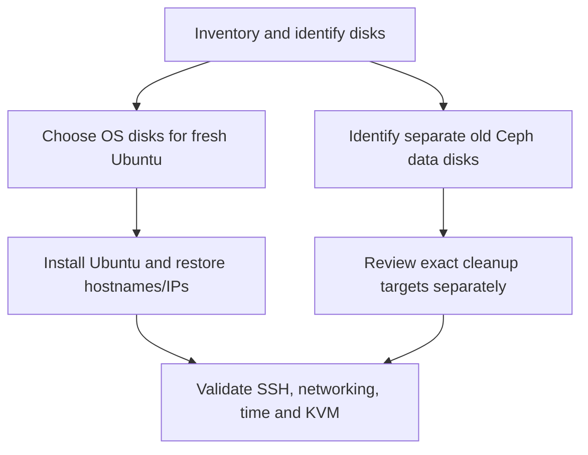
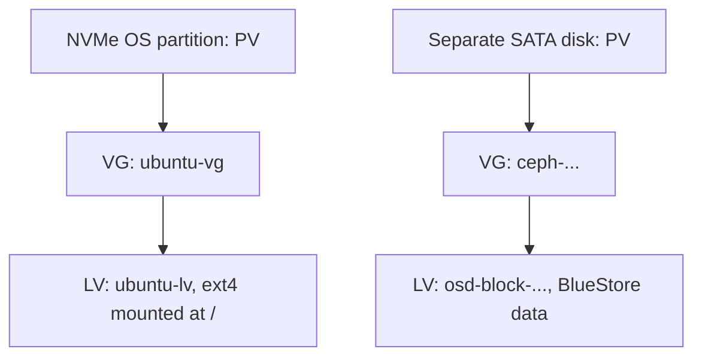

# Stage 0 — Keep Hermes, install Codex, reset the three nodes

## Purpose and effect

Keep the existing Hermes VM. Replace the operating systems on node1, node2, and node3 with clean Ubuntu Server 24.04 LTS installations. This removes the previous host configuration from the selected OS disks. Reusing each hostname/IP does not preserve its old SSH identity or OpenStack data.

This is a destructive rebuild of a disposable lab, not a Ceph-to-LVM data migration. Decide whether any files, VM data, or private configuration need exporting before starting. Old Terraform state must not be reused against the new cloud: resource IDs belong to the old installation.

## Is this like Windows Sysprep?

| Operation | What it does | Fits this rebuild? |
|---|---|---|
| Sysprep / virt-sysprep | Generalizes a prepared OS image for cloning; installed software can remain | No: the aim is to remove old deployment state |
| cloud-init clean | Clears cloud-init state so initialization can run again | No: it does not uninstall OpenStack or erase Ceph |
| Kolla destroy | Removes managed containers/volumes and related configuration | An alternative cleanup method, not a vanilla OS reinstall |
| Boot Ubuntu installer and reinstall | Recreates the chosen OS installation | Yes: clearest baseline for this learning exercise |
| Separately clean a selected data disk | Removes old storage ownership/metadata | Required before reusing an old Ceph disk for LVM |

Do not run image-generalization tools against these running physical nodes. Do not erase Hermes.



## 1. Inspect first — on Hermes

After pulling this repository, verify SSH access with the account actually created during Ubuntu installation. The completed rebuild uses `joe` on all three nodes. The script takes that username as its first argument, visits all three nodes, and optionally accepts node IPs for targeted retries. For initial discovery, run once on Hermes:

```bash
bash scripts/discover.sh joe
```

SSH may ask for each node's `joe` password. No characters appear while typing. The script permits password login as well as existing SSH keys; it does not require `ssh-copy-id`, passwordless sudo, or executable permission when run through `bash`. Keep SSH host-key checking enabled. If a key changed after reinstalling, follow section 3 before trying again.

It writes private reports under build/discovery-*. Initial discovery is already complete in this rebuild; continue to the storage inspection below. For a targeted retry, append an IP, for example `bash scripts/discover.sh joe 192.168.0.200`. If future usernames differ, supply the selected node's actual account. The wrapper equivalent for all three nodes is `python scripts/labctl.py discover --ssh-user joe`. Discovery skips privileged disk details if passwordless sudo is unavailable; ordinary hardware/network reports are still collected. A failed connection prints the account/IP and exits unsuccessfully; any report for that failed node may be incomplete.

The user's discovery reports from 2026-10-21 confirm successful `joe` logins on all three nodes, Ubuntu 24.04.5 LTS, preserved management IPs on enp0s31f6, gateway and configured DNS 192.168.0.1, synchronized clocks, and the presence of /dev/kvm. Both preparation and generated Kolla inventories now use `joe`.

The NVMe disks hold Ubuntu, with 100 GiB root logical volumes. Each separate 223.6 GiB SATA disk still contains an old Ceph LVM volume. Reinstalling the OS did not erase those separate data disks. Storage ownership/mount inspection and SMART health review remain pending before selecting exact cleanup commands or preparing Cinder. The USB provider interfaces are administratively DOWN; their physical link has not yet been tested. No storage cleanup, Netplan change, or OpenStack deployment has been performed in this rebuild.

Record the current OS/NIC/disk information before reinstalling when possible. If the reinstalls are already complete, collect the fresh layout now; do not reinstall again merely to run discovery. The script only inspects the nodes.

Make a private record with one row per disk: host, model, serial, stable by-id path, size, current partitions/mounts, intended OS/data use. The old README reports prior disk-health findings; a new use as Cinder storage does not make an unhealthy disk safe.

### Storage inspection: one script for all three nodes

**Current chapter: Stage 0.** Discovery is complete. Its remaining storage question is why Ceph still appears after reinstalling Ubuntu, and whether the old data disks are suitable for reuse.

Read this lesson before running the collector: [1. SSH](#1-ssh-how-one-script-reaches-all-three-nodes), [2. Disks, mounts and LVM](#2-disks-mounts-and-lvm-what-owns-the-space), [3. SMART](#3-smart-what-the-drive-reports-about-its-health), [4. One combined report](#4-reports-where-the-results-go-and-how-to-read-them). The [script source](../scripts/check-storage.sh) implements these checks.

The installer recreated Ubuntu on each NVMe disk. The separate SATA disk retained its Ceph volume group and logical volume. Linux's LVM tools discover that metadata at boot and can activate its mappings even though the old Ceph software has not been redeployed. A `ceph_bluestore` entry therefore shows retained storage, not proof that the old Ceph cluster is running. Think of reinstalling ESXi on a boot disk while a separate datastore disk retains its metadata.

#### 1. SSH: how one script reaches all three nodes

The script runs on Hermes. Its loop opens an SSH connection to node1 (.200), then node2 (.201), then node3 (.202). SSH carries the inspection commands to each node and sends their output back to Hermes. It uses the supplied account, `joe`, which has been confirmed on all three nodes. This bootstrap check needs SSH and Bash; an Ansible environment is not needed yet.

SSH authenticates the login account. Inside that connection, `sudo` runs the collector with root privileges so it can read protected disk information. These are two separate checks, so each node may request a login password and then a sudo password. `ssh -t` supplies the terminal needed for interactive sudo. Enter passwords directly at their prompts; the script does not save them. Normal host-key verification remains enabled.

If a connection fails, the script records the failure and continues with the remaining nodes. A connection failure leaves that node's evidence incomplete; it says nothing about the disk's health.

#### 2. Disks, mounts and LVM: what owns the space

A **disk** is a block device such as an SSD. A **filesystem** organizes files inside allocated storage. A **mountpoint** is the directory where Linux exposes that filesystem; `/` is the root filesystem containing Ubuntu. A disk without a mountpoint can still hold allocated storage.

LVM (Logical Volume Manager) adds three layers. A **physical volume (PV)** is a disk or partition prepared for LVM. A **volume group (VG)** pools space from its PVs. A **logical volume (LV)** is an allocation from that pool, presented as another block device. Here, ownership means the storage system and volume group using that device.

Your discovery reports show these separate paths on each node. The shortened Ceph names represent the actual per-node UUID names in the reports:



| Inspection | What to look for in the report |
|---|---|
| `lsblk` | Disk → partition → LV relationships, model, serial, filesystem and mountpoint |
| `findmnt` and `swapon` | Devices backing mounted filesystems and active swap |
| `/dev/disk/by-id/` | Stable identity links for matching a device to its serial; `/dev/sda` alone is not a stable identity |
| `pvs` | Which PV belongs to `ubuntu-vg` or a `ceph-...` VG |
| `vgs` | Total and free space in each VG |
| `lvs` | Each LV's VG, activation attributes and backing devices |
| `wipefs --no-act` | Existing signatures that identify retained storage; the no-act option suppresses writes |

Read these sections together. The NVMe root LV is Ubuntu's storage. The SATA disk's Ceph VG/LV identifies retained Ceph allocation. BlueStore accesses its block device directly, so an empty mountpoint column does not make that disk empty or available. These checks establish layout and allocation; we still review exact device use before choosing any cleanup operation.

#### 3. SMART: what the drive reports about its health

SMART is the drive's built-in health reporting. `smartctl -a` reads the device identity, available health indicators, and existing error/self-test logs. The script enumerates actual whole disks and queries both the NVMe OS disks and SATA data disks.

We examine reported errors and wear because removing Ceph metadata cannot repair failing hardware. Available attributes and their meaning depend on the drive model. Read the detailed attributes and logs alongside the overall status; a `PASSED` line alone does not guarantee that a disk is suitable for reuse. This command reads existing test results; it does not start a new self-test.

SMART command exit codes can encode several flags at once. A nonzero code can indicate a command/access problem, a health warning, or an error-history finding. The collector retains the output and marks it for review while continuing with the other disks and nodes. **Actual health is still unknown until the lab report has been reviewed.**

#### 4. Reports: where the results go and how to read them

Hermes displays each node's output while saving it. The script then joins all three results into one report so we can compare the same checks across the nodes.

| Path on Hermes, relative to the repository | Contents |
|---|---|
| `build/storage-health-report.txt` | Combined report from the latest run; this is the file to share for review |
| `build/storage-health-<timestamp>-<suffix>/report.txt` | Preserved combined report for that particular run |
| `build/storage-health-<timestamp>-<suffix>/<node-IP>.txt` | Individual node output, useful when investigating a particular failure |

Report directories are restricted to your account (mode 700); report files are readable/writable by your account (mode 600). They remain under the Git-ignored `build/` directory on Hermes. Reports contain hardware identities and command output, so share the required report privately rather than committing it to the public repository.

Read the combined report by node header, then disk/mount layout, LVM allocation, and SMART details. `COLLECTED` means the inspection command returned zero. `REVIEW` means a command or connection returned nonzero; inspect the nearby output for the reason. These labels describe collection results. The health and reuse decision comes from interpreting the evidence.

The outcome of this step is a reviewed map of Ubuntu's disks versus old Ceph disks, plus an initial health assessment for the proposed Cinder host. We will document that interpretation in this guide after receiving the report. Existing discovery results are recorded above; a storage-health run has not yet been supplied.

#### Run the documented inspection

The `--install-tools` flag permits apt to install missing `smartmontools`/`lvm2` packages. Without that flag, missing commands appear in the report and nothing is installed. Its disk commands inspect only: it does not start a SMART self-test, remove Ceph, create LVM volumes, change networking, or deploy OpenStack. Re-running creates another report and skips package installation when the diagnostic commands already exist.

After reading the lesson and updating your clone, run once on Hermes, in an interactive terminal at the repository root:

```bash
bash scripts/check-storage.sh joe --install-tools
```

Share the single `build/storage-health-report.txt` for review. Old Ceph cleanup and Cinder provisioning are separate, later operations based on the reviewed identities and health findings.

## 2. Reinstall Ubuntu — at each node's console

1. Download Ubuntu Server 24.04 LTS from [Ubuntu](https://ubuntu.com/download/server) and verify the published image checksum.
2. Boot the USB installer. Choose the intended node's **OS disk by model/serial**. Recreate its OS layout. Check that the installer is not selecting the separate data disk.
3. Set the hostname and static management address from the table below. The recorded gateway was 192.168.0.1; verify the router address. Use verified DNS servers from the existing network.
4. Create a normal user, enable OpenSSH, and retain normal sudo access. The completed rebuild uses `joe` on all three nodes, and both Ansible inventories use that confirmed account. If a future rebuild chooses another name, update the inventory source and Kolla inventory generator before running Ansible. Do not reinstall or create another account just to run discovery. Do not copy a shared SSH host key or machine-id between nodes.
5. Reboot, remove the installer, and inspect disk/mount/network state again.

| Hostname | Management IP |
|---|---|
| node1 | 192.168.0.200/24 |
| node2 | 192.168.0.201/24 |
| node3 | 192.168.0.202/24 |

The old cluster becomes unavailable during this full rebuild. Reinstalling only node1 leaves node2/node3's old deployment state in place, so it does not achieve the requested three-node clean start.

Separate data disks can retain Ceph signatures after the OS reinstall. Their erase/provisioning commands must be written after the actual serials and device relationships are reviewed. This repository intentionally has no generic wipe-all-disks script.

## 3. Verify the new SSH identities

On each node's console, confirm the login username and show its host fingerprint:

```bash
whoami
sudo ssh-keygen -lf /etc/ssh/ssh_host_ed25519_key.pub
```

On Hermes, inspect the existing known-host entry for that IP. Once the new fingerprint has been compared with the console, remove the obsolete entry and reconnect. Example for node1, whose account is `joe`:

```bash
ssh-keygen -f /home/joe/.ssh/known_hosts -F 192.168.0.200
ssh-keygen -f /home/joe/.ssh/known_hosts -R 192.168.0.200
ssh joe@192.168.0.200
```

At SSH's trust prompt, compare the fingerprint with the console output before accepting it. Use the actual node account's installation password. `Permission denied` is a login failure; removing a remembered host identity does not fix a wrong username or password.

Repeat for .201/.202, checking each node's own username and fingerprint; do not reuse node1's fingerprint for another host. Remove/check hostname aliases too if SSH reports an old key under `node1` rather than its IP. Do not disable host-key checking to suppress the warning. Later, `ssh-copy-id` can install Hermes's public key for unattended Ansible access; it is not required for this initial discovery and does not recreate the old host identity.

## 4. Install Codex on Hermes — run these yourself

Codex CLI runs the terminal tools on Hermes and uses the selected model provider for AI responses. It can create YAML, Ansible roles, Terraform files, and documentation in your project. This is a local client setup; the project instructions live in README.md and AGENTS.md.

Install prerequisites and download the official installer as your normal Hermes user:

```bash
sudo apt update
sudo apt install -y curl ca-certificates bubblewrap
curl -fsSL https://chatgpt.com/codex/install.sh -o /tmp/codex-install.sh
less /tmp/codex-install.sh
sh /tmp/codex-install.sh
```

Follow the installer's PATH instructions, then open a new terminal and verify:

```bash
codex --version
codex login --device-auth
codex login status
```

For device authentication, enable device-code login in your ChatGPT security settings if required. Open the URL printed by Codex in **your own browser** and complete the ChatGPT sign-in there. Do not paste the code or credentials into chat. If device authentication is unavailable, `codex login` provides the regular browser flow. ChatGPT sign-in uses your plan access; API-key sign-in uses separately billed API usage.

Ubuntu 24.04 may need the additional AppArmor profile if Codex reports a user-namespace error after bubblewrap installation. Only in that case:

```bash
sudo apt install -y apparmor-profiles apparmor-utils
sudo install -m 0644 /usr/share/apparmor/extra-profiles/bwrap-userns-restrict /etc/apparmor.d/bwrap-userns-restrict
sudo apparmor_parser -r /etc/apparmor.d/bwrap-userns-restrict
```

Keep the restriction in place if that profile is unavailable; inspect the error with the official documentation rather than disabling AppArmor globally.

## 5. Start Codex inside this project

After cloning or extracting the repository to `~/git/openstack-iac-lab`:

```bash
cd ~/git/openstack-iac-lab
codex --sandbox workspace-write --ask-for-approval on-request
```

First prompt:

> Read README.md and AGENTS.md. Inspect only this repository. Explain Stage 0. You may edit project files and run local syntax checks. Do not SSH to the nodes, change networking, run infrastructure deployments, or erase anything. Show your proposed diff.

Those permission flags allow project work with approval boundaries; they do not guarantee that every file read is confined to the project. The ordinary Linux account can have access to other files. Keep unrelated data and unnecessary credentials out of the account used for infrastructure work. Running Codex as root is unnecessary.

## Finish line and recovery

All three hosts report Ubuntu 24.04, the correct hostname and original management IP. SSH fingerprints have been verified, sudo works, time synchronizes, and the compute hosts expose `/dev/kvm`. Hermes remains intact and Codex starts in the new project.

If networking fails after the install, fix it from the node's console. If a disk selection is unclear, stop before erasing anything. Reinstalling the wrong disk has no general undo procedure.

## Sources

- [Official Codex installation](https://learn.chatgpt.com/docs/codex/cli)
- [Codex authentication](https://learn.chatgpt.com/docs/auth)
- [Codex CLI flags](https://learn.chatgpt.com/docs/cli/reference)
- [Linux sandbox and Ubuntu AppArmor](https://learn.chatgpt.com/docs/sandboxing)
- [virt-sysprep purpose](https://libguestfs.org/virt-sysprep.1.html)
- [cloud-init CLI](https://docs.cloud-init.io/en/latest/reference/cli.html)
- [SMART status bitmask definitions](https://github.com/smartmontools/smartmontools/blob/main/src/smartctl.h)
- [wipefs inspection mode](https://github.com/util-linux/util-linux/blob/master/misc-utils/wipefs.8.adoc)
- [OpenSSH remote commands and terminals](https://man.openbsd.org/ssh.1)
- [BlueStore raw block-device use](https://docs.ceph.com/en/latest/rados/configuration/bluestore-config-ref/)

Next: [Stage 1](01-openstack-foundation.md).
