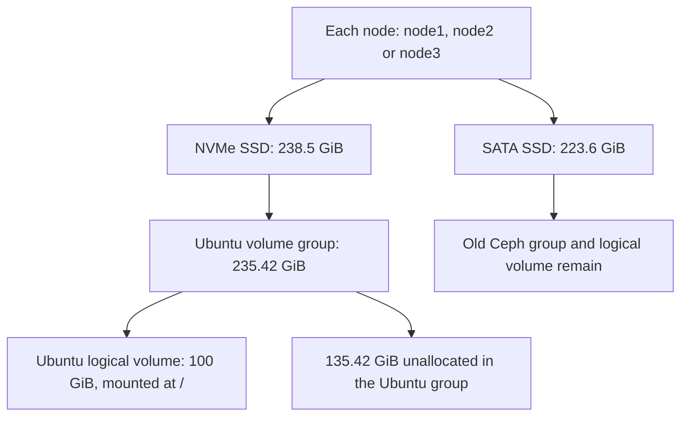
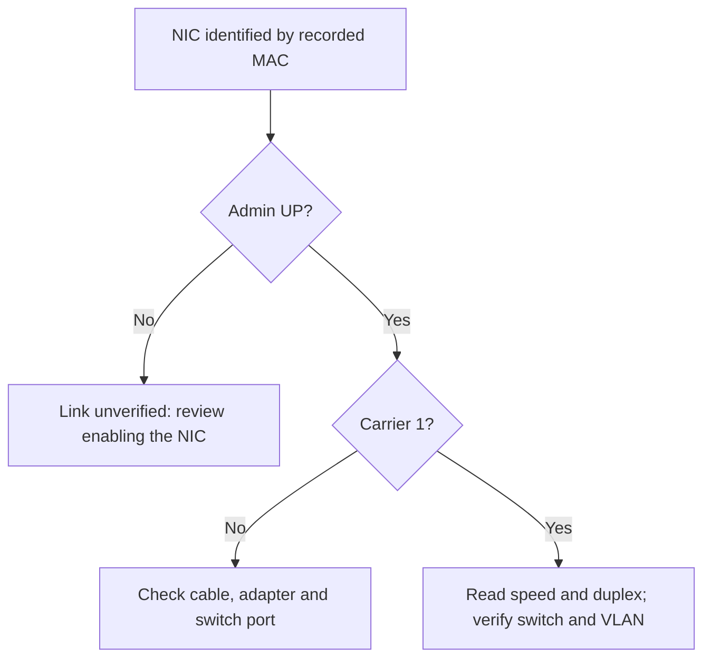
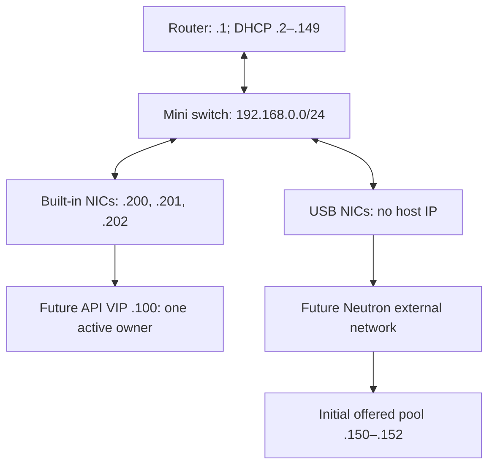

# Stage 0 — Understand and verify the three nodes

**Current route: [Stage 1 — Install OpenStack](01-openstack-foundation.md).** Node reinstall, old Ceph cleanup and USB physical link tests are complete. This chapter records those lessons. Use the offered `.150–.152` for the initial external pool; VIP `.100` binding remains the outstanding input. Stage 1 uses the existing node3 SATA health/cleanup evidence for its reuse review.

| Step | Status |
|---|---|
| Reinstall Ubuntu, keep the original IPs | Completed |
| Log in as `joe` and run discovery | Completed |
| Collect storage information from all three nodes | Completed; results explained below |
| Storage follow-up | Node3 SATA snapshot reviewed for lab reuse; NVMe log-query warnings and node1 SATA count remain separate diagnostic items |
| Clean the recorded SATA Ceph allocations | Completed on all three nodes; each post-check reports CLEANED |
| Inspect two NIC paths | Report reviewed on all three; management UP, USB DOWN, DNS query succeeded |
| Confirm switch/LAN and DHCP scope | Joe confirms shared switch, `192.168.0.0/24`, DHCP `.2–.149`; `.100` reservation needs clarification |
| Measure USB carrier/speed and restore DOWN | Completed on all three: LINK_OK, 1000 Mb/s full duplex; restoration verified |
| Configure networking / deploy OpenStack | Pending |

## Storage inspection: one script for all three nodes

**Historical snapshot:** these inspection tables describe the disks before cleanup. Step 7 records the completed removal.

Your pasted file is a **diagnostic transcript**. It is long because the script printed installation progress and full health reports for six drives. The collection already ran; start with the diagram below and read one lesson at a time.

### The architecture: two separate disks in every node



**Cause:** the installer replaced Ubuntu on the NVMe disk. The separate SATA disk retained its Ceph metadata.

**VMware comparison:** reinstalling ESXi on a boot disk can leave a separate datastore disk intact.

### 1. SSH: how one script reaches all three nodes

| Where | What happened |
|---|---|
| Hermes | Started the script and kept its output files |
| node1 — `192.168.0.200` | Logged in as `joe`, inspected its disks |
| node2 — `192.168.0.201` | Ran the same inspection on its disks |
| node3 — `192.168.0.202` | Ran the same inspection on its disks |

The loop uses **SSH** to carry commands to each node. **Sudo** gives those commands access to protected disk information. That explains the two password prompts per node.

`smartmontools` was installed on all three nodes during this run. The storage commands inspected existing metadata and health logs. They did not remove the Ceph volumes.

### 2. Disks, mounts and LVM: what owns the space

**Learn these four words first:**

| Word | Plain meaning | Example in your output |
|---|---|---|
| PV — physical volume | Disk or partition prepared for LVM | `/dev/nvme0n1p3` or `/dev/sda` |
| VG — volume group | A pool of storage space | `ubuntu-vg` or a `ceph-...` group |
| LV — logical volume | A disk-like allocation from a VG | `ubuntu-lv` or `osd-block-...` |
| Mountpoint | Directory exposing a filesystem's files | `/` is Ubuntu's root filesystem |

**Read just these numbers from your report:**

| Observed value, on every node | Meaning |
|---|---|
| NVMe disk: **238.5 GiB** | Physical OS disk capacity |
| `ubuntu-vg`: **235.42 GiB** | LVM pool after the separate boot partitions |
| `ubuntu-lv`: **100 GiB**, mounted at `/` | Space allocated to Ubuntu's root filesystem |
| Ubuntu VG `VFree`: **135.42 GiB** | Space in the pool not yet assigned to an LV |
| SATA Ceph VG `VFree`: **0** | The old Ceph LV already occupies the pool |

VG free space describes **allocation**. It does not tell us the free space inside Ubuntu's filesystem or how much user data Ceph stored.

**Why does Ceph have no mountpoint?** BlueStore uses its block device directly. An empty mountpoint column does not establish that the disk is empty or available.

<details>
<summary>Which command supplied each part of the diagram?</summary>

| Command | Question it answers |
|---|---|
| `lsblk` | Which disks, partitions, filesystems and LVs exist? |
| `findmnt`, `swapon` | What backs mounted filesystems and active swap? |
| `/dev/disk/by-id/` links | Which stable identity corresponds to each disk? |
| `pvs` | Which device supplies each volume group? |
| `vgs` | How much space is allocated or unallocated in each group? |
| `lvs` | Which logical volume uses which underlying device? |
| `wipefs --no-act` | What storage signatures are present? This mode suppresses writes. |

LVM storage ownership here means which VG/LV already allocates a device. Current device use still needs checking before any later cleanup.

</details>

### 3. SMART: what the drive reports about its health

SMART is the drive's built-in health reporting. The collector read both disks in each node. **All six drives reported overall `PASSED`; the detailed readings still require interpretation.**

**SATA disks — these still contain Ceph:**

| Node | Data SSD | What the report actually says |
|---|---|---|
| node1 | Kingston UV400 | `PASSED`; `Runtime_Bad_Block` raw count **11**; review this finding |
| node2 | ADATA SU630 | `PASSED`; reallocated-sector count **0**; ATA error log unsupported |
| node3 | Kingston A400 | `PASSED`; reported-uncorrectable count **0**; no ATA errors logged |

All three SATA disks have a **previous** extended self-test recorded as completed without error. This run read those old results; it did not start fresh self-tests.

**NVMe disks — these contain Ubuntu:**

| Node | Critical warning | Media/data-integrity errors | Reported percentage used |
|---|---|---|---|
| node1 | `0x00` | **0** | **4%** |
| node2 | `0x00` | **0** | **0%** |
| node3 | `0x00` | **0** | **7%** |

These are reported health fields. They do not resolve every diagnostic warning or guarantee future reliability.

<details>
<summary>SMART columns: categories, thresholds and raw values</summary>

| SMART column | How to read it |
|---|---|
| `TYPE: Pre-fail` | Attribute category; the label alone is not a failure report |
| `VALUE` / `THRESH` | Normalized value and the device's failure threshold |
| `WHEN_FAILED` | Whether that attribute crossed its threshold |
| `RAW_VALUE` | Vendor-specific raw data; units and encoding depend on the model |

For example, node1 shows `SSD_Life_Left` with normalized value 98 and raw value 2. We have not interpreted that raw number as a remaining-life percentage. Node1's bad-block count also needs its model-specific meaning and trend reviewed.

</details>

### 4. Reports: where the results go and how to read them

**Why did all three nodes finish with `REVIEW`?** Each NVMe self-test-log request was rejected:

| Node | NVMe log-read message | Command exit code |
|---|---|---|
| node1 | `Invalid Field in Command (0x002)` | **4** |
| node2 | `Invalid Namespace or Format (0x00b)` | **4** |
| node3 | `Invalid Field in Command (0x002)` | **4** |

`4` marks a failed SMART command. The main health page was readable, but the self-test log query failed. The exact device/firmware/tool interaction remains unresolved. This is different evidence from a firmware health-failure indication.

| Finding | What we conclude now |
|---|---|
| SSH and sudo worked on all three nodes | The collector reached all three machines |
| NVMe health pages report warning `0x00` and media errors `0` | These main health fields show no warning in this snapshot |
| NVMe self-test log queries failed | Diagnostic follow-up remains; `REVIEW` is appropriate |
| Node1 SATA reports runtime bad-block raw count 11 | Keep this as a separate health-review item |
| Ceph VG/LV exists on every SATA disk | Ceph cleanup has not happened |

<details>
<summary>Extra finding: the UMIS NVMe error-log rows look inconsistent</summary>

Node1 and node3 report `Error Information Log Entries: 0`, yet their detailed error-log tables contain unusual large counts/rows. Those table rows need further interpretation. We have not treated them as confirmed media failures or dismissed them as a proven firmware bug.

</details>

**Your report files are on Hermes:**

| File | Purpose |
|---|---|
| `build/storage-health-report.txt` | Latest combined report; your run has already been reviewed for this lesson |
| `build/storage-health-20261021T145723Z-TjNzzA/report.txt` | Combined report preserved for this run |
| Same directory, `<node-IP>.txt` | Individual node log for focused review |

The files contain hardware identifiers and stay in the Git-ignored `build/` directory. The public guide records interpreted findings rather than copying your raw report.

### 5. One script, with a node selector

**Already completed:** your all-node run. The following is a command reference for future focused checks.

| Lesson target | Script argument | Actual node |
|---|---|---|
| Study node1 | `--node node1` | `192.168.0.200` |
| Compare node2 | `--node node2` | `192.168.0.201` |
| Compare node3 | `--node node3` | `192.168.0.202` |
| Inspect the whole lab | `--node all` or omit `--node` | All three, sequentially |

Example for a later node1-only inspection, started from the repository on Hermes:

```bash
bash scripts/check-storage.sh joe --node node1
```

| Option or effect | Meaning |
|---|---|
| `joe` | Node login account |
| `--node node1` | Inspect only node1; node2/node3 are skipped |
| `--install-tools` | Optional: install missing `smartmontools`/`lvm2`; omit it for inspection only |
| Report output | Latest combined file covers only the selected nodes; old timestamped runs remain |
| Disk operations | Read layout/signatures/health; no erase, LVM creation, or new SMART self-test |

The [script source](../scripts/check-storage.sh) implements this table. SSH host-key checks stay enabled, and passwords are entered at normal terminal prompts.

Your earlier disk table clipped labels such as `LVM2_m` because of the SSH terminal width. The full identities are available elsewhere in the report. The updated script uses a wider table for future collections.

### 6. Stop point for this lesson

This was the pre-cleanup checkpoint. Cleanup has since completed in Step 7.

| We now understand | Still pending before deployment |
|---|---|
| NVMe holds Ubuntu; SATA retains old Ceph | Exact cleanup targets and current device-use review |
| Root LV allocation differs from VG free space | Node1's bad-block finding and NVMe log-query warnings |
| `REVIEW` requires reading the reason | USB provider-link checks and reviewed network inputs |

**Inspection checkpoint:** these findings informed the approved cleanup recorded below. Its completed result is in Step 7; the current network lesson is Step 8.

## 7. Remove the recorded old Ceph allocations

**Completed in Stage 0, from Hermes.** The reinstall put Ubuntu on NVMe but had left Ceph's PV → VG → LV on each separate SATA SSD. Joe confirmed those contents could be discarded; the removal and post-check have now succeeded on all three nodes.

**Goal for this step:** leave the three SATA SSDs available for a fresh allocation. Later, Stage 1 creates `cinder-volumes` on **node3 only**. Node1/node2 SATA SSDs remain unallocated; they are not additional Cinder replicas.

### Cleanup completed on all three nodes

The supplied 2026-10-21 combined report confirms:

| Node | Result | SATA after the post-check | Ubuntu backing disk |
|---|---|---|---|
| node1 — `.200` | `CLEANED` | No detected signatures, PV or children | NVMe; unchanged |
| node2 — `.201` | `CLEANED` | No detected signatures, PV or children | NVMe; unchanged |
| node3 — `.202` | `CLEANED` | No detected signatures, PV or children | NVMe; unchanged |

| Output you saw | Meaning |
|---|---|
| `22 bytes were erased ... ceph_bluestore` | Removed BlueStore's identifying signature; this is metadata cleanup, not an overwrite of every data sector |
| LV / VG successfully removed | Removed the old Ceph logical volume and its storage pool |
| PV labels successfully wiped | Removed the SATA disk's LVM physical-volume label |
| `device already locked, waiting ... OK` | The operation waited for its lock, then continued successfully; the log does not identify the other lock holder |
| `CLEANED ... Ubuntu backing unchanged` | The helper re-read the storage state and passed its final checks |

**Current layout:** Ubuntu remains backed by NVMe. Each SATA SSD is available for a new allocation. No Cinder VG or replacement filesystem was created in this step. Later, node3 alone will receive `cinder-volumes`; node1/node2 SATA remain unallocated in this design.

The remaining disk-health/diagnostic findings are separate from removal success. Continue with [Step 8: network observation](#8-inspect-the-two-nic-paths).

### Understand the exact targets

Each disk reported **240,057,409,536 bytes**, approximately **223.6 GiB**. These identities come from your supplied report.

| Node / SSH address | SATA model | Serial that the script must match |
|---|---|---|
| node1 / `192.168.0.200` | KINGSTON SUV400S37240G | `50026B7766070422` |
| node2 / `192.168.0.201` | ADATA SU630 | `4P3521354988` |
| node3 / `192.168.0.202` | KINGSTON SA400S37240G | `50026B768317883A` |

The [Python helper](../scripts/reset-ceph.py) records each full `/dev/disk/by-id/ata-...` path, PV UUID, Ceph VG and Ceph LV. It resolves that stable path on the actual node. `/dev/sda` is not used as a guessed erase target.

### What runs and why

The [Hermes wrapper](../scripts/reset-ceph.sh) visits node1 → node2 → node3. It uses the same helper on each, with that node's recorded identity. SSH host-key checks remain enabled.

| Script step | What happens | Why |
|---|---|---|
| Show observations | Print expected/observed model, serial, byte capacity, disk tree and Ubuntu backing | Keep a failed validation diagnosable |
| Identify | Match hostname, management IP, stable disk path, serial, recorded Linux model and byte capacity | Avoid selecting another host/disk |
| Check Ubuntu | Trace the current `/` device back to its physical disk | Reject any target backing Ubuntu |
| Check ownership/use | Require the exact recorded single-PV/single-LV Ceph layout; inspect mounts/swap, holders, raw open-device handles and LV open count | An unmounted BlueStore disk can still be in use |
| Show the plan | Print the host, disk tree, ownership and exact removal commands | Make the operation readable before it happens |
| Confirm | Ask for `ERASE nodeN SERIAL`, then repeat the checks | Approve this exact target and reject changed state |
| Remove | Clear the Ceph LV signature, remove its LV, VG and PV label, then clear remaining visible whole-disk signatures | Release the old allocation for fresh use |
| Verify/report | Re-read the disk and Ubuntu backing devices | Require no detected SATA signatures/PV/children and unchanged Ubuntu backing |

The script removes allocation metadata and detected signatures. It does not overwrite every data sector. It creates no replacement filesystem, Cinder VG or OpenStack service.

<details>
<summary>The five removal commands and their effects</summary>

These are an explanation of the commands the helper prints with **actual recorded paths**. Run the wrapper below, rather than editing these into direct disk commands.

| Command | Effect |
|---|---|
| `wipefs --all --lock=yes EXACT_LV_PATH` | Remove detected BlueStore signatures inside that verified unused LV |
| `lvremove --yes EXACT_VG/EXACT_LV` | Remove the one Ceph logical volume |
| `vgremove --yes EXACT_VG` | Remove its now-empty Ceph volume group |
| `pvremove --yes EXACT_BY_ID_PATH` | Remove the SATA disk's LVM physical-volume label |
| `wipefs --all --lock=yes EXACT_BY_ID_PATH` | Clear remaining signatures detected on that whole SATA disk |

There is no `--force` override, no wildcard device target and no automatic service stop. A changed layout, mounted/open target or new `cinder-volumes` owner causes a refusal. A partially completed removal also needs review before resuming.

</details>

<details>
<summary>Completed-step reference: earlier stops, confirmation and cleanup command</summary>

### Observed stop: model and capacity check

**Your first cleanup attempt stopped on node1 before erasure.** The run reached SSH and sudo, then failed the model/capacity guard. It never reached the removal commands or the `ERASE ...` confirmation. Node2/node3 were not attempted.

| Output | Meaning |
|---|---|
| Git `Fast-forward` | The checkout updated successfully |
| SSH and sudo prompts completed | The helper started on node1 |
| `STOP: Disk model/size changed` | The old identity comparison failed; it did not print which value differed |
| `Stopped at node1` | No earlier node existed in this run; no cleanup was performed |

**A confirmed script defect:** the expected model was copied from SMART, but the comparison read Linux's `lsblk` model. Your earlier discovery already showed different strings on the Kingston disks:

| Node | Full model from SMART | Linux MODEL from discovery |
|---|---|---|
| node1 | `KINGSTON SUV400S37240G` | `KINGSTON SUV400S` |
| node2 | `ADATA SU630` | `ADATA SU630` |
| node3 | `KINGSTON SA400S37240G` | `KINGSTON SA400S3` |

The old code required those two fields to be identical. That makes the recorded Kingston Linux names fail. This was an implementation error; the stopped run does not establish that you changed a disk.

**Correction:** compare `lsblk` with its recorded Linux model. Keep the full SMART name as descriptive information. Preserve the exact serial, byte-capacity, stable-path, PV/VG/LV and current-use checks. No prefix matching or force override was added.

The corrected helper prints expected and observed model, serial and byte capacity **before** validation. Model and capacity now have separate mismatch messages. That first failed run did not show its observed byte capacity. The later retry below confirmed node1 at 240,057,409,536 bytes; node2/node3 had not yet been reached at that point. The completed run is recorded above.

**Next:** pull the corrected script and run the consolidated command below. Read each current target and command list before its per-node confirmation. A passing local test does not mean the cleanup has already succeeded on your nodes.

### Why the run stopped at node1

**Latest observed result:** node1's identity, ownership and current-use checks all passed. Its model, serial and **240,057,409,536-byte** capacity matched. Ubuntu was traced to NVMe. The script then displayed the removal plan and asked for confirmation.

| What you entered | What this node required | Result |
|---|---|---|
| `ERASE` | `ERASE node1 50026B7766070422` | Confirmation did not match; no removal command ran |

`--node all` selects **node1 → node2 → node3**, processed one at a time. Each node must pass its checks and complete its approved action before the wrapper proceeds. A failure or cancelled confirmation stops the run at that node. This is why node2/node3 were not attempted.

`--apply` requests removal after validation and confirmation. The full phrase identifies both the host and the disk serial being approved.

**Next:** pull the script update described below. At each matching confirmation prompt, enter its **entire phrase**:

| Prompt on | Full phrase to enter at that prompt |
|---|---|
| node1 | `ERASE node1 50026B7766070422` |
| node2 | `ERASE node2 4P3521354988` |
| node3 | `ERASE node3 50026B768317883A` |

These phrases are responses inside the running script. Enter one when its node asks. After a successful node1 cleanup/post-check, the script connects to node2, then node3 after node2 succeeds.

**Outcome of that cancelled attempt:** nothing was erased. Node1's checks passed; cleanup and all node2/node3 checks remain pending. A successful run ends with `CLEANED` or `ALREADY_BLANK` for each node, recorded in the combined report.

### Updated confirmation prompt

**Cause of the latest stop:** the old prompt received `ERASE`, while it required the three-word host/serial phrase. Its single attempt immediately cancelled the all-node run. Node1 passed its checks; no removal ran, and node2/node3 were skipped again.

The helper now displays a separate line to copy and gives **three attempts** in the same SSH session. The full phrase remains required. This is an example of the new display after node1 passes its checks:

```text
Copy this ENTIRE line into the response below:
ERASE node1 50026B7766070422
Response (full line; Enter or cancel to stop):
```

Paste `ERASE node1 50026B7766070422` after `Response`, then press Enter. Include all three words. The script displays the matching phrase for node2 and node3 when it reaches them.

| Response or event | Effect |
|---|---|
| Correct full phrase | Recheck current state, then run the printed removal commands |
| An incomplete or wrong phrase | Show the required line again, up to three total attempts; no removal yet |
| Three unmatched responses | Stop this node and the remaining run without removal on this node |
| Empty response, `cancel`, or input ending | Cancel this node and stop the run |
| Completed cleanup and post-check | Proceed to the next selected node |

The wrapper announces `Run order: node1 node2 node3` and `Node 1/3`, `Node 2/3`, `Node 3/3` as it reaches each node. Node/disk identities, exact command approval and all current-use protections remain in place.

**Local verification:** terminal-driven tests ran the actual wrapper and Python confirmation input with simulated SSH and disk operations. Full phrases reached all three nodes; an `ERASE` response could be corrected in the same session. Cancellation, input ending and exhausted retries ran no disk commands. These were local checks before the later successful live cleanup recorded above.

### Run one consolidated command

First update the checkout with `git pull --ff-only` inside `~/git/openstack-iac-lab` on Hermes. Then:

```bash
bash scripts/reset-ceph.sh joe --node all --apply
```

**During the run:** enter each node's normal SSH password and sudo password when requested. Read its target/commands. At `Response`, paste the complete `ERASE nodeN SERIAL` line shown by the script and press Enter. It then works on that disk and moves to the next node.

| Input | Meaning |
|---|---|
| `joe` | Confirmed login account on the nodes |
| `--node all` | Process exactly node1, node2 and node3, sequentially |
| `--apply` | Allow the printed removal after the per-node confirmation |
| Omit `--apply` | Inspect and print plans; perform no removal |
| Use `--node node3`, for example | Select only that recorded node; same implementation |

### Read the result before the next step

**Expected messages below are acceptance examples, not results already observed in your lab.**

| Result | Meaning / action |
|---|---|
| `RESULT nodeN: CLEANED` | Removal and post-check succeeded on this node |
| `RESULT nodeN: ALREADY_BLANK` | This recorded SATA disk already has no detected signatures/PV/children; no change needed |
| `RESULT nodeN: PLAN_ONLY` | Inspection only; removal was not requested |
| `STOP: ...` | A check/command failed or confirmation was cancelled; inspect the reason |

If one node stops, the wrapper does **not** attempt the later nodes. Changes already completed on earlier nodes remain. Do not rerun with a force flag; there is none.

| Report on Hermes | Purpose |
|---|---|
| `build/ceph-reset-report.txt` | Combined output for this run |
| `build/ceph-reset-<timestamp>-<suffix>/report.txt` | Preserved historical combined report |
| Same directory, `node1.txt` / `node2.txt` / `node3.txt` | Output for each attempted node |

Reports stay private and Git-ignored. **Stop here and review this combined report.** The next lesson checks the two NIC paths and remaining inputs in the [execution map](../README.md#execution-map-what-runs-when-and-why).

**Health is a separate question:** cleanup does not resolve node1's SATA bad-block finding or the NVMe log-query errors. Node1's SATA is not the selected Cinder backend. Review node3's reuse evidence before the later Cinder creation step; do not turn a successful cleanup into a hardware-health certificate.

</details>

### Two NICs are part of this rebuild

| Interface role | Confirmed observation | Next check |
|---|---|---|
| Built-in `enp0s31f6` | Working management SSH at `.200`, `.201`, `.202` | Preserve address/routing/DNS through host preparation |
| USB provider NIC | Detected on each node; MACs below | Verify cable, switch/VLAN, link speed and stability before Netplan/OVS |

| Node | USB interface observed | MAC used for the planned `ext0` match |
|---|---|---|
| node1 | `enx00e04c557e58` | `00:e0:4c:55:7e:58` |
| node2 | `enx00e04c2c1678` | `00:e0:4c:2c:16:78` |
| node3 | `enx00e04c304688` | `00:e0:4c:30:46:88` |

The USB interfaces were administratively DOWN in the initial discovery. Detection establishes identity; it does not establish cable carrier or throughput. The [README diagram](../README.md#two-nics-per-node) shows the intended management and provider paths. Netplan later matches these MACs and names each provider interface `ext0`, with no host IP.

### References for this operation

- [LVM lvremove: unopened LV removal](https://man7.org/linux/man-pages/man8/lvremove.8.html)
- [LVM vgremove](https://man7.org/linux/man-pages/man8/vgremove.8.html)
- [LVM pvremove](https://man7.org/linux/man-pages/man8/pvremove.8.html)
- [util-linux wipefs: signatures, locking and erase scope](https://man7.org/linux/man-pages/man8/wipefs.8.html)
- [Ceph volume removal concepts](https://docs.ceph.com/en/latest/ceph-volume/lvm/zap/)

## 8. Inspect the two NIC paths

**Stage 0, completed passive inspection.** These results describe the initial DOWN USB state. The later temporary activation passed on all three nodes in [Step 9](#observed-usb-link-results).

### Observed network results

Your supplied 2026-10-21 network report reached all three nodes and changed no interface configuration.

| Node | Management address | Built-in link | USB provider NIC |
|---|---|---|---|
| node1 | `192.168.0.200/24` | UP; carrier 1; 1000 Mb/s; full duplex | `enx00e04c557e58`: Admin DOWN; no host IP |
| node2 | `192.168.0.201/24` | UP; carrier 1; 1000 Mb/s; full duplex | `enx00e04c2c1678`: Admin DOWN; no host IP |
| node3 | `192.168.0.202/24` | UP; carrier 1; 1000 Mb/s; full duplex | `enx00e04c304688`: Admin DOWN; no host IP |

Both recorded NIC MACs match on every node. Built-in NICs use `e1000e`; USB NICs use `r8152`. All three nodes use gateway/DNS `192.168.0.1`, and each successfully resolved `archive.ubuntu.com` using DNS data from the network.

**Why REVIEW in that report?** The script explicitly flagged each USB interface as administratively DOWN. Linux had not enabled those interfaces for traffic. That passive inspection could not establish cable carrier or current usable link speed; DOWN alone does not establish a faulty cable or adapter. [Linux distinguishes administrative and operational state](https://docs.kernel.org/networking/operstates.html).

**Why did ethtool also print 1000 Mb/s on the USB NICs?** The same output said `Link detected: no`, while sysfs carrier/speed was unavailable and the interface was DOWN. That speed field alone did not establish an active gigabit link. Step 9 subsequently measured carrier and speed with each interface UP; why the driver reported that particular value while inactive remains unexplained.

**What is `netlink error: Operation not permitted`?** An ethtool query was denied under the unprivileged account. Basic management link data was still returned. The report does not identify the denied subrequest. Some [ethtool get requests require privileges](https://docs.kernel.org/networking/ethtool-netlink.html); this warning is separate from the USB admin-DOWN state and gives no new evidence of hardware failure.

### Hermes reaches the lab through another subnet

| Observation | Meaning |
|---|---|
| Hermes source `192.168.162.130`, interface `ens33` | Local source/interface selected for the connections |
| Next hop `192.168.162.2` | Gateway used to reach each node |
| Destination `192.168.0.200–202` | Node management addresses on the lab LAN |

The route and successful SSH collection establish reachability through that gateway. This report alone does not establish whether the VMware network is using NAT or a particular routed configuration.

<details>
<summary>Why are there many IPv4 and IPv6 addresses in the DNS output?</summary>

They are addresses returned for `archive.ubuntu.com`, not extra addresses assigned to your nodes. The query succeeded; it did not test package downloads or IPv6 data connectivity.

</details>

### Current checkpoint before the next change

Collection and interpretation are complete. Joe confirmed the NICs connect to the same mini switch on `192.168.0.0/24`. [Step 9's temporary USB activation/measurement](#observed-usb-link-results) then passed on all three. Persistent naming/configuration comes later through Netplan and has not run in this rebuild.

**Remaining facts:** switch-port/VLAN forwarding, sustained throughput and VM traffic still need verification. The API VIP reservation and floating-IP pool's device exclusions also need review; the address table in Step 9 separates confirmed values from proposals.

**Cause and effect:** working SSH proves the management path reaches the node. VM floating-IP traffic will also need the USB provider path. A detected USB adapter does not establish a working cable, link speed or switch/VLAN connection.

| Path | Current identity | Intended use |
|---|---|---|
| Management | `enp0s31f6`; preserve `.200`, `.201`, `.202` | SSH, APIs and internal cloud traffic |
| Provider | Each recorded USB MAC; planned name `ext0` | External/provider traffic for VMs; no host IP in the planned configuration |

The [architecture diagram](../README.md#two-nics-per-node) shows these two paths. Think of them as the host-management uplink and a separate external VM uplink.

### What the inspection script does

The [network script](../scripts/check-network.sh) visits all three nodes through SSH as `joe`. This observation requires **no sudo** and installs no packages.

| Observation | Why we collect it |
|---|---|
| Hermes route to each node | Record the selected local interface/source address for SSH |
| NIC name, actual MAC and driver | Match the physical adapters to their intended roles |
| Administrative state and carrier | Distinguish an interface being disabled from a physical link reading |
| Speed and duplex, when readable | See the negotiated Ethernet link parameters |
| Interface addresses and routes | Check the preserved management addresses and current gateway |
| Configured DNS and an Ubuntu hostname query | Observe name-resolution settings and whether a query succeeds |

It writes private reports on Hermes. It does not enable/rename interfaces, set addresses/routes, edit Netplan, install packages or configure OpenStack.

### Learn these link states

| Field | Meaning |
|---|---|
| `Admin: UP` | Linux has enabled the interface |
| `Admin: DOWN` | Linux has disabled it; this inspection cannot establish the cable's working link |
| `carrier: 1` | The kernel reports carrier; switch/VLAN configuration still needs review |
| `carrier: 0` with Admin UP | Physical carrier is not reported; inspect cable, adapter and switch port |
| `speed_Mbps`, `duplex` | Negotiated link readings when available; `unavailable` needs interpretation with the admin state |



The USB NICs were DOWN in both the original discovery and this network report. The inspection left them in that state. Step 9 tests them temporarily; an inactive NIC is not enough evidence of a faulty adapter.

<details>
<summary>Reference: completed network collection and report locations</summary>

### Run one command for the three nodes

From `~/git/openstack-iac-lab` on Hermes, update with `git pull --ff-only`, then:

```bash
bash scripts/check-network.sh joe --node all
```

Enter the node SSH passwords when asked. The script prints `Node 1/3`, `Node 2/3`, `Node 3/3`. Because this is inspection, it continues to later nodes after a review flag or connection error and preserves the partial evidence.

| Report | Contents |
|---|---|
| `build/network-check-report.txt` | Latest combined report, including Hermes route observations |
| `build/network-check-<timestamp>-<suffix>/report.txt` | Historical combined report |
| Same directory, `node1.txt`, `node2.txt`, `node3.txt` | Individual attempted-node output |

`COLLECTED` means the observation returned without a flagged command/state. `REVIEW` means read the reason: it can be an inactive NIC, unreadable link information, a failed lookup or a connection problem. Collection alone does not prove the provider network is ready.

**The combined report has been reviewed above.** Joe subsequently confirmed the shared mini switch/LAN. The script cannot infer switch-port configuration or router DHCP exclusions. A client route lookup also does not discover NAT translations.

Next, use that evidence to review provider links, the unused/reserved API VIP `.100`, DNS and a floating-IP range excluded from router DHCP. Host preparation and Cinder creation follow those input checks.

</details>

## 9. Test the USB links and review the address plan

**Stage 0 — physical link test completed.** The earlier report found each USB NIC disabled. This test briefly enabled each identified USB NIC, measured its link, then restored DOWN. Persistent Netplan and OpenStack configuration come later.

### Observed USB link results

Your combined report started at `2026-10-21T19:17:04Z`. All three nodes completed the test:

| Node | USB interface | While enabled | Final checked state |
|---|---|---|---|
| node1 — `.200` | `enx00e04c557e58` | Carrier 1; 1000 Mb/s; full duplex | DOWN; original IPv6 setting restored; management addresses/routes unchanged |
| node2 — `.201` | `enx00e04c2c1678` | Carrier 1; 1000 Mb/s; full duplex | DOWN; original IPv6 setting restored; management addresses/routes unchanged |
| node3 — `.202` | `enx00e04c304688` | Carrier 1; 1000 Mb/s; full duplex | DOWN; original IPv6 setting restored; management addresses/routes unchanged |

**What changed in our understanding?** The earlier DOWN state left link operation unknown. After temporary activation, every adapter reported carrier and gigabit full-duplex negotiation. This verifies basic physical link negotiation at that moment. It does not measure sustained throughput, USB stability, VLAN forwarding or VM connectivity.

| Line from your output | Meaning |
|---|---|
| `networkctl unmanaged` | networkd was not configuring that USB NIC; this was the expected ownership guard |
| `USB-only disable_ipv6=1` | Temporarily prevented automatic IPv6 addresses/routes on that unused USB NIC |
| `Measured: carrier=1; speed_Mbps=1000; duplex=full` | Physical carrier and gigabit full-duplex negotiation were observed while UP |
| `ip link set ... down`, then `disable_ipv6=0` | Returned the tested NIC and its IPv6 setting to their original state |
| `RESTORED ... unchanged` and `LINK_OK` | Restoration checks passed along with the link readings |
| `Connection ... closed` | SSH ended after the completed test; it is not a failure here |

**Why DOWN again?** The script intentionally reverses its temporary change. The later Netplan step will configure `ext0` persistently. Do not enable it manually or repeat the completed test just because it is DOWN now.

The timestamped directories in `build/` are run history. `provider-link-report.txt` is the latest combined link report; `provider-link-20261021T191704Z-qH34bh/` is this run's historical directory. Existing discovery/storage/Ceph reports are separate completed steps, not pending work.

| Checkpoint | State |
|---|---|
| USB physical negotiation and restoration | Complete on all three nodes |
| `.100` reservation and external pool | Reservation reported and no static users in `.150–.199` confirmed; binding and pool-size choice remain open |
| Persistent Netplan, cloud deployment and VM traffic | Later steps; not run yet |

### Address plan: confirmed values and proposals

Joe confirms both NICs connect to the **same mini switch**, on **`192.168.0.0/24`**. The intended provider network is flat/untagged. A link test checks negotiation, not switch VLAN forwarding or VM connectivity.

| Address or range | Purpose | Status |
|---|---|---|
| `192.168.0.1` | Router and DNS | Observed in all three node reports |
| `192.168.0.2–149` | Router DHCP pool | Confirmed by Joe |
| `192.168.0.100` | Planned OpenStack API VIP | Joe reiterates it is reserved; reservation client/current lease still unspecified |
| `192.168.0.150–152` | Three external addresses explicitly offered by Joe | Owner says free; enough for the first workload, smaller than the full coexistence budget |
| `192.168.0.153–199` | Remaining addresses in the proposed wider pool | Joe reports no static users across `.150–.199`; no wider allocation is needed for the first workload |
| `192.168.0.200–202` | node1, node2, node3 management | Preserved; already in use |
| `192.168.0.203–250` | No new allocation in this step | Outside reported DHCP; availability unknown |

**Why not give OpenStack `.150–.250`?** That block includes the nodes at `.200–.202`. An address outside DHCP can also belong to a manually configured printer, VM or other device. A silent ping does not establish that an address is unallocated.

**Why review `.100`?** It is inside DHCP's reported range. A DHCP reservation commonly binds an address to a client's MAC; an exclusion prevents DHCP allocation. Keepalived will move the statically configured VIP between controllers. We need `.100` withheld from other devices, with no conflicting lease/static user. Do not assign `.100` manually to all three nodes or invent a DHCP MAC for it.



The VIP is how clients reach OpenStack APIs. External allocation addresses are for Neutron router gateways and VM floating IPs. Neither is a new host address for `ext0`.

### Reviewed Windows ping and address budget

Joe confirms **no manually configured devices in `.150–.199`**, and explicitly offers **`.150`, `.151`, `.152`**. Record that as the network owner's allocation information. The supplied ping output is a separate connectivity observation:

| Output | Precise interpretation |
|---|---|
| `Reply from 192.168.0.59: Destination host unreachable` | `.59` reports an error; this is not an echo reply from `.150`, `.151` or `.152` |
| `Received = 4 ... 0% loss` | All four displayed lines are errors; that summary does not turn them into successful target replies |
| No successful target replies | Consistent with the targets being unused, but a ping cannot prove an address has no offline/static owner |

The pasted output does not establish whether `.59` is the local PC or another device, nor does it identify the DHCP server. Do not diagnose a broken Windows stack or change firewall/VLAN settings from this output. [Microsoft's troubleshooting guidance](https://learn.microsoft.com/en-us/troubleshoot/windows-server/networking/troubleshoot-tcp-ip-communication-guidance) explains unreachable errors and the limits of ping.

**Why three external addresses are tight:** Neutron router gateways consume external addresses as well as VM floating IPs. The current repository templates have this budget if the first VM, app and monitoring remain deployed together:

| Workload | Router gateway addresses | VM floating IPs | Total |
|---|---:|---:|---:|
| First workload | 1 | 1 | 2 |
| Application, including private PostgreSQL | 1 | 1 for the Flask/Nginx VM; 0 for DB | 2 |
| Monitoring | 0 new; reuses the app network/router | 1 | 1 |
| **All three together** | **2** | **3** | **5** |

This is a budget calculated from `terraform/01-first-workload`, `02-application`, `03-monitoring` and the shared modules; it is not an observed allocation or a promise of exact IP order. [Neutron documents external router address consumption](https://specs.openstack.org/openstack/neutron-specs/specs/newton/subnet-service-types.html). The API VIP `.100` is separate and does not consume this pool. A three-controller router HA setup does not mean one floating IP per physical node.

| Choice | Effect |
|---|---|
| Keep only `.150–.152` | First lesson fits. Destroy its disposable workload before running app plus monitoring together, which then use three addresses; no spare capacity |
| Use the proposed `.150–.199` | Fifty addresses, room for the five-address design and later practice; Joe reports the block unused, but confirm this wider allocation scope before generation |

**VIP fact to establish:** Joe has already answered that `.100` is reserved. The useful next detail is **which DHCP product/device manages that reservation**, so its client binding and current lease can be checked precisely. Do not keep asking whether it is reserved. Do not map the VIP to an invented controller MAC or assign it on all three nodes.

**Initial scope:** use the three offered addresses for the first workload. Expanding the pool is a later capacity decision. Hermes tool preparation has already completed; continue at [Stage 1's current step](01-openstack-foundation.md#2-review-one-deployment-configuration). The VIP binding remains outstanding. Node3 SATA reuse is reviewed from the existing recorded health/cleanup evidence; this pool choice does not establish VIP ownership.

<details>
<summary>Completed-test reference: script behavior and command</summary>

### What the link-test script does

The [Hermes wrapper](../scripts/test-provider-link.sh) runs the same [Python helper](../scripts/test-provider-link.py) on **node1 → node2 → node3** through SSH. It uses the recorded USB MACs from Step 8; interface names are discovered from those MACs.

| Phase | Action and reason |
|---|---|
| Guard | Match hostname, management IP/MAC and USB identity; refuse an already-UP USB NIC, addresses, routes, bridge/VLAN use or uncertain network-service ownership |
| Protect | Require networkd to report USB `unmanaged` and NetworkManager inactive; temporarily disable IPv6 **only on that empty USB interface** to prevent automatic IPv6 addresses/routes |
| Measure | Set that USB NIC UP; allow up to 12 seconds for carrier and read sysfs carrier/speed/duplex with sudo |
| Restore | Set USB DOWN, restore its prior IPv6 setting, recheck that management addresses/routes and provider ownership/state match the baseline |
| Report | Save one private combined report on Hermes, plus per-node output/history |

It issues no DHCP request, interface rename, static-IP assignment, route edit, Netplan change, package installation or disk operation. The temporary IPv6 setting is restored, not written into configuration files. The management NIC is never selected for a link write.

**Why two passwords?** SSH authenticates `joe`; sudo authorizes protected observations and the temporary USB-only change. Type the relevant node's passwords when asked. There is no disk erase phrase in this test.

### Run from Hermes

In your existing `~/git/openstack-iac-lab` checkout on **Hermes**:

```bash
git pull --ff-only
bash scripts/test-provider-link.sh joe --node all --apply
```

`--node all` selects all three sequentially. `--apply` permits the temporary test; without it, the script validates and prints a plan without writes. For a later targeted retry, `--node node2` selects just node2.

</details>

### Read the result before continuing

| Output | Meaning |
|---|---|
| `Measured: carrier=1; speed_Mbps=1000; duplex=full` | The USB NIC negotiated a gigabit full-duplex physical link during this test |
| `RESTORED: USB DOWN ... management addresses/routes unchanged` | Restoration and the comparison passed |
| `RESULT nodeN: LINK_OK` | Those gigabit readings **and** restoration passed; VLAN, throughput and VM traffic remain untested |
| `RESULT nodeN: REVIEW` | No carrier, slower speed or incomplete readings; restoration passed and the wrapper continues to later nodes |
| `STOP: ...` | Identity, ownership, command or restoration checks failed; the wrapper stops and does not attempt later nodes |
| `RESTORATION NOT VERIFIED` or a lost SSH session | Do not infer the final state; review the report and use the node console to check that exact USB interface |

**Why return to DOWN?** This step measures hardware without installing the final network configuration. A restored DOWN state is expected; later MAC-matched Netplan will keep `ext0` enabled for OpenStack.

| Report on Hermes | Contents |
|---|---|
| `build/provider-link-report.txt` | Latest combined report to review together |
| `build/provider-link-<timestamp>-<suffix>/` | Private history and individual node logs |

The helper attempts restoration after measurement errors and handled interruptions. Power loss or an uncatchable kill cannot guarantee restoration. A failed SSH session is not a successful test. The script refuses to write if the USB MAC/interface index changes.

**Current validation:** local mocked guard/restoration/transport tests pass, and the supplied real-node report confirms LINK_OK/restoration on all three nodes. The physical link step is complete; no repeat run is needed for this checkpoint.

**Remaining address choices:** which DHCP product/device manages `.100`, and should OpenStack receive only `.150–.152` or the wider proposed `.150–.199`? Joe's no-static-device answer is already recorded. Final cloud configuration waits for the remaining details; Hermes tool preparation can proceed now.

<details>
<summary>Primary references for the network choices</summary>

- [Kolla 2026.1 quick start: external interface active without a host IP](https://docs.openstack.org/kolla-ansible/2026.1/user/quickstart.html)
- [systemd 255 networkctl: unmanaged means networkd does not handle the link](https://www.freedesktop.org/software/systemd/man/255/networkctl.html)
- [Linux per-interface IPv6 controls](https://docs.kernel.org/networking/ip-sysctl.html): `disable_ipv6` prevents IPv6 address/route creation on the selected interface. The helper first requires no existing addresses/routes and restores the prior setting with USB DOWN.

</details>

## Earlier setup — reference only

<details>
<summary>Original objective, Ubuntu reinstall, and SSH host-key verification</summary>

The rebuild keeps Hermes intact and uses three Ubuntu Server 24.04 nodes. All three nodes were reinstalled and SSH access as `joe` has been demonstrated. The addresses remain .200, .201 and .202. This is a lab rebuild, not a data migration.

Reinstalling an OS removes configuration from the chosen OS disk. Separate storage needs its own reviewed cleanup. Old Terraform resource IDs belong to the old cloud and must not be reused against the replacement cloud.

For a future reinstall, record disk identities and export any required data before replacing the OS. Generalization tools such as Sysprep, virt-sysprep or cloud-init clean do not perform this full rebuild.

## 2. Reinstall Ubuntu — at each node's console

1. Download Ubuntu Server 24.04 LTS from [Ubuntu](https://ubuntu.com/download/server) and verify the published image checksum.
2. Boot the USB installer. Choose the intended node's **OS disk by model/serial**. Recreate its OS layout. Check that the installer is not selecting the separate data disk.
3. Set the hostname and static management address from the table below. The recorded gateway was 192.168.0.1; verify the router address. Use verified DNS servers from the existing network.
4. Create a normal user, enable OpenSSH, and retain normal sudo access. The completed rebuild uses `joe` on all three nodes, and both Ansible inventories use that confirmed account. If a future rebuild chooses another name, update the inventory source and Kolla inventory generator before running Ansible. Do not reinstall or create another account just to run discovery. Do not copy a shared SSH host key or machine-id between nodes.
5. Reboot, remove the installer, and inspect disk/mount/network state again.

| Hostname | Management IP |
|---|---|
| node1 | 192.168.0.200/24 |
| node2 | 192.168.0.201/24 |
| node3 | 192.168.0.202/24 |

The old cluster becomes unavailable during this full rebuild. Reinstalling only node1 leaves node2/node3's old deployment state in place, so it does not achieve the requested three-node clean start.

Separate data disks can retain Ceph signatures after the OS reinstall. Their erase/provisioning commands depend on actual serials and device relationships. Step 7 now provides the reviewed, target-specific Ceph cleanup for this rebuild. It is not a generic wipe-all-disks procedure.

## 3. Verify the new SSH identities

On each node's console, confirm the login username and show its host fingerprint:

```bash
whoami
sudo ssh-keygen -lf /etc/ssh/ssh_host_ed25519_key.pub
```

On Hermes, inspect the existing known-host entry for that IP. Once the new fingerprint has been compared with the console, remove the obsolete entry and reconnect. Example for node1, whose account is `joe`:

```bash
ssh-keygen -f /home/joe/.ssh/known_hosts -F 192.168.0.200
ssh-keygen -f /home/joe/.ssh/known_hosts -R 192.168.0.200
ssh joe@192.168.0.200
```

At SSH's trust prompt, compare the fingerprint with the console output before accepting it. Use the actual node account's installation password. `Permission denied` is a login failure; removing a remembered host identity does not fix a wrong username or password.

Repeat for .201/.202, checking each node's own username and fingerprint; do not reuse node1's fingerprint for another host. Remove/check hostname aliases too if SSH reports an old key under `node1` rather than its IP. Do not disable host-key checking to suppress the warning. Later, `ssh-copy-id` can install Hermes's public key for unattended Ansible access; it is not required for this initial discovery and does not recreate the old host identity.


</details>

<details>
<summary>Optional reference: install and start Codex on Hermes</summary>

## 4. Install Codex on Hermes — run these yourself

Codex CLI runs the terminal tools on Hermes and uses the selected model provider for AI responses. It can create YAML, Ansible roles, Terraform files, and documentation in your project. This is a local client setup; the project instructions live in README.md and AGENTS.md.

Install prerequisites and download the official installer as your normal Hermes user:

```bash
sudo apt update
sudo apt install -y curl ca-certificates bubblewrap
curl -fsSL https://chatgpt.com/codex/install.sh -o /tmp/codex-install.sh
less /tmp/codex-install.sh
sh /tmp/codex-install.sh
```

Follow the installer's PATH instructions, then open a new terminal and verify:

```bash
codex --version
codex login --device-auth
codex login status
```

For device authentication, enable device-code login in your ChatGPT security settings if required. Open the URL printed by Codex in **your own browser** and complete the ChatGPT sign-in there. Do not paste the code or credentials into chat. If device authentication is unavailable, `codex login` provides the regular browser flow. ChatGPT sign-in uses your plan access; API-key sign-in uses separately billed API usage.

Ubuntu 24.04 may need the additional AppArmor profile if Codex reports a user-namespace error after bubblewrap installation. Only in that case:

```bash
sudo apt install -y apparmor-profiles apparmor-utils
sudo install -m 0644 /usr/share/apparmor/extra-profiles/bwrap-userns-restrict /etc/apparmor.d/bwrap-userns-restrict
sudo apparmor_parser -r /etc/apparmor.d/bwrap-userns-restrict
```

Keep the restriction in place if that profile is unavailable; inspect the error with the official documentation rather than disabling AppArmor globally.

## 5. Start Codex inside this project

After cloning or extracting the repository to `~/git/openstack-iac-lab`:

```bash
cd ~/git/openstack-iac-lab
codex --sandbox workspace-write --ask-for-approval on-request
```

First prompt:

> Read README.md and AGENTS.md. Inspect only this repository. Explain Stage 0. You may edit project files and run local syntax checks. Do not SSH to the nodes, change networking, run infrastructure deployments, or erase anything. Show your proposed diff.

Those permission flags allow project work with approval boundaries; they do not guarantee that every file read is confined to the project. The ordinary Linux account can have access to other files. Keep unrelated data and unnecessary credentials out of the account used for infrastructure work. Running Codex as root is unnecessary.


</details>

## Sources

- [Official Codex installation](https://learn.chatgpt.com/docs/codex/cli)
- [Codex authentication](https://learn.chatgpt.com/docs/auth)
- [Codex CLI flags](https://learn.chatgpt.com/docs/cli/reference)
- [Linux sandbox and Ubuntu AppArmor](https://learn.chatgpt.com/docs/sandboxing)
- [virt-sysprep purpose](https://libguestfs.org/virt-sysprep.1.html)
- [cloud-init CLI](https://docs.cloud-init.io/en/latest/reference/cli.html)
- [SMART status bitmask definitions](https://github.com/smartmontools/smartmontools/blob/main/src/smartctl.h)
- [wipefs inspection mode](https://github.com/util-linux/util-linux/blob/master/misc-utils/wipefs.8.adoc)
- [OpenSSH remote commands and terminals](https://man.openbsd.org/ssh.1)
- [BlueStore raw block-device use](https://docs.ceph.com/en/latest/rados/configuration/bluestore-config-ref/)

- [SMART attributes, normalized/raw values and command status](https://github.com/smartmontools/smartmontools/blob/main/src/smartctl.8.in)

Next, when Stage 0 checks are resolved: [Stage 1](01-openstack-foundation.md).
