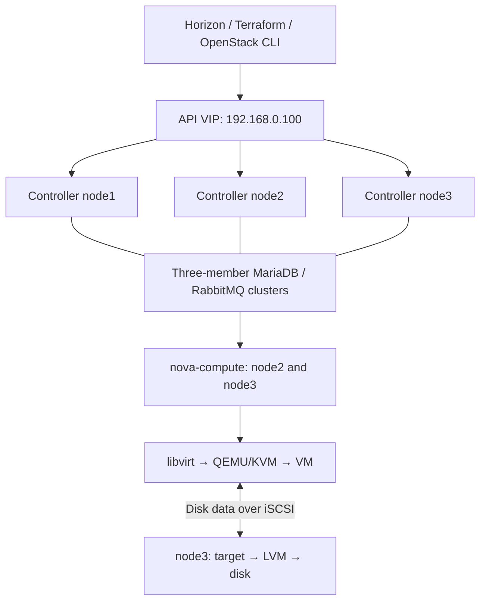

# Stage 1 — Three controllers, two computes, one Cinder LVM host

## Understand the roles first

A controller hosts cloud-management services: authentication, APIs, scheduling, cloud records, and service messaging. Compute hosts run QEMU/KVM instances. The volume host supplies persistent disks. A host can perform several roles; controller count does not determine storage replication.

Initial allocation: node1/node2/node3 are controllers and network nodes; node2/node3 are computes; node3 is the proposed single LVM volume host. Glance uses one local file store on node1. This keeps the selected three-controller design without pretending that every storage component is highly available.



Quorum protects agreement on control state. It does not recover a lost local disk. Two healthy connected members form a majority of three; losing two can stop quorum-dependent operations. Glance uploads/downloads still depend on node1, and Cinder disk access still depends on node3.

## 1. Freeze the toolchain without changing the old project

### Next run: prepare the tools on Hermes

**Stage 1 — prepare the deployment computer.** Node identity, old-Ceph cleanup and USB physical testing are complete. The remaining address-allocation details do not block installing tools on Hermes. This step installs software; it does not log into or configure the nodes.

Think of Hermes as the management workstation. Ansible will apply host configuration, Kolla-Ansible will install OpenStack, and the OpenStack client will call its APIs. Installing those tools does not yet run those operations.

| Part | What this step does | Why |
|---|---|---|
| Ubuntu packages on Hermes | Update package index; install Git, curl, certificates and Python build/venv dependencies | Build/install the Python deployment tools |
| `~/venvs/kolla-iac` | Install the repository's selected Kolla commit, compatible Ansible constraint, OpenStack client and PyYAML | Give this project an isolated Python tool environment |
| `build/collections` | Install Kolla's requirements and the project's Ansible collections | Supply the Ansible modules/roles used by later steps |
| Version record | Save `pip freeze` in the private report directory | Record the exact Python versions that were actually installed |
| Doctor | Print executable locations and any `MISSING` tools | Verify what Hermes can find before configuring nodes |

The [preparation wrapper](../scripts/prepare-hermes.sh) calls the existing [bootstrap installer](../scripts/bootstrap-hermes.sh), records output, and runs doctor with the new environment on PATH. It requires the hostname `hermes` and an interactive terminal. Existing `~/venvs/kolla` and `/etc/kolla` are outside its targets. It does not install Codex or modify AI settings.

**Run once from a terminal on Hermes**, even if your current directory is `build/`:

```bash
cd ~/git/openstack-iac-lab
git pull --ff-only
bash scripts/prepare-hermes.sh
```

Enter **Hermes's sudo password** when asked. Package download/installation may take several minutes. You do not need to activate a virtual environment first; the script uses the intended environment explicitly. It does not change the parent terminal's environment.

| Result | Interpretation |
|---|---|
| `INSTALL: COMPLETED` | Package/bootstrap commands finished successfully |
| `INSTALL: STOPPED` | Installation failed; read the first actual error before retrying |
| Doctor paths under `~/venvs/kolla-iac/bin` for Ansible/Kolla/OpenStack | The selected project environment is being used |
| `terraform: MISSING` | Terraform still needs installation before Stage 3; this script does not install it |
| `RESULT: TOOLS_FOUND` | All doctor executables were found; this is not a deployment or API test |
| `RESULT: REVIEW` | Read each missing executable or command error; do not run deployment phases yet |

The latest combined report is **`build/hermes-tools-report.txt`**. Timestamped logs and `python-versions.txt` live in `build/hermes-tools-<timestamp>-<suffix>/`, with private file/directory permissions. Review the report's final doctor/result section together. No raw report belongs in public Git.

**Validation status:** shell/source checks and isolated wrapper simulations are local checks. The actual package install, dependency resolution and executable paths on Hermes need the user's run. Final VIP/pool configuration, SSH keys for Ansible, disk-health review and node preparation remain later checkpoints.

<details>
<summary>Reference: individual installation commands and later configuration generation</summary>

New-project input lives in private/lab.yml; `python scripts/labctl.py configure --hosts-only` generates build/inventory.yml, build/kolla-inventory.yml, and build/globals.yml. HCP/workload inputs can wait until Stage 3, when the full configure step generates Terraform settings too. The commands below explain the underlying installer and later configuration; do not run them in addition to the preparation script for this checkpoint.

Run on Hermes. This guide selects OpenStack 2026.1 and the inspected Kolla stable/2026.1 commit `15ce36696a21356eb59abb4473e210f13cf7c98c`. The branch can move; the commit pin does not. Container tags and OS package repositories are separate moving inputs and must be recorded after deployment.

```bash
sudo apt install -y git python3-dev python3-venv libffi-dev gcc libssl-dev libdbus-glib-1-dev
python3 -m venv ~/venvs/kolla-iac
source ~/venvs/kolla-iac/bin/activate
python -m pip install --upgrade pip
python -m pip install 'ansible-core>=2.19,<2.20.99' 'kolla-ansible @ git+https://opendev.org/openstack/kolla-ansible@15ce36696a21356eb59abb4473e210f13cf7c98c' python-openstackclient PyYAML
export ANSIBLE_COLLECTIONS_PATH="$PWD/build/collections"
mkdir -p "$ANSIBLE_COLLECTIONS_PATH"
kolla-ansible install-deps
mkdir -p build
python -m pip freeze > build/python-versions.txt
ansible --version
kolla-ansible --version
```

Keep `~/venvs/kolla` and `/etc/kolla` from the old project intact. Collections are also isolated under this project's ignored build/collections directory; ansible.cfg selects it when commands run from the project root. Set a fresh configuration directory in this terminal and repeat the export in any new terminal used for this project:

```bash
export LAB_CONFIG="$HOME/.config/kolla-iac-lab"
install -d -m 0700 "$LAB_CONFIG"
```

Copy the selected release's default `globals.yml` and `passwords.yml` into that **empty** directory, using the package example path under `~/venvs/kolla-iac/share/kolla-ansible/etc_examples/kolla/`. Do not overwrite an existing new-cluster password file. Generate fresh passwords:

```bash
cp ~/venvs/kolla-iac/share/kolla-ansible/etc_examples/kolla/globals.yml "$LAB_CONFIG/globals.yml"
cp ~/venvs/kolla-iac/share/kolla-ansible/etc_examples/kolla/passwords.yml "$LAB_CONFIG/passwords.yml"
kolla-genpwd -p "$LAB_CONFIG/passwords.yml"
chmod 600 "$LAB_CONFIG/passwords.yml"
```

Merge the reviewed values from `kolla/globals.yml.example` into the new globals file. Each command below passes `--configdir` explicitly. Old Ceph overrides and custom images are not inputs to this deployment.

</details>

## 2. Prepare the host networking

Use Stage 2's common and Netplan roles before deploying. The fresh two-NIC design puts the original .200/.201/.202 addresses directly on the verified management interfaces. The provider NIC `ext0` has no host IP and is reserved for Neutron/OVS.

Fill each provider NIC's actual MAC in `ansible/inventory/host_vars/`. Supply verified DNS addresses in `group_vars/all.yml`. Keep only one active Netplan definition for each interface; review installer-generated files from the console before applying a replacement.

The central-config workflow instead fills these inputs in private/lab.yml and generates build/inventory.yml. The candidate globals explicitly enables Neutron L3 agent HA; verify actual router HA/agent placement after creating a tenant network. Three network-agent processes alone are not a completed failover test.

Reserve `192.168.0.100` for the API VIP and exclude it from router DHCP/floating-IP allocations. It is assigned by Keepalived, not configured permanently on all three hosts. Verify that no unrelated host uses it before deploying.

## 3. Preserve Kolla's full inventory hierarchy

A hand-written inventory with only `[control]` and `[compute]` can omit required service groups. Generate YAML from the exact installed release's complete sample:

```bash
python scripts/render-kolla-inventory.py ~/venvs/kolla-iac/share/kolla-ansible/ansible/inventory/multinode build/kolla-inventory.yml
ansible-inventory -i build/kolla-inventory.yml --graph
ansible -i build/kolla-inventory.yml control --list-hosts
ansible -i build/kolla-inventory.yml cinder-volume --list-hosts
ansible -i build/kolla-inventory.yml cinder-volume-lvm --list-hosts
ansible -i build/kolla-inventory.yml glance --list-hosts
```

Expected membership: control = all three; compute = node2/node3; storage, cinder-volume, cinder-volume-lvm, tgtd = node3; glance/glance-api = node1. The generator deliberately aligns the Cinder parent group with its single backend to avoid declaring three backend writers while using only one LVM host. APIs and schedulers remain on all controllers. Inspect the generated graph before proceeding; it is a candidate, not a live result.

Kolla's guide still flags multi-controller LVM issues. One volume host does not prove every such issue absent. Keep all prechecks enabled; validate attachment and data access from both computes. If a precheck fails, diagnose group membership, enabled backends, and release behavior instead of setting a skip flag.

## 4. Prepare exactly one Cinder data disk

This step is blocked until Stage 0's live disk identification and health review is complete. The dedicated disk must not contain the OS, an OS LVM physical volume, a mounted filesystem, swap, or data to retain. Old Ceph ownership must first be cleared through [Stage 0 Step 7](00-hermes-codex-and-node-reset.md#7-remove-the-recorded-old-ceph-allocations), then its actual result reviewed.

On the selected storage node, create the `cinder-volumes` volume group on the approved dedicated disk. The `labctl --ask-become-pass storage` action uses `scripts/storage-target.py` to create this VG only on the configured blank disk after host/serial confirmation. It refuses existing Ceph ownership; cleanup is the separate Stage 0 action. Fill the reviewed node3 by-id path/serial in private/lab.yml first.

After the approved provisioning, verify on node3:

```bash
sudo pvs -o pv_name,pv_size,vg_name
sudo vgs cinder-volumes
sudo lvs -a -o lv_name,vg_name,lv_size
```

Expected: one intended Cinder VG on the dedicated data disk, separate from the Ubuntu OS VG. Do not create matching independent VGs on all three hosts and call them replicated storage.

## 5. Deploy in deliberate steps

Run from the repository root on Hermes after the preceding checks:

```bash
kolla-ansible bootstrap-servers -i build/kolla-inventory.yml --configdir "$LAB_CONFIG"
kolla-ansible prechecks -i build/kolla-inventory.yml --configdir "$LAB_CONFIG"
kolla-ansible pull -i build/kolla-inventory.yml --configdir "$LAB_CONFIG"
kolla-ansible deploy -i build/kolla-inventory.yml --configdir "$LAB_CONFIG"
kolla-ansible post-deploy -i build/kolla-inventory.yml --configdir "$LAB_CONFIG"
kolla-ansible check -i build/kolla-inventory.yml --configdir "$LAB_CONFIG"
```

If sudo requires a password, set `export ANSIBLE_BECOME_ASK_PASS=True` in this shell before the manual Kolla commands, or use labctl's `--ask-become-pass` option. The selected Kolla Python CLI does not expose the regular ansible-playbook flag directly. Do not put the password in the public inventory. Stop after a failing step; do not rerun all phases blindly.

## 6. Create the initial cloud resources

Load the admin credentials generated by post-deploy from the new configuration directory. If it provides `admin-openrc.sh`, source that file. If it provides `clouds.yaml`, use it through `OS_CLIENT_CONFIG_FILE` and the generated cloud name. Never print or commit either file.

Verify APIs and the expected service counts:

```bash
openstack token issue -c expires -f value
openstack compute service list
openstack hypervisor list
openstack network agent list
openstack volume service list
```

Create the external network once, after recording a verified unused floating-IP range on 192.168.0.0/24. Exclude .1, .100, .200–.202, Hermes, router DHCP leases, and all other existing addresses. `FLOAT_START`, `FLOAT_END`, and `DNS_SERVER` below must be set from that review, not guessed:

The OpenStack network name `public` does not make these RFC1918 addresses internet-public. The lab floating IPs are reachable from the appropriate LAN/routed clients. Internet publication would require a separate design.

```bash
: "${FLOAT_START:?Set the reviewed first floating IP}"
: "${FLOAT_END:?Set the reviewed last floating IP}"
: "${DNS_SERVER:?Set the verified DNS server}"
openstack network create --external --share --provider-network-type flat --provider-physical-network physnet1 public
openstack subnet create --network public --subnet-range 192.168.0.0/24 --allocation-pool start="$FLOAT_START",end="$FLOAT_END" --gateway 192.168.0.1 --no-dhcp --dns-nameserver "$DNS_SERVER" public-subnet
```

The gateway value is the preserved address plan and must already have been verified. Confirm Kolla's physical-network mapping is physnet1 before using this command. Do not recreate an existing network of the same name.

Upload an official Ubuntu 24.04 cloud image after checksum verification; give it the lab name `ubuntu-24.04`. Create a small flavor named `lab.small` (2 vCPU, 2048 MiB RAM, 15 GiB root disk) only if the post-deployment available resources support it. Import the intended **public** SSH key as `lab-key`. Create a separate project/user or project-scoped application credential for the Terraform stages; avoid routine use of admin credentials.

Use Stage 3's first VM for the network test. Create a 1 GiB disposable Cinder volume, attach it to a disposable VM on node2, write a checksum-tested file, detach cleanly, and attach it to a disposable VM on node3. Identify the new guest disk with `lsblk` before formatting it. Confirm the file/checksum persists. This is the required LVM integration gate, not just a green service list.

## Finish line and recovery

Record service counts, API reachability, VM floating-IP access, successful cross-compute volume access, actual image digests, and free memory. Test controller redundancy one host at a time later. Because node1 carries Glance and node3 carries LVM storage, their loss tests have additional consequences; first test losing node2 without workloads depending on it.

If all controllers shut down together, consult the selected release's documented MariaDB recovery path. Do not reset RabbitMQ or delete databases as a routine recovery action. Storage failure is not repaired by adding more controllers.

Expansion: retain these three controller addresses, add a verified new host to the compute group, bootstrap it, and use the release's add-host procedure. Moving Glance or Cinder to redundant storage later is a separate design/data-migration task.

## Sources

- [Pinned Kolla source](https://github.com/openstack/kolla-ansible/tree/15ce36696a21356eb59abb4473e210f13cf7c98c)
- [Quick start and compatible Ansible](https://docs.openstack.org/kolla-ansible/2026.1/user/quickstart.html)
- [Multinode inventory and file-backed Glance](https://docs.openstack.org/kolla-ansible/2026.1/user/multinode.html)
- [Cinder LVM and HA caveats](https://docs.openstack.org/kolla-ansible/2026.1/reference/storage/cinder-guide.html)
- [Production architecture](https://docs.openstack.org/kolla-ansible/2026.1/admin/production-architecture-guide.html)

Next: [Stage 2](02-ansible-roles.md). Its host-preparation steps are a prerequisite for deployment above.
