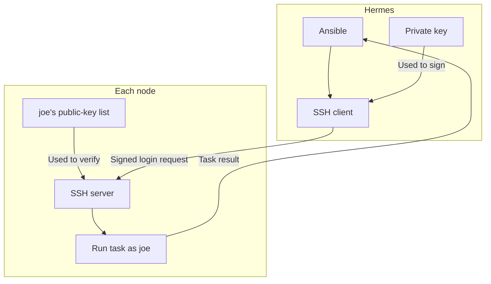
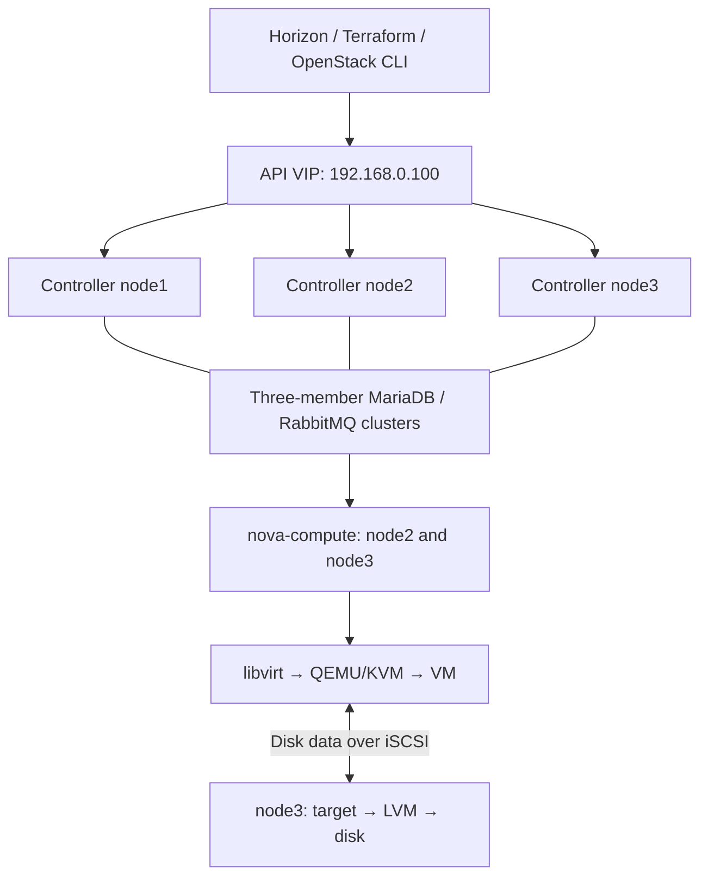

# Stage 1 — Three controllers, two computes, one Cinder LVM host

**Current checkpoint:** common-role verification stopped on node1 in the report starting `2026-10-22T12:12:23Z`: its name returned both `127.0.1.1` and `192.168.0.200`. Node1's packages, hostname, management IP and running/enabled Chrony passed; clock synchronization and later nodes remain unverified. **Next: [pull the hostname correction and resume the existing wrapper](02-ansible-roles.md#resolve-duplicate-hostname-lookup).** Tools, SSH, sudo and the earlier preview remain complete.

## SSH access for Ansible

### The idea: Hermes proves its identity

**One key pair, two files.** Think of a private signing stamp kept on Hermes and a public verification record kept on the nodes. SSH proves that Hermes has the matching private key. Ansible uses that SSH connection to run its tasks.

| File / location | What it does |
|---|---|
| Hermes: `~/.ssh/openstack-iac-lab-ansible` | Private key; stays on Hermes and proves its identity |
| Hermes: `~/.ssh/openstack-iac-lab-ansible.pub` | Public half of the same pair; this is the part copied to the nodes |
| Each node: `/home/joe/.ssh/authorized_keys` | Contains the public keys allowed to log in as `joe` |

**During setup**, `ssh-copy-id` adds the public half to each node's allowed-key list. You used the node's account password to authorize that addition. **During later login**, SSH uses the private key on Hermes to sign a login request; the node verifies it with the listed public key. The private key is not sent to the node.



The diagram applies to **all three nodes**: node1 `192.168.0.200`, node2 `192.168.0.201`, node3 `192.168.0.202`. The same public key was added once to each node. Ansible runs on Hermes and uses the matching private key through SSH.

### Password and passphrase: different jobs

| Item | Purpose |
|---|---|
| Node's Ubuntu `joe` password | Logs into that node with password authentication; used when installing the public key |
| Optional SSH key passphrase | Protects the private-key file on Hermes; chosen when creating that file |
| Sudo authorization | Allows administrative tasks after login; SSH key access does not automatically grant root privileges |

“SSH without a password” here means **without typing the node's login password for each connection**. A protected private key can still ask for its own local passphrase until an agent holds it ready.

### Why pressing Enter worked in the previous lab

**Yes: an empty passphrase is allowed during key creation.** The command and the prompt determine what Enter means:

| Prompt | Pressing Enter without typing means |
|---|---|
| `ssh-keygen`: `Enter passphrase (empty for no passphrase):` | Create the new key without passphrase protection; confirm the empty choice at the next prompt |
| `ssh-add`: `Enter passphrase for ...:` | Stop trying to unlock that existing protected key |

A key created without a passphrase still supports SSH key authentication. Its private file has no passphrase protection; the SSH connection itself is still encrypted. The previous guide should have explained this choice before discussing a forgotten passphrase.

**Your current log:** `Identity added` appears without a displayed unlocking prompt. That is consistent with choosing an empty passphrase, but the pasted output does not record your typed input or establish the file's encryption setting. The successful SSH tests do not depend on us guessing that setting.

### Why we replaced the old key

The earlier `~/.ssh/openstack-iac-lab` key asked for a passphrase, and you did not remember it. OpenSSH cannot recover a forgotten key passphrase. We used the new name `~/.ssh/openstack-iac-lab-ansible` and registered its public key on the nodes; the script leaves the original pair intact.

Here, **recovery meant replacing a forgotten login credential on Hermes**. It was not an Ubuntu reinstall or an OpenStack rebuild. This is completed troubleshooting; the main lesson is the key pair and SSH flow above.

### What your four commands did

| Command | Effect in this run |
|---|---|
| `git pull --ff-only` | Updated the repository on Hermes from `613507a` to `8c6d9ec`, including the script, inventories and lessons |
| `eval "$(ssh-agent -s)"` | Started the local key helper and connected this terminal to it; `Agent pid 23384` identifies that process |
| `bash scripts/prepare-ssh.sh joe --node all --apply` | Created the new pair, loaded it, added its public key to all three nodes, then tested SSH and Ansible Python execution |
| `cat build/ssh-access-summary.txt` | Displayed the saved summary; it did not repeat setup |

**What is the agent?** A helper on Hermes that keeps a key ready to sign SSH requests. For a protected key, that avoids repeated passphrase entry. Your script loaded it with a **14,400-second / four-hour agent lifetime**. That timer applies to the agent's copy; it does not expire the key file or remove public keys from the nodes. A key without a passphrase can also be read directly from its file by SSH.

### Read your successful result

Your report began at `2026-10-22T06:33:11Z` and ended with **`RESULT: SSH_READY for all`**.

| Output | Plain meaning |
|---|---|
| `Identity added` | The agent accepted the selected key on Hermes |
| Fingerprint / randomart | Recognition labels for the key; these are not the private-key file contents |
| `Number of key(s) added: 1` on each node | One public-key entry was installed for `joe` on that node |
| `KEY_LOGIN_OK` on each node | A fresh key-only SSH login worked, with expected hostname, account and management address |
| Ansible `SUCCESS`, `ping: pong`, `changed: false` | Ansible logged in and ran a small Python test successfully; that test needed no configuration change |

The Ansible `ping` test uses SSH and Python, rather than ICMP. Its `changed: false` describes the test; the earlier public-key installation did change the nodes' allowed-key files.

| Node | Preserved address | Key login | Ansible Python test |
|---|---|---|---|
| node1 | `192.168.0.200` | Passed as `joe` | `pong` |
| node2 | `192.168.0.201` | Passed as `joe` | `pong` |
| node3 | `192.168.0.202` | Passed as `joe` | `pong` |

**Later confirmation:** the summary starting `2026-10-22T09:45:00Z` again reports `SSH_READY for all`, using the same key fingerprint. Key loading, public-key installation, fresh logins and the Ansible SSH/Python test completed. The administrator-access run starting `2026-10-22T10:14:57Z` and common-role preview starting `2026-10-22T10:35:36Z` then passed on all three. [Correcting node1's duplicate hostname result is now the current checkpoint](02-ansible-roles.md#resolve-duplicate-hostname-lookup).

**Checkpoint complete:** Hermes can reach all three as `joe` using the selected key, and Ansible can execute Python. This step installed no node packages and changed no network, disk or sudo policy. It did not test Ansible privilege escalation or deploy OpenStack. No repeat SSH setup is needed; host configuration follows review of its remaining inputs.

<details>
<summary>Completed setup and troubleshooting reference</summary>

### Recover access with a new project key

This command block is the completed run recorded above. The [script](../scripts/prepare-ssh.sh) creates a missing pair, reuses a complete pair and refuses incomplete/symlinked key files. It adds only the selected public key and keeps host-key checks enabled. Its SSH-only test inventory disables sudo. VM workload keys are a separate later input.

```bash
cd ~/git/openstack-iac-lab
git pull --ff-only
eval "$(ssh-agent -s)"
bash scripts/prepare-ssh.sh joe --node all --apply
cat build/ssh-access-summary.txt
```

### Current SSH stop: key created, unlock failed

Historical stop, now resolved with the new key: the original report started at `2026-10-21T21:09:40Z`. Key creation completed, but loading stopped before any node-copy phase. A direct load later reached a passphrase prompt and exited `1`; you then reported not remembering the old passphrase. The original pair was not deleted or overwritten by the recovery script.

The script now records `command_exit` and `log_exit` separately when a phase fails, and says whether public-key installation was attempted. It stops before later steps; completed public-key additions are retained.

Latest private reports: `build/ssh-access-summary.txt` and `build/ssh-access-report.txt`. Timestamped history stays under ignored `build/`. The private key stays outside the repository under Hermes's `.ssh` directory.

**Later use:** a different terminal must have the right agent environment if it is to use that agent. A protected key needs its passphrase when loaded into a new agent or after its agent copy expires. An unprotected key has no passphrase prompt. Neither case requires regenerating or reinstalling the key merely because four hours elapsed.

Sources:

- [OpenSSH key creation, optional passphrases and forgotten-passphrase handling](https://man.openbsd.org/ssh-keygen)
- [SSH server authentication and authorized_keys](https://man.openbsd.org/sshd)
- [OpenSSH agent key loading and lifetime](https://man.openbsd.org/ssh-add)
- [OpenSSH 9.6 empty input during key loading](https://github.com/openssh/openssh-portable/blob/V_9_6_P1/ssh-add.c#L300-L327)
- [Ansible ping module source and documentation](https://github.com/ansible/ansible/blob/stable-2.20/lib/ansible/modules/ping.py)

</details>

## 1. Finish the Hermes tool setup

### Observed Hermes tool setup

Your resume report started at `2026-10-21T20:35:49Z` and ended with **`RESULT: TOOLS_FOUND`**.

| Check | Observed result | Meaning |
|---|---|---|
| Kolla collections | COMPLETED | Kolla's collection install command succeeded |
| Project collections | COMPLETED | The project's collection install command succeeded |
| Python dependency check | COMPLETED | `pip check` found no broken declared package requirements |
| Version manifest and collection list | Completed | The script saved Python versions and successfully listed collections; exact collection versions are in the full log |
| Tool locations | All eight found | Doctor found every requested executable |

| Tools | Location confirmed by the report |
|---|---|
| Python, Ansible playbook/inventory, Kolla-Ansible, OpenStack client | `/home/joe/venvs/kolla-iac/bin/` |
| SSH and Git | `/usr/bin/ssh`, `/usr/bin/git` |
| Terraform | `/usr/bin/terraform` |

**What changed?** The PATH correction allowed the recovery to finish the collection setup that failed earlier. The project environment supplied the intended Python/Ansible/Kolla/OpenStack commands. Terraform was already available; this recovery did not install it. The summary establishes its location, not its version or provider operation.

**This checkpoint is complete.** The result verifies collection command completion, declared Python dependencies and executable discovery. It does not test node SSH access, OpenStack APIs or a running cloud. No deployment was attempted. SSH access as `joe` has since passed on all three nodes; reviewed host configuration comes later.

<details>
<summary>Completed recovery lesson: collection purposes, script actions and command</summary>

### Resume collections on Hermes

**Why this step?** The previous run installed Ansible, Kolla-Ansible and the OpenStack client, then stopped because Kolla could not find `ansible-galaxy`. The recovery adds the installed environment to PATH before calling it.

**What is a collection?** A bundle of Ansible modules, roles and plugins. Ansible is the engine; collections provide additional tasks it can run later.

| Collections to install | Purpose |
|---|---|
| `openstack.kolla` | Kolla's shared OpenStack deployment roles/modules |
| `ansible.netcommon`, `ansible.utils`, `ansible.posix` | Network utilities and Linux administration modules |
| `community.crypto`, `community.general` | Certificate and general administration modules |
| `community.docker`, `containers.podman` | Modules for managing container engines |
| `community.postgresql` | Modules for the later PostgreSQL lesson |

They install on **Hermes**, under **`~/git/openstack-iac-lab/build/collections`**. These are task libraries: this step does not install PostgreSQL or container engines on the nodes. The Kolla requirements come from the installed pinned release; the project adds its requirements from `ansible/requirements.yml`. Resolved collection versions will be listed in the log.

| Script action | Effect |
|---|---|
| Use `~/venvs/kolla-iac/bin` on PATH | Make Kolla and its child `ansible-galaxy` discover the same installed tools |
| Install Kolla and project collections | Finish the interrupted downloads; skip APT, venv creation and `pip install` |
| Check Python dependencies and run doctor | Check installed package consistency and executable locations |

**Run on Hermes:**

```bash
cd ~/git/openstack-iac-lab
git pull --ff-only
bash scripts/prepare-hermes.sh --resume-collections
cat build/hermes-tools-summary.txt
```

The last line only displays the short report. Resume mode uses no sudo and makes no node or cloud configuration changes. Downloads may take several minutes. It stops on a failed collection/dependency command rather than continuing into deployment.

**Read the short result:** `build/hermes-tools-summary.txt`. The full log remains `build/hermes-tools-report.txt`; timestamped history includes `python-versions.txt`.

| Result | Meaning |
|---|---|
| Collection/check lines say `COMPLETED`, then `RESULT: TOOLS_FOUND` | Installation and the listed tool-location checks passed; deployment has not started |
| `RESULT: REVIEW` | Read the actual `MISSING` entry; Terraform is needed by Stage 3 |
| `STOPPED` or expected executable missing | Read the failed phase/error in the full log before another attempt |

**Reviewed result:** the supplied resume summary passed on Hermes as recorded above. This command is a completed-step reference; no repeat run is needed.

</details>

<details>
<summary>Earlier lesson: controller architecture, installed packages and the reviewed PATH failure</summary>

## Understand the roles first

A controller hosts cloud-management services: authentication, APIs, scheduling, cloud records, and service messaging. Compute hosts run QEMU/KVM instances. The volume host supplies persistent disks. A host can perform several roles; controller count does not determine storage replication.

Initial allocation: node1/node2/node3 are controllers and network nodes; node2/node3 are computes; node3 is the proposed single LVM volume host. Glance uses one local file store on node1. This keeps the selected three-controller design without pretending that every storage component is highly available.



Quorum protects agreement on control state. It does not recover a lost local disk. Two healthy connected members form a majority of three; losing two can stop quorum-dependent operations. Glance uploads/downloads still depend on node1, and Cinder disk access still depends on node3.

## 1. Freeze the toolchain without changing the old project

### What actually installed on Hermes

**Purpose of this step:** equip Hermes to run later infrastructure tasks. Think of installing PowerCLI on a management VM: the tools live on the management computer. Installation alone does not create the infrastructure they will manage.

Your report started at `2026-10-21T19:47:23Z`. It confirms a **partial setup**, with these completed changes:

| Installed or changed | Plain purpose | Location / observed version |
|---|---|---|
| Project Python environment | A separate directory containing this project's Python and packages; it is not a VM or container | `/home/joe/venvs/kolla-iac` |
| `pip` | Downloads and installs Python packages into that environment | Updated from 24.0 to **26.2.2** inside the environment |
| `ansible-core` | Reads YAML playbooks/roles and runs their tasks on selected machines, usually over SSH | **2.20.10**, inside the environment |
| `kolla-ansible` | Provides the playbooks and command used later to install OpenStack services in containers | **22.2.1.dev24**, from pinned commit `15ce36696a21356eb59abb4473e210f13cf7c98c` |
| `python-openstackclient` | Provides the `openstack` command for later API operations such as creating networks, VMs and volumes | **10.4.0**, inside the environment |
| `PyYAML` | Lets our Python scripts read YAML configuration files | **6.0.3**, inside the environment |
| Supporting Python libraries | Building blocks for the above tools: API requests, authentication, templates and cryptography | Includes `openstacksdk` **4.21.0**, Jinja2, requests and other dependencies |
| Ubuntu `ca-certificates` | Updates the system's trusted HTTPS certificate authorities | Upgraded to **20260816ubuntu0.24.04.1** on Hermes |

**What was already there?** Git, curl, Python development/venv packages, GCC and the listed development libraries were already at the requested versions. APT reports **1 upgraded, 0 newly installed, 0 removed and 69 not upgraded**. It refreshed package indexes; it did not perform a full system upgrade. Repository lines mentioning Docker or HashiCorp are index checks, not evidence of installing Docker or Terraform in this run.

**Why so many package names?** Pip automatically installs dependencies. For example, the OpenStack client uses `openstacksdk` and authentication libraries; Kolla/Ansible use YAML and template libraries. A client library named after an OpenStack service does not install that service's server. The terminal transcript is a dependency/download log, not a new list of cloud services.

### Why the setup stopped

| Phase | Observed outcome |
|---|---|
| Check/install Ubuntu prerequisites | Completed; only the certificate package was upgraded |
| Create/use the project environment and install Python tools | Completed; the log says `Successfully installed ...` |
| Kolla's Ansible Galaxy collection installation | **Stopped:** `[Errno 2] No such file or directory: 'ansible-galaxy'` |
| Project collection installation, Python version report and doctor | Not reached in this run |

**The script defect:** it called Kolla by its full path, but had not added `~/venvs/kolla-iac/bin` to **PATH**. PATH is the list of directories searched when a program calls another command by name. Kolla's dependency installer calls `ansible-galaxy` by name, so it could not locate the new environment's command. The wrapper added that PATH entry only after bootstrap, which was too late.

The [bootstrap script](../scripts/bootstrap-hermes.sh) now exports the environment's `bin` directory before `kolla-ansible install-deps`. This fixes the command-search ordering. It does not mean that the repair has already run on Hermes or that collection installation is complete. [The selected Kolla source](https://github.com/openstack/kolla-ansible/blob/15ce36696a21356eb59abb4473e210f13cf7c98c/kolla_ansible/utils.py) shows the child `ansible-galaxy` call.

**Scope of this run:** it installed/updated software on Hermes. The script did not SSH to node1/node2/node3, change their networking or disks, install cloud services there, create VMs, or install Codex. Terraform was not installed by this script. No cluster deployment was attempted.

**Outcome of that run:** Python tools installed; collections incomplete; doctor not run. The current recovery command is in [Resume collections on Hermes](#resume-collections-on-hermes).

### Next run: prepare the tools on Hermes

**Reference for the attempted preparation step.** The actual partial result and cause are recorded above. Node identity, old-Ceph cleanup and USB physical testing are complete. The remaining address-allocation details do not block installing tools on Hermes. This step installs software; it does not log into or configure the nodes.

Think of Hermes as the management workstation. Ansible will apply host configuration, Kolla-Ansible will install OpenStack, and the OpenStack client will call its APIs. Installing those tools does not yet run those operations.

| Part | What this step does | Why |
|---|---|---|
| Ubuntu packages on Hermes | Update package index; install Git, curl, certificates and Python build/venv dependencies | Build/install the Python deployment tools |
| `~/venvs/kolla-iac` | Install the repository's selected Kolla commit, compatible Ansible constraint, OpenStack client and PyYAML | Give this project an isolated Python tool environment |
| `build/collections` | Install Kolla's requirements and the project's Ansible collections | Supply the Ansible modules/roles used by later steps |
| Version record | Save `pip freeze` in the private report directory | Record the exact Python versions that were actually installed |
| Doctor | Print executable locations and any `MISSING` tools | Verify what Hermes can find before configuring nodes |

The [preparation wrapper](../scripts/prepare-hermes.sh) calls the existing [bootstrap installer](../scripts/bootstrap-hermes.sh), records output, and runs doctor with the new environment on PATH. It requires the hostname `hermes` and an interactive terminal. Existing `~/venvs/kolla` and `/etc/kolla` are outside its targets. It does not install Codex or modify AI settings.

<details>
<summary>Original preparation command — reference, not a retry instruction</summary>

The command used for the attempted installation was run from Hermes:

```bash
cd ~/git/openstack-iac-lab
git pull --ff-only
bash scripts/prepare-hermes.sh
```

Enter **Hermes's sudo password** when asked. Package download/installation may take several minutes. You do not need to activate a virtual environment first; the script uses the intended environment explicitly. It does not change the parent terminal's environment.

</details>

| Result | Interpretation |
|---|---|
| `INSTALL: COMPLETED` | Package/bootstrap commands finished successfully |
| `INSTALL: STOPPED` | Installation failed; read the first actual error before retrying |
| Doctor paths under `~/venvs/kolla-iac/bin` for Ansible/Kolla/OpenStack | The selected project environment is being used |
| `terraform: MISSING` | Terraform still needs installation before Stage 3; this script does not install it |
| `RESULT: TOOLS_FOUND` | All doctor executables were found; this is not a deployment or API test |
| `RESULT: REVIEW` | Read each missing executable or command error; do not run deployment phases yet |

The latest combined report is **`build/hermes-tools-report.txt`**. Timestamped logs and `python-versions.txt` live in `build/hermes-tools-<timestamp>-<suffix>/`, with private file/directory permissions. Review the report's final doctor/result section together. No raw report belongs in public Git.

**Validation status:** the uploaded report confirms the Python package installation and the PATH-related stop. The PATH correction has a local child-command lookup check and shell/source validation; the corrected dependency installation and doctor remain untested on Hermes. Final VIP/pool configuration, SSH keys for Ansible, disk-health review and node preparation remain later checkpoints.

<details>
<summary>Reference: individual installation commands and later configuration generation</summary>

New-project input lives in private/lab.yml; `python scripts/labctl.py configure --hosts-only` generates build/inventory.yml, build/kolla-inventory.yml, and build/globals.yml. HCP/workload inputs can wait until Stage 3, when the full configure step generates Terraform settings too. The commands below explain the underlying installer and later configuration; do not run them in addition to the preparation script for this checkpoint.

Run on Hermes. This guide selects OpenStack 2026.1 and the inspected Kolla stable/2026.1 commit `15ce36696a21356eb59abb4473e210f13cf7c98c`. The branch can move; the commit pin does not. Container tags and OS package repositories are separate moving inputs and must be recorded after deployment.

```bash
sudo apt install -y git python3-dev python3-venv libffi-dev gcc libssl-dev libdbus-glib-1-dev
python3 -m venv ~/venvs/kolla-iac
source ~/venvs/kolla-iac/bin/activate
python -m pip install --upgrade pip
python -m pip install 'ansible-core>=2.19,<2.20.99' 'kolla-ansible @ git+https://opendev.org/openstack/kolla-ansible@15ce36696a21356eb59abb4473e210f13cf7c98c' python-openstackclient PyYAML
export ANSIBLE_COLLECTIONS_PATH="$PWD/build/collections"
mkdir -p "$ANSIBLE_COLLECTIONS_PATH"
kolla-ansible install-deps
mkdir -p build
python -m pip freeze > build/python-versions.txt
ansible --version
kolla-ansible --version
```

Keep `~/venvs/kolla` and `/etc/kolla` from the old project intact. Collections are also isolated under this project's ignored build/collections directory; ansible.cfg selects it when commands run from the project root. Set a fresh configuration directory in this terminal and repeat the export in any new terminal used for this project:

```bash
export LAB_CONFIG="$HOME/.config/kolla-iac-lab"
install -d -m 0700 "$LAB_CONFIG"
```

Copy the selected release's default `globals.yml` and `passwords.yml` into that **empty** directory, using the package example path under `~/venvs/kolla-iac/share/kolla-ansible/etc_examples/kolla/`. Do not overwrite an existing new-cluster password file. Generate fresh passwords:

```bash
cp ~/venvs/kolla-iac/share/kolla-ansible/etc_examples/kolla/globals.yml "$LAB_CONFIG/globals.yml"
cp ~/venvs/kolla-iac/share/kolla-ansible/etc_examples/kolla/passwords.yml "$LAB_CONFIG/passwords.yml"
kolla-genpwd -p "$LAB_CONFIG/passwords.yml"
chmod 600 "$LAB_CONFIG/passwords.yml"
```

Merge the reviewed values from `kolla/globals.yml.example` into the new globals file. Each command below passes `--configdir` explicitly. Old Ceph overrides and custom images are not inputs to this deployment.

</details>

</details>

## 2. Prepare the host networking

Use Stage 2's common and Netplan roles before deploying. The fresh two-NIC design puts the original .200/.201/.202 addresses directly on the verified management interfaces. The provider NIC `ext0` has no host IP and is reserved for Neutron/OVS.

Fill each provider NIC's actual MAC in `ansible/inventory/host_vars/`. Supply verified DNS addresses in `group_vars/all.yml`. Keep only one active Netplan definition for each interface; review installer-generated files from the console before applying a replacement.

The central-config workflow instead fills these inputs in private/lab.yml and generates build/inventory.yml. The candidate globals explicitly enables Neutron L3 agent HA; verify actual router HA/agent placement after creating a tenant network. Three network-agent processes alone are not a completed failover test.

Reserve `192.168.0.100` for the API VIP and exclude it from router DHCP/floating-IP allocations. It is assigned by Keepalived, not configured permanently on all three hosts. Verify that no unrelated host uses it before deploying.

## 3. Preserve Kolla's full inventory hierarchy

A hand-written inventory with only `[control]` and `[compute]` can omit required service groups. Generate YAML from the exact installed release's complete sample:

```bash
python scripts/render-kolla-inventory.py ~/venvs/kolla-iac/share/kolla-ansible/ansible/inventory/multinode build/kolla-inventory.yml
ansible-inventory -i build/kolla-inventory.yml --graph
ansible -i build/kolla-inventory.yml control --list-hosts
ansible -i build/kolla-inventory.yml cinder-volume --list-hosts
ansible -i build/kolla-inventory.yml cinder-volume-lvm --list-hosts
ansible -i build/kolla-inventory.yml glance --list-hosts
```

Expected membership: control = all three; compute = node2/node3; storage, cinder-volume, cinder-volume-lvm, tgtd = node3; glance/glance-api = node1. The generator deliberately aligns the Cinder parent group with its single backend to avoid declaring three backend writers while using only one LVM host. APIs and schedulers remain on all controllers. Inspect the generated graph before proceeding; it is a candidate, not a live result.

Kolla's guide still flags multi-controller LVM issues. One volume host does not prove every such issue absent. Keep all prechecks enabled; validate attachment and data access from both computes. If a precheck fails, diagnose group membership, enabled backends, and release behavior instead of setting a skip flag.

## 4. Prepare exactly one Cinder data disk

This step is blocked until Stage 0's live disk identification and health review is complete. The dedicated disk must not contain the OS, an OS LVM physical volume, a mounted filesystem, swap, or data to retain. Old Ceph ownership must first be cleared through [Stage 0 Step 7](00-hermes-codex-and-node-reset.md#7-remove-the-recorded-old-ceph-allocations), then its actual result reviewed.

On the selected storage node, create the `cinder-volumes` volume group on the approved dedicated disk. The `labctl --ask-become-pass storage` action uses `scripts/storage-target.py` to create this VG only on the configured blank disk after host/serial confirmation. It refuses existing Ceph ownership; cleanup is the separate Stage 0 action. Fill the reviewed node3 by-id path/serial in private/lab.yml first.

After the approved provisioning, verify on node3:

```bash
sudo pvs -o pv_name,pv_size,vg_name
sudo vgs cinder-volumes
sudo lvs -a -o lv_name,vg_name,lv_size
```

Expected: one intended Cinder VG on the dedicated data disk, separate from the Ubuntu OS VG. Do not create matching independent VGs on all three hosts and call them replicated storage.

## 5. Deploy in deliberate steps

Run from the repository root on Hermes after the preceding checks:

```bash
kolla-ansible bootstrap-servers -i build/kolla-inventory.yml --configdir "$LAB_CONFIG"
kolla-ansible prechecks -i build/kolla-inventory.yml --configdir "$LAB_CONFIG"
kolla-ansible pull -i build/kolla-inventory.yml --configdir "$LAB_CONFIG"
kolla-ansible deploy -i build/kolla-inventory.yml --configdir "$LAB_CONFIG"
kolla-ansible post-deploy -i build/kolla-inventory.yml --configdir "$LAB_CONFIG"
kolla-ansible check -i build/kolla-inventory.yml --configdir "$LAB_CONFIG"
```

If sudo requires a password, set `export ANSIBLE_BECOME_ASK_PASS=True` in this shell before the manual Kolla commands, or use labctl's `--ask-become-pass` option. The selected Kolla Python CLI does not expose the regular ansible-playbook flag directly. Do not put the password in the public inventory. Stop after a failing step; do not rerun all phases blindly.

## 6. Create the initial cloud resources

Load the admin credentials generated by post-deploy from the new configuration directory. If it provides `admin-openrc.sh`, source that file. If it provides `clouds.yaml`, use it through `OS_CLIENT_CONFIG_FILE` and the generated cloud name. Never print or commit either file.

Verify APIs and the expected service counts:

```bash
openstack token issue -c expires -f value
openstack compute service list
openstack hypervisor list
openstack network agent list
openstack volume service list
```

Create the external network once, after recording a verified unused floating-IP range on 192.168.0.0/24. Exclude .1, .100, .200–.202, Hermes, router DHCP leases, and all other existing addresses. `FLOAT_START`, `FLOAT_END`, and `DNS_SERVER` below must be set from that review, not guessed:

The OpenStack network name `public` does not make these RFC1918 addresses internet-public. The lab floating IPs are reachable from the appropriate LAN/routed clients. Internet publication would require a separate design.

```bash
: "${FLOAT_START:?Set the reviewed first floating IP}"
: "${FLOAT_END:?Set the reviewed last floating IP}"
: "${DNS_SERVER:?Set the verified DNS server}"
openstack network create --external --share --provider-network-type flat --provider-physical-network physnet1 public
openstack subnet create --network public --subnet-range 192.168.0.0/24 --allocation-pool start="$FLOAT_START",end="$FLOAT_END" --gateway 192.168.0.1 --no-dhcp --dns-nameserver "$DNS_SERVER" public-subnet
```

The gateway value is the preserved address plan and must already have been verified. Confirm Kolla's physical-network mapping is physnet1 before using this command. Do not recreate an existing network of the same name.

Upload an official Ubuntu 24.04 cloud image after checksum verification; give it the lab name `ubuntu-24.04`. Create a small flavor named `lab.small` (2 vCPU, 2048 MiB RAM, 15 GiB root disk) only if the post-deployment available resources support it. Import the intended **public** SSH key as `lab-key`. Create a separate project/user or project-scoped application credential for the Terraform stages; avoid routine use of admin credentials.

Use Stage 3's first VM for the network test. Create a 1 GiB disposable Cinder volume, attach it to a disposable VM on node2, write a checksum-tested file, detach cleanly, and attach it to a disposable VM on node3. Identify the new guest disk with `lsblk` before formatting it. Confirm the file/checksum persists. This is the required LVM integration gate, not just a green service list.

## Finish line and recovery

Record service counts, API reachability, VM floating-IP access, successful cross-compute volume access, actual image digests, and free memory. Test controller redundancy one host at a time later. Because node1 carries Glance and node3 carries LVM storage, their loss tests have additional consequences; first test losing node2 without workloads depending on it.

If all controllers shut down together, consult the selected release's documented MariaDB recovery path. Do not reset RabbitMQ or delete databases as a routine recovery action. Storage failure is not repaired by adding more controllers.

Expansion: retain these three controller addresses, add a verified new host to the compute group, bootstrap it, and use the release's add-host procedure. Moving Glance or Cinder to redundant storage later is a separate design/data-migration task.

## Sources

- [Pinned Kolla source](https://github.com/openstack/kolla-ansible/tree/15ce36696a21356eb59abb4473e210f13cf7c98c)
- [Quick start and compatible Ansible](https://docs.openstack.org/kolla-ansible/2026.1/user/quickstart.html)
- [Multinode inventory and file-backed Glance](https://docs.openstack.org/kolla-ansible/2026.1/user/multinode.html)
- [Cinder LVM and HA caveats](https://docs.openstack.org/kolla-ansible/2026.1/reference/storage/cinder-guide.html)
- [Production architecture](https://docs.openstack.org/kolla-ansible/2026.1/admin/production-architecture-guide.html)

Next: [Stage 2](02-ansible-roles.md). Its host-preparation steps are a prerequisite for deployment above.
