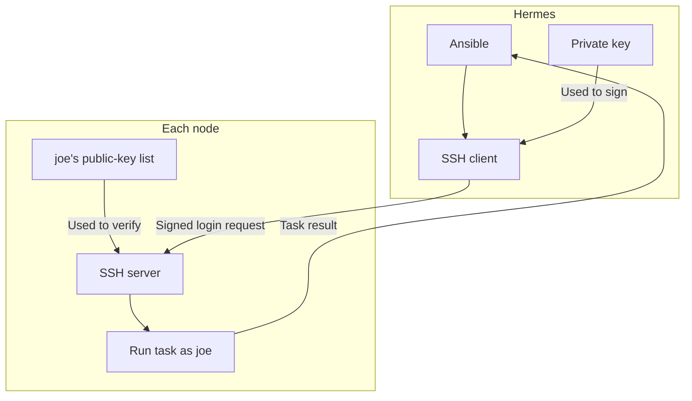

# Stage 1 — Install OpenStack

**Goal:** install the selected three-controller OpenStack layout with Cinder LVM. **Kolla-Ansible deployment has not started.** The Ansible work so far has checked access and prepared basic host settings.

## Where we are

| Complete | Still ahead |
|---|---|
| Ubuntu reinstall, old Ceph cleanup, physical USB link tests | Review deployment inputs |
| Hermes tools, key login, Ansible sudo checks | Configure networking and node3 LVM |
| Common-role preview, apply and verification on all three | Run Kolla-Ansible and verify services/APIs |

**Current checkpoint:** the report starting `2026-10-22T12:31:45Z` confirms `COMMON_APPLIED_OK for all`. The hostname issue is resolved. Continue at **Step 2**, without repeating common or access setup.

The route below stays in this chapter. Completed SSH/tool lessons are [collapsed at the end](#reference-completed-setup).

| Step | Purpose | Changes where? |
|---|---|---|
| 1 · complete | Common host settings verified | All three nodes, through Ansible |
| **2 · current** | **Review one deployment configuration** | Private files on Hermes |
| 3 | Apply host networking and create one Cinder VG | Node NIC settings; node3's dedicated SATA disk |
| 4 | Install OpenStack with Kolla-Ansible | Container runtime and OpenStack services on nodes |
| 5 | Verify APIs and seed the cloud | The new OpenStack cloud |

## 1. Finish the common baseline

**Complete — no rerun needed.** Your report starting `2026-10-22T12:31:45Z` confirms:

| Node | Actual change in this run | Verified result |
|---|---|---|
| node1 · `.200` | Corrected the hosts file; `changed=1` | All common checks passed |
| node2 · `.201` | Installed Chrony/supporting data and corrected hosts; `changed=2` | All common checks passed |
| node3 · `.202` | Installed Chrony/supporting data and corrected hosts; `changed=2` | All common checks passed |

Each recap has `failed=0`, `unreachable=0`. All three verified packages, hostname, original management address, exact name resolution, running/enabled Chrony and successful synchronization commands.

**What you learned:** `/etc/hosts` maps names to IPs; Chrony keeps time synchronized. The earlier role added the management mappings but left `127.0.1.1 nodeN` aliases. The corrected role removed those exact aliases, kept the management mappings and saved a hosts backup on each node. Your new diffs show this correction worked.

Node2/node3 installed `chrony` and APT's supporting `tzdata-legacy`, replacing `systemd-timesyncd`. Node1 already had the packages. [All seven common package purposes](02-ansible-roles.md#what-the-common-role-manages).

The final result is **`COMMON_APPLIED_OK for all`**. These are host settings, not OpenStack services. Continue with Step 2.

## 2. Review one deployment configuration

**Why:** Kolla must know which NIC, address and disk belong to each service. These are deployment settings, not more installation tools.

Keep the reviewed values in ignored `private/lab.yml`, based on [config/lab.yml.example](../config/lab.yml.example). Generate inventories from that file rather than maintaining two live configurations.

| Setting | Known value / required review |
|---|---|
| Nodes and account | `node1=.200`, `node2=.201`, `node3=.202`; login `joe` |
| Management | `enp0s31f6`, `192.168.0.0/24`; gateway/DNS `.1` recorded in Stage 0 |
| USB MACs | node1 `00:e0:4c:55:7e:58`; node2 `00:e0:4c:2c:16:78`; node3 `00:e0:4c:30:46:88` |
| Provider | MAC-matched name `ext0`, no host IP; flat `physnet1` on the same mini switch |
| Initial external pool | `192.168.0.150–152`, explicitly offered by Joe; enough for the first workload |
| API VIP | `.100` is reserved; **DHCP device/product, binding and conflicting lease/use still need review** |
| Cinder host | node3; SATA identity below; recorded SMART `PASSED`, zero reported-uncorrectable errors, no ATA errors, cleanup `CLEANED` |

**Remaining input: the VIP's DHCP binding/current use.** Node3's SATA reuse review can use the already recorded health snapshot and successful cleanup; no new storage scan is requested. The storage action still checks the actual target's identity and current use before provisioning. The template's verification fields record these reviews; they are not filled automatically by copying the file.

**Detail to establish:** which device/software provides DHCP, which device/MAC owns the `.100` reservation, and whether it has a lease or another active user. Because `.100` is inside the reported DHCP range, its reservation must prevent a competing assignment while Keepalived moves the VIP between controllers. Gateway/DNS, node IPs, NIC MACs and the SATA target are already recorded.

### What I simulated before recommending the next command

| Local check | Result |
|---|---|
| Real hosts-only generator with the pinned full Kolla sample | Passed; service groups and preserved IPs matched the intended layout |
| Real Ansible Netplan role for all three nodes | Passed; correct management IPs/MACs, no host IP on `ext0` |
| Repeat the same render | Passed; no candidate changed |
| Missing review flags / duplicate USB MAC | Refused as expected |
| Existing regression suite | All 147 tests passed, including the actual hosts-template preview/apply/repeat fixture |

**Scope:** temporary local files, with local transport forced. The successful-generation fixture uses explicitly synthetic acceptance flags; it does not approve the real VIP or disk. No lab SSH, live Netplan activation, disk provisioning or Kolla deployment was performed. Real NIC/USB behavior, DHCP ownership and OpenStack runtime still require lab evidence.

The initial three-address pool is enough for a router gateway and the first VM's floating IP. Before keeping first/app/monitor together, expand the reviewed pool or remove the disposable first workload; their combined budget is five. This later capacity choice does not delay the initial cloud.

<details>
<summary>After input review: create the private file once and generate hosts-only configuration</summary>

Run later, after Step 1 and the input review. Activate the existing project environment once for the `labctl` commands below:

```bash
source ~/venvs/kolla-iac/bin/activate
install -d -m 0700 private
test -e private/lab.yml || cp config/lab.yml.example private/lab.yml
chmod 600 private/lab.yml
```

Edit the copied file with the reviewed values before generating. A copied template is not a completed configuration. `fresh_install_confirmed` records the already confirmed three OS reinstalls; other verification fields require their own evidence.

```bash
python scripts/labctl.py configure --hosts-only
```

This writes private `build/inventory.yml`, `build/kolla-inventory.yml` and `build/globals.yml` on Hermes. It does not change the nodes. **HCP organization/workspaces, tenant CIDR checks and application settings can wait for their later stages.** The `--hosts-only` option deliberately excludes those requirements.

Inspect the generated Kolla inventory graph:

```bash
ansible-inventory -i build/kolla-inventory.yml --graph
```

Expected placement: control/network all three; compute node2/node3; storage, `cinder-volume`, `cinder-volume-lvm` and `tgtd` only node3; Glance only node1. The renderer uses the full installed Kolla sample and retains its service hierarchy. The smaller preparation inventory is not a replacement for it.

</details>

## 3. Configure networking and one Cinder VG

**Later step:** Step 1 must pass and Step 2's configuration must be reviewed/generated first. Keep the project environment active for `labctl` commands.

### Networking

**Effect:** keep `.200/.201/.202` on each built-in management NIC; match each USB adapter by its actual MAC and name it `ext0`, without a host IP. The USB interface becomes the provider connection for VM traffic.

```bash
python scripts/labctl.py netplan
```

This only renders three candidates in `build/netplan/` **on Hermes**. It does not install or activate them on the nodes.

Install one candidate at a time from the node console: compare all current `/etc/netplan` files, retain a private backup, and resolve conflicting definitions before replacing them. Then run:

```bash
sudo netplan generate
sudo netplan try --timeout 120
```

Before accepting, verify SSH from Hermes, the preserved management IP/default route, DNS and `ext0`'s link with no host IP. If the trial times out, check the actual restored state at the console. Proceed to the next node only after the current node works. The exact file replacement depends on the existing node configuration; do not invent or delete an installer filename.

### Cinder storage

**Effect:** create one `cinder-volumes` LVM volume group on node3's reviewed blank SATA disk. Its Ubuntu installation remains on NVMe. Node1/node2 SATA disks stay unallocated.

| Target | Recorded identity |
|---|---|
| Host | node3 · `192.168.0.202` |
| Disk | `/dev/disk/by-id/ata-KINGSTON_SA400S37240G_50026B768317883A` |
| Serial | `50026B768317883A` |
| Capacity | `240057409536` bytes |

Old Ceph cleanup already completed on all three; it does not need repeating. The existing node3 SATA findings support this lab reuse review; they are a health snapshot, not a guarantee against future failure. NVMe self-test-log query failures and node1's unused SATA bad-block count remain separate follow-up items. Once the target/review are recorded in the private configuration:

```bash
python scripts/labctl.py --ask-become-pass storage
```

The existing guard checks the selected disk and refuses mounted/owned or mismatched targets. It asks for `node3:50026B768317883A` before provisioning. Verify that `cinder-volumes` uses this SATA disk and stays separate from `ubuntu-vg`. This creates storage capacity, not OpenStack services or storage replication.

## 4. Install OpenStack with Kolla-Ansible

**Prerequisites:** common passed on all three; reviewed configuration generated; networking working; node3 Cinder VG prepared. The selected Kolla source is pinned to `15ce36696a21356eb59abb4473e210f13cf7c98c` for stable/2026.1. OS packages and container tags are separately moving inputs; record their actual deployed versions/digests.

First initialize the new project's Kolla configuration:

```bash
python scripts/labctl.py init-config
```

This writes `~/.config/kolla-iac-lab/globals.yml` and creates and generates `passwords.yml` only when that file is absent. Existing new-project passwords are retained. Keep these private. The old `/etc/kolla` is not the configuration directory for this rebuild.

**Kolla-Ansible is the Ansible-based OpenStack installer.** Its phases have different effects. Run each separately using `python scripts/labctl.py --ask-become-pass kolla PHASE`, replacing `PHASE` with the next row:

| Order / phase | What happens | Finish condition |
|---|---|---|
| 1 · `bootstrap-servers` | Prepare the hosts and container runtime | Host preparation completes |
| 2 · `prechecks` | Check configuration, inventory and release prerequisites | All required checks pass |
| 3 · `pull` | Download the selected container images | Downloads complete |
| 4 · `deploy` | Configure and start OpenStack services | Deployment tasks complete |
| 5 · `post-deploy` | Generate client access configuration | New cloud credentials/configuration created |
| 6 · `check` | Run Kolla's service checks | Checks pass |

This is the installation sequence, not another set of tutorials to complete first. `--ask-become-pass` enables Ansible's sudo prompt; do not put a password in Git. If one phase fails, diagnose that phase rather than restarting all preparation.

**Cinder LVM limitation:** Kolla documents caveats with multiple controllers. We use one backend host, keep all prechecks enabled, and later verify volume access from both computes. A failing precheck is investigated; it is never skipped to claim success.

## 5. Verify APIs and seed the cloud

After `post-deploy`, load the **new** admin credentials it actually generated. Source its `admin-openrc.sh` if present, or select its `clouds.yaml` and generated cloud name. Do not print or commit credentials.

```bash
openstack token issue -c expires -f value
openstack compute service list
openstack hypervisor list
openstack network agent list
openstack volume service list
```

Review actual service state/placement: two computes, the configured network agents, one Cinder LVM backend on node3 and controller services matching the inventory. A running service list alone does not prove VM traffic or persistent data access.

Before the seed command, select an existing **public** VM-login key in `workloads.public_key_path`; the template path is an example, not evidence that the file exists. Confirm image/flavor names and that the 2-vCPU, 2-GiB RAM, 15-GiB disk flavor fits available resources.

```bash
python scripts/labctl.py init-cloud
```

This seeds a flat external network/subnet using the reviewed `.150–.152` allocation pool, a checksum-verified Ubuntu 24.04 cloud image, the flavor and public key. It uses the current OpenStack CLI identity. The network name `public` does not make these LAN addresses internet-public.

**Stage 1 finish:** Kolla deployment/checks and API/service checks pass, with results recorded. Stage 2 explains the roles already used. Stage 3 creates the first VM; its floating-IP and cross-compute Cinder test must pass before Stage 4's database. We do not label those runtime tests complete before running them.

<details>
<summary>Later acceptance, failover and recovery</summary>

For Cinder acceptance, use a disposable 1-GiB volume and VMs on node2/node3. Identify the new guest disk, write a checksum-tested file, detach cleanly, reattach on the other compute, and verify the same data. Review the actual guest device before any formatting command.

Test one-controller loss only after the cloud is healthy. Node1 also carries Glance and node3 carries LVM, so losing either has storage consequences. A quorum of controllers does not replicate those disks. After a whole-cluster shutdown, use the selected release's MariaDB recovery procedure rather than deleting databases or resetting RabbitMQ blindly.

Expansion keeps the three controller IPs and follows the release's add-host procedure for new computes. Redundant Glance/Cinder storage is a separate design and migration task.

</details>

## Reference: completed setup

The lessons below explain earlier results. **Do not rerun their setup commands; those checkpoints are complete.**

<details>
<summary>SSH lesson: private/public keys, passphrases, agent and successful node access</summary>

## SSH access for Ansible


### The idea: Hermes proves its identity

**One key pair, two files.** Think of a private signing stamp kept on Hermes and a public verification record kept on the nodes. SSH proves that Hermes has the matching private key. Ansible uses that SSH connection to run its tasks.

| File / location | What it does |
|---|---|
| Hermes: `~/.ssh/openstack-iac-lab-ansible` | Private key; stays on Hermes and proves its identity |
| Hermes: `~/.ssh/openstack-iac-lab-ansible.pub` | Public half of the same pair; this is the part copied to the nodes |
| Each node: `/home/joe/.ssh/authorized_keys` | Contains the public keys allowed to log in as `joe` |

**During setup**, `ssh-copy-id` adds the public half to each node's allowed-key list. You used the node's account password to authorize that addition. **During later login**, SSH uses the private key on Hermes to sign a login request; the node verifies it with the listed public key. The private key is not sent to the node.



The diagram applies to **all three nodes**: node1 `192.168.0.200`, node2 `192.168.0.201`, node3 `192.168.0.202`. The same public key was added once to each node. Ansible runs on Hermes and uses the matching private key through SSH.

### Password and passphrase: different jobs

| Item | Purpose |
|---|---|
| Node's Ubuntu `joe` password | Logs into that node with password authentication; used when installing the public key |
| Optional SSH key passphrase | Protects the private-key file on Hermes; chosen when creating that file |
| Sudo authorization | Allows administrative tasks after login; SSH key access does not automatically grant root privileges |

“SSH without a password” here means **without typing the node's login password for each connection**. A protected private key can still ask for its own local passphrase until an agent holds it ready.

### Why pressing Enter worked in the previous lab

**Yes: an empty passphrase is allowed during key creation.** The command and the prompt determine what Enter means:

| Prompt | Pressing Enter without typing means |
|---|---|
| `ssh-keygen`: `Enter passphrase (empty for no passphrase):` | Create the new key without passphrase protection; confirm the empty choice at the next prompt |
| `ssh-add`: `Enter passphrase for ...:` | Stop trying to unlock that existing protected key |

A key created without a passphrase still supports SSH key authentication. Its private file has no passphrase protection; the SSH connection itself is still encrypted. The previous guide should have explained this choice before discussing a forgotten passphrase.

**Your current log:** `Identity added` appears without a displayed unlocking prompt. That is consistent with choosing an empty passphrase, but the pasted output does not record your typed input or establish the file's encryption setting. The successful SSH tests do not depend on us guessing that setting.

### Why we replaced the old key

The earlier `~/.ssh/openstack-iac-lab` key asked for a passphrase, and you did not remember it. OpenSSH cannot recover a forgotten key passphrase. We used the new name `~/.ssh/openstack-iac-lab-ansible` and registered its public key on the nodes; the script leaves the original pair intact.

Here, **recovery meant replacing a forgotten login credential on Hermes**. It was not an Ubuntu reinstall or an OpenStack rebuild. This is completed troubleshooting; the main lesson is the key pair and SSH flow above.

### What your four commands did

| Command | Effect in this run |
|---|---|
| `git pull --ff-only` | Updated the repository on Hermes from `613507a` to `8c6d9ec`, including the script, inventories and lessons |
| `eval "$(ssh-agent -s)"` | Started the local key helper and connected this terminal to it; `Agent pid 23384` identifies that process |
| `bash scripts/prepare-ssh.sh joe --node all --apply` | Created the new pair, loaded it, added its public key to all three nodes, then tested SSH and Ansible Python execution |
| `cat build/ssh-access-summary.txt` | Displayed the saved summary; it did not repeat setup |

**What is the agent?** A helper on Hermes that keeps a key ready to sign SSH requests. For a protected key, that avoids repeated passphrase entry. Your script loaded it with a **14,400-second / four-hour agent lifetime**. That timer applies to the agent's copy; it does not expire the key file or remove public keys from the nodes. A key without a passphrase can also be read directly from its file by SSH.

### Read your successful result

Your report began at `2026-10-22T06:33:11Z` and ended with **`RESULT: SSH_READY for all`**.

| Output | Plain meaning |
|---|---|
| `Identity added` | The agent accepted the selected key on Hermes |
| Fingerprint / randomart | Recognition labels for the key; these are not the private-key file contents |
| `Number of key(s) added: 1` on each node | One public-key entry was installed for `joe` on that node |
| `KEY_LOGIN_OK` on each node | A fresh key-only SSH login worked, with expected hostname, account and management address |
| Ansible `SUCCESS`, `ping: pong`, `changed: false` | Ansible logged in and ran a small Python test successfully; that test needed no configuration change |

The Ansible `ping` test uses SSH and Python, rather than ICMP. Its `changed: false` describes the test; the earlier public-key installation did change the nodes' allowed-key files.

| Node | Preserved address | Key login | Ansible Python test |
|---|---|---|---|
| node1 | `192.168.0.200` | Passed as `joe` | `pong` |
| node2 | `192.168.0.201` | Passed as `joe` | `pong` |
| node3 | `192.168.0.202` | Passed as `joe` | `pong` |

**Later confirmation:** the summary starting `2026-10-22T09:45:00Z` again reports `SSH_READY for all`, using the same key fingerprint. Key loading, public-key installation, fresh logins and the Ansible SSH/Python test completed. The administrator-access run starting `2026-10-22T10:14:57Z` and common-role preview starting `2026-10-22T10:35:36Z` then passed on all three. [The current action is Step 2 above](#2-review-one-deployment-configuration).

**Checkpoint complete:** Hermes can reach all three as `joe` using the selected key, and Ansible can execute Python. This step installed no node packages and changed no network, disk or sudo policy. It did not test Ansible privilege escalation or deploy OpenStack. No repeat SSH setup is needed. Continue at Step 2 above.

<details>
<summary>Completed setup and troubleshooting reference</summary>

### Recover access with a new project key

This command block is the completed run recorded above. The [script](../scripts/prepare-ssh.sh) creates a missing pair, reuses a complete pair and refuses incomplete/symlinked key files. It adds only the selected public key and keeps host-key checks enabled. Its SSH-only test inventory disables sudo. VM workload keys are a separate later input.

```bash
cd ~/git/openstack-iac-lab
git pull --ff-only
eval "$(ssh-agent -s)"
bash scripts/prepare-ssh.sh joe --node all --apply
cat build/ssh-access-summary.txt
```

### Current SSH stop: key created, unlock failed

Historical stop, now resolved with the new key: the original report started at `2026-10-21T21:09:40Z`. Key creation completed, but loading stopped before any node-copy phase. A direct load later reached a passphrase prompt and exited `1`; you then reported not remembering the old passphrase. The original pair was not deleted or overwritten by the recovery script.

The script now records `command_exit` and `log_exit` separately when a phase fails, and says whether public-key installation was attempted. It stops before later steps; completed public-key additions are retained.

Latest private reports: `build/ssh-access-summary.txt` and `build/ssh-access-report.txt`. Timestamped history stays under ignored `build/`. The private key stays outside the repository under Hermes's `.ssh` directory.

**Later use:** a different terminal must have the right agent environment if it is to use that agent. A protected key needs its passphrase when loaded into a new agent or after its agent copy expires. An unprotected key has no passphrase prompt. Neither case requires regenerating or reinstalling the key merely because four hours elapsed.

Sources:

- [OpenSSH key creation, optional passphrases and forgotten-passphrase handling](https://man.openbsd.org/ssh-keygen)
- [SSH server authentication and authorized_keys](https://man.openbsd.org/sshd)
- [OpenSSH agent key loading and lifetime](https://man.openbsd.org/ssh-add)
- [OpenSSH 9.6 empty input during key loading](https://github.com/openssh/openssh-portable/blob/V_9_6_P1/ssh-add.c#L300-L327)
- [Ansible ping module source and documentation](https://github.com/ansible/ansible/blob/stable-2.20/lib/ansible/modules/ping.py)

</details>

</details>

<details>
<summary>Hermes tools: what was installed and the completed collection recovery</summary>

## 1. Finish the Hermes tool setup

**Completed:** `TOOLS_FOUND`, report starting `2026-10-21T20:35:49Z`. Kolla/project collections and Python dependency checks completed. No cloud deployment was attempted.

| Tool / location | Purpose |
|---|---|
| `~/venvs/kolla-iac` | Separate Python environment for this project's tools |
| Ansible inside that environment | Runs YAML tasks against selected nodes |
| Kolla-Ansible inside that environment | Supplies the OpenStack deployment playbooks/CLI |
| OpenStack client inside that environment | Calls the cloud APIs after deployment |
| PyYAML and supporting Python libraries | Read configuration and support the tools |
| `build/collections` | Project-local Ansible modules/roles/plugins |
| `/usr/bin/ssh`, `/usr/bin/git`, `/usr/bin/terraform` | Executables found by the completed tool check |

Terraform was already present, not installed by this recovery. Package/library names in the installation log do not mean OpenStack server services were deployed.

### Resume collections on Hermes

Historical cause: Kolla was called by its full path, but its child `ansible-galaxy` command could not be found because the new environment was missing from PATH. The script now puts the environment on PATH before invoking child commands. The later resume completed collection setup and tool discovery.

### Next run: prepare the tools on Hermes

This old anchor is retained for earlier links. **That preparation is complete.** Return to [the current Step 2](#2-review-one-deployment-configuration). The installer is [prepare-hermes.sh](../scripts/prepare-hermes.sh); its private summary is `build/hermes-tools-summary.txt`, with full log/history under `build/`.

</details>

## Sources

- [Pinned Kolla source](https://github.com/openstack/kolla-ansible/tree/15ce36696a21356eb59abb4473e210f13cf7c98c)
- [Kolla quick start](https://docs.openstack.org/kolla-ansible/2026.1/user/quickstart.html)
- [Multinode inventory](https://docs.openstack.org/kolla-ansible/2026.1/user/multinode.html)
- [Cinder LVM caveats](https://docs.openstack.org/kolla-ansible/2026.1/reference/storage/cinder-guide.html)
- [Netplan try](https://netplan.readthedocs.io/en/stable/netplan-try/)

Next after installation: [Stage 2 — understand the roles we used](02-ansible-roles.md).
