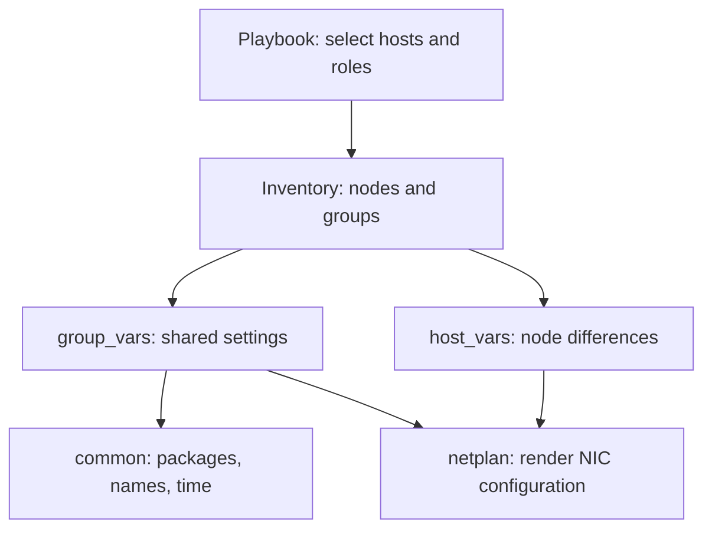

# Stage 2 — Understand reusable Ansible roles

**Installation instructions stay in [Stage 1](01-openstack-foundation.md).** This chapter explains the inventory and roles already used there. Reading it does not add another prerequisite or require repeating completed checks.

## Why roles?

A **playbook** selects hosts and work. A **role** bundles one job. **Inventory** lists machines and groups; **group_vars** holds shared settings; **host_vars** holds node differences.



| Project file | Job |
|---|---|
| `ansible/inventory/hosts.yml` | Fixed three-node preparation inventory |
| `ansible/inventory/group_vars/all.yml` | Shared packages, account and selected SSH key |
| `ansible/inventory/host_vars/` | Examples of per-node settings |
| `ansible/playbooks/base.yml` | Run common, then verify its real result |
| `ansible/roles/common/` | Maintain the host baseline |
| `ansible/roles/netplan/` | Write network candidates on Hermes |

For deployment, `private/lab.yml` is the single reviewed input. The generator writes `build/inventory.yml` and Kolla's full service inventory; it does not ask you to maintain duplicate live values in host_vars. The small preparation inventory is deliberately not Kolla's full hierarchy.

## What the common role manages

| Ubuntu package on each node | Plain purpose |
|---|---|
| `curl` | Request/test HTTP endpoints |
| `git` | Retrieve and inspect versioned source |
| `jq` | Read/filter JSON |
| `lvm2` | Manage Linux physical volumes, volume groups and logical volumes |
| `smartmontools` | Read disk-health information |
| `chrony` | Run the time synchronization service |
| `python3` | Execute Ansible modules on the node |

These install as node system packages, not inside Hermes's Python environment. Commands are under system paths such as `/usr/bin`; Chrony configuration is under `/etc/chrony`.

APT keeps installed packages and adds missing ones. It also resolves supporting dependencies/conflicts. The real preview proposed `chrony` plus `tzdata-legacy`, removing `systemd-timesyncd`; it did not propose a general upgrade. A later apply evaluates the actual state again, rather than replaying a saved APT transaction.

| Other setting | Why |
|---|---|
| Hostname matches inventory | Consistent node identity |
| One managed `/etc/hosts` block | Resolve node1/node2/node3 to `.200/.201/.202` |
| Remove selected short-name loopback alias | Avoid two IPv4 answers for the same node name |
| Chrony running and enabled | Keep time synchronized during use and after reboot |

The role does not configure Netplan, provision Cinder disks or deploy OpenStack.

## Read Ansible output

| Output | Meaning |
|---|---|
| `ok` | A read/check completed, or the requested state already existed |
| `changed` in check mode | Ansible predicts a change |
| `changed` in normal mode | A task reports making a change |
| `failed` | That task or assertion did not pass; read the actual message |
| `unreachable` | Ansible could not establish/use the remote connection |
| `skipping` | The task's condition did not select it |

**Preview:** `preview-common.sh` uses `--check --diff`; missing Chrony startup checks may be deferred until installation. **Apply:** `apply-common.sh` makes real changes, verifies them and stops on the first failure. Both use one selected-node/all-node command and keep private reports/history under `build/`.

The normal verification checks packages, hostname, management IP, exact name mappings, Chrony service and synchronization commands. `COMMON_APPLIED_OK` is printed only after these pass. A successful fixture test on our side is not the same as this marker from the real nodes.

## SSH and sudo are two permissions

SSH uses Hermes's private key to log into a node as `joe`; the matching public key is on that node. Ansible then uses **become/sudo** for administrative tasks. `BECOME password` means that node's Ubuntu `joe` password, not an SSH-key passphrase.

Both access checks have already passed on all three. The four-hour agent timer controls how long its loaded key copy is held; it does not expire the key files. [Completed SSH lesson](01-openstack-foundation.md#ssh-access-for-ansible).

## Netplan: a template before a live change

The Netplan role renders the same design for each node, substituting its management IP and actual USB MAC. Candidates go to `build/netplan/node1.yaml`, `node2.yaml` and `node3.yaml` on Hermes. Rendering is not a live network change.

Stage 1 explains the one-node-at-a-time console procedure. The intended result is the original IP on `enp0s31f6`, plus MAC-matched `ext0` with no host IP. Retain backups and verify connectivity before accepting `netplan try`.

## Repeatability: what you should learn

With unchanged inputs and host state, a role should keep the same configuration rather than append duplicate lines or recreate resources. This is called **idempotence**.

After the cloud is healthy, examine a repeat common run: configuration tasks should need no change unless the node changed. Package metadata refreshes can still occur. Do not make a second successful run an extra installation prerequisite.

<details>
<summary>Reference: the observed hostname failure and its correction</summary>

## Resolve duplicate hostname lookup


### 1. What the report means

Report start: **`2026-10-22T12:12:23Z`**. Node1 returned **two IPv4 addresses for its name**:

| Address returned for `node1` | Meaning |
|---|---|
| `127.0.1.1` | Local loopback address |
| `192.168.0.200` | Its preserved management address |

**Line 41 identifies the verification task that caught the conflict.** The YAML ran successfully up to that assertion. We require the lab node names to resolve to their management IPs, so verification stopped the run.

The original role added its marked hosts block without handling the selected node's existing loopback alias. The correction belongs in the common role; the resolver check remains strict. A typical entry behind this result is `127.0.1.1 node1`; the full hosts file was not supplied, so the corrected role reads the actual file before editing it.

| What this run established | Status |
|---|---|
| Node1's declared packages, hostname and management IP | Passed |
| Node1's Chrony service | Running and enabled |
| Node1's name lookup | Failed: loopback plus management IP |
| Clock synchronization check | Not reached |
| Node2 and node3 | Not attempted in this run |

The `(item=node2)` and `(item=node3)` lines are name lookups performed on node1.

Node1's recap is `changed=0`: the reported run found the package/host/service configuration already present. It does not establish when those earlier changes happened.

### 2. What the correction does

The role now reads `/etc/hosts` and renders **one corrected file**. It maintains the marked management block, and removes only the selected node's exact hostname from `127.0.1.1` records. Other aliases and comments are retained. If that record has no aliases left, the empty record is removed; an attached comment is kept as a comment line.

The `localhost` and IPv6 entries are retained. A changed file receives a dated backup, and its existing permissions are preserved. The management mappings stay:

| Name | Required IPv4 address |
|---|---|
| `node1` | `192.168.0.200` |
| `node2` | `192.168.0.201` |
| `node3` | `192.168.0.202` |

The renderer refuses incomplete or repeated lab markers. If the resolver still returns an extra address, verification continues to stop and show the actual result.

### 3. Resume from Hermes — use the active Stage 1 command

The corrected run starting `2026-10-22T12:31:45Z` passed on all three. No further recovery command is needed. Continue at [Stage 1, Step 2](01-openstack-foundation.md#2-review-one-deployment-configuration).

The completed wrapper run re-evaluated the existing desired state, corrected the hosts files, verified node1, then proceeded to node2 and node3. Each selected node asks for its Ubuntu `joe` sudo password. A failure stops later nodes; already completed changes remain.

Expected final result:

```text
RESULT: COMMON_APPLIED_OK for all; installed baseline and time synchronization verified.
```

**Resolved:** the supplied full log ends `COMMON_APPLIED_OK for all`; each node has `failed=0`, `unreachable=0`. The common phase is complete. This reference preserves the cause of the earlier failure.

### 4. Why the report path said Permission denied

| Terminal input | What Bash does |
|---|---|
| `/home/joe/git/openstack-iac-lab/build/common-apply-report.txt` | Tries to execute the text report as a program |
| `cat build/common-apply-report.txt` | Reads and displays it; this worked in the supplied output |

The report is intentionally private text data. Reading it with `cat` is the appropriate operation.

<details>
<summary>Code map for this correction</summary>

| File | Job |
|---|---|
| `ansible/roles/common/tasks/hosts.yml` | Read the actual hosts file, then write a backed-up candidate through Ansible |
| `ansible/roles/common/filter_plugins/lab_hosts.py` | Build the management block and retire only the selected node's loopback alias |
| `ansible/roles/common/templates/hosts.j2` | Render the calculated file contents |
| `ansible/tasks/verify-common.yml` | Keep the existing strict resolver and baseline checks |

The filter only calculates text on Hermes; Ansible performs the node file operation. No new package or service was introduced by this fix. Native local fixtures exercise preview, backup, preserved permissions and an unchanged second application.

</details>

</details>

<details>
<summary>Completed checks and reports — no default rerun</summary>

| Check | Actual result |
|---|---|
| SSH-key login / Ansible Python | `SSH_READY for all`, latest supplied run `2026-10-22T09:45:00Z` |
| Sudo identity | `ADMIN_ACCESS_OK for all`, `2026-10-22T10:14:57Z` |
| Common preview | `COMMON_PREVIEW_OK for all`, `2026-10-22T10:35:36Z` |
| Common apply | `COMMON_APPLIED_OK for all`, `2026-10-22T12:31:45Z`; earlier duplicate lookup resolved |

The earlier incorrect sudo password on node2 was resolved by the later all-node check. No further password/key reset is needed for the hostname issue. Detailed evidence and local validation limits remain in [VALIDATION.md](../VALIDATION.md).

</details>

<details>
<summary>Later exercise: rebuild a physical node</summary>

## 5. Rebuild a node without confusing the layers


| Layer | Correct operation | What it does not do |
|---|---|---|
| Terraform workload | Review destroy plan → apply → recreate | Does not reinstall physical Ubuntu |
| Physical host | Reinstall Ubuntu → restore identity/network → common role | Does not recreate old VMs or volumes |
| OpenStack services | Follow Kolla's host lifecycle/recovery procedure | Does not restore a lost LVM disk |

On this layout every physical node is a controller. A host reset therefore removes a controller as well as any compute/storage roles it carries. Do not start with a random live `--limit node2` Kolla deployment: Kolla documents limitations around --limit, and full service-group context matters.

First complete the requested **full lab rebuild**. For a later controlled one-host exercise:

1. Record controller/database/message health and take recoverable private control-plane backups.
2. Evacuate or deliberately delete disposable instances on the chosen compute. Verify that it is not the only Glance/LVM host needed by the exercise.
3. Follow the selected Kolla release's removal/replacement procedure for that host; decide how the database and RabbitMQ member identities will be removed/re-enrolled.
4. Reinstall Ubuntu with its same hostname/IP, verify its new SSH fingerprint, apply preparation roles, then follow the reviewed Kolla rejoin procedure.
5. Check quorum and service health before doing anything to a second controller.

That final controller rejoin depends on the observed cluster state; it is not represented as a generic one-command promise here.

</details>

## Finish line

Explain which file selects hosts, which values are shared, which differ per node, and how common/netplan reuse those inputs. The rebuild exercise waits until the cloud is healthy and its recovery plan is reviewed.

## Sources

- [Ansible roles](https://docs.ansible.com/ansible/latest/playbook_guide/playbooks_reuse_roles.html)
- [Ansible inventory](https://docs.ansible.com/ansible/latest/inventory_guide/intro_inventory.html)
- [Ansible check/diff modes](https://docs.ansible.com/projects/ansible/latest/playbook_guide/playbooks_checkmode.html)
- [Netplan try](https://netplan.readthedocs.io/en/stable/netplan-try/)
- [Kolla operations and host lifecycle](https://docs.openstack.org/kolla-ansible/2026.1/user/operating-kolla.html)

Next: [Stage 3 — Terraform modules and the first workload](03-terraform-modules.md).
