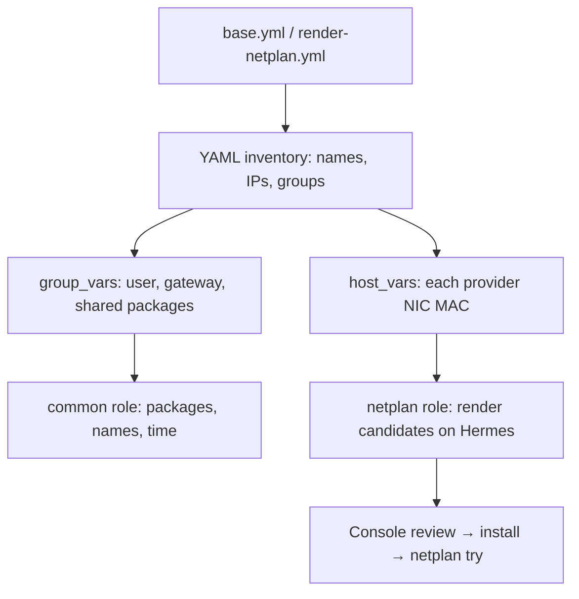

# Stage 2 — Ansible roles, YAML inventory, and node rebuilding

## Why roles?

A playbook describes which hosts to work on. A role packages one responsibility: tasks, templates, handlers, and defaults. Inventory says where hosts belong; group_vars contains shared settings; host_vars contains differences such as a USB NIC's MAC address.

The supplied common and Netplan examples can be used during Stage 1's preparation. This stage explains and validates that structure before extending it to applications.



## 1. Examine the supplied inventory

Run from the repository root in the kolla-iac virtual environment:

```bash
ansible-inventory --graph
ansible lab_nodes --list-hosts
ansible control --list-hosts
ansible lab_nodes -m ansible.builtin.ping
```

Expected: exactly node1/node2/node3 in lab_nodes and control. Hermes is not a managed lab node. Ansible's ping module tests SSH/Python operation; it is not an ICMP ping.

The preparation inventory is intentionally smaller than Kolla's service inventory. Stage 1 generates the latter from the full installed sample, preserving its child groups. Do not use the small preparation inventory as a substitute for Kolla's complete inventory.

When using the central private/lab.yml configuration, use `-i build/inventory.yml` with the commands in this stage, or use labctl's entry points. The tracked inventory/host_vars files show the source structure; the generated inventory embeds the reviewed values so you do not maintain two copies of live input.

## 2. Inspect hosts, then apply common

```bash
ansible-playbook ansible/playbooks/preflight.yml --ask-become-pass
ansible-playbook ansible/playbooks/base.yml --syntax-check
ansible-playbook ansible/playbooks/base.yml --check --diff --ask-become-pass
ansible-playbook ansible/playbooks/base.yml --ask-become-pass
ansible-playbook ansible/playbooks/base.yml --ask-become-pass
```

The common role installs explicit packages, sets hostnames, writes a marked /etc/hosts block, and enables Chrony. It does not reset Ceph, edit storage, or deploy OpenStack. On the second normal run, configuration tasks should report no changes unless the machine changed between runs. A check-mode run is a preview, not proof that a real run will succeed.

If the last command repeatedly changes something, inspect the particular task before proceeding. Avoid tasks such as an unconditional `echo >> /etc/hosts`, which append another duplicate on each run.

## 3. Render networking without cutting off SSH

At each node, read `ip -br link` and the actual provider NIC MAC. Fill the corresponding host_vars file. Check management-interface names and set verified DNS servers in group_vars. Then:

```bash
ansible-playbook ansible/playbooks/render-netplan.yml --syntax-check
ansible-playbook ansible/playbooks/render-netplan.yml
cat build/netplan/node1.yaml
cat build/netplan/node2.yaml
cat build/netplan/node3.yaml
```

The role fails if a provider MAC is still a placeholder or DNS is empty. It writes candidates under build/netplan on Hermes, not /etc/netplan on the nodes.

For a freshly installed node, compare the candidate with **all** files in /etc/netplan. Back up the existing configuration privately. From its local console, install one reviewed definition, remove conflicting definitions only after reviewing their ownership, and run:

```bash
sudo netplan generate
sudo netplan try --timeout 120
```

Test SSH, the default route, DNS, and the expected interface addresses from another terminal before accepting the change. Verify the actual rollback state if it times out. Repeat one host at a time. Keep provider ext0 free of a host IP; Kolla will attach it to OVS.

## 4. Sudo and Kolla

The confirmed account is `joe` on all three reinstalled nodes; both preparation and generated Kolla inventories use it. Discovery succeeded with SSH passwords. The report's "passwordless sudo is unavailable" message is expected with normal Ubuntu sudo and is not a discovery failure. Regular ansible-playbook commands use `--ask-become-pass` for sudo; unattended SSH access must be prepared separately before running them. Kolla's selected Python CLI does not expose that same flag; use Ansible's environment setting when needed:

```bash
export ANSIBLE_BECOME_ASK_PASS=True
```

Run the Kolla command normally; the underlying Ansible process prompts. Do not set this to an actual password. Alternatively, explicitly review a lab deployment-account sudo policy. Passwordless sudo is a permission choice, not a prerequisite for understanding roles.

## 5. Rebuild a node without confusing the layers

| Layer | Correct operation | What it does not do |
|---|---|---|
| Terraform workload | Review destroy plan → apply → recreate | Does not reinstall physical Ubuntu |
| Physical host | Reinstall Ubuntu → restore identity/network → common role | Does not recreate old VMs or volumes |
| OpenStack services | Follow Kolla's host lifecycle/recovery procedure | Does not restore a lost LVM disk |

On this layout every physical node is a controller. A host reset therefore removes a controller as well as any compute/storage roles it carries. Do not start with a random live `--limit node2` Kolla deployment: Kolla documents limitations around --limit, and full service-group context matters.

First complete the requested **full lab rebuild**. For a later controlled one-host exercise:

1. Record controller/database/message health and take recoverable private control-plane backups.
2. Evacuate or deliberately delete disposable instances on the chosen compute. Verify that it is not the only Glance/LVM host needed by the exercise.
3. Follow the selected Kolla release's removal/replacement procedure for that host; decide how the database and RabbitMQ member identities will be removed/re-enrolled.
4. Reinstall Ubuntu with its same hostname/IP, verify its new SSH fingerprint, apply preparation roles, then follow the reviewed Kolla rejoin procedure.
5. Check quorum and service health before doing anything to a second controller.

That final controller rejoin depends on the observed cluster state; it is not represented as a generic one-command promise here.

## Finish line and recovery

Understand the graph, obtain repeatable common-role results, and render the same Netplan candidate from the same inputs. Keep the console available during networking changes. Restore the saved configuration from the console if the candidate loses connectivity. Do not continue into Kolla with unresolved interface or hostname resolution problems.

## Sources

- [Ansible roles](https://docs.ansible.com/ansible/latest/playbook_guide/playbooks_reuse_roles.html)
- [Ansible inventory](https://docs.ansible.com/ansible/latest/inventory_guide/intro_inventory.html)
- [Netplan try](https://netplan.readthedocs.io/en/stable/netplan-try/)
- [Kolla operations and --limit caveats](https://docs.openstack.org/kolla-ansible/2026.1/user/operating-kolla.html)
- [Ansible become_ask_pass setting](https://docs.ansible.com/ansible/latest/reference_appendices/config.html#default-become-ask-pass)

Next: [Stage 3](03-terraform-modules.md).
