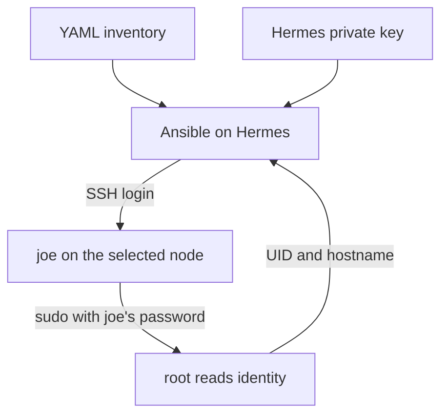
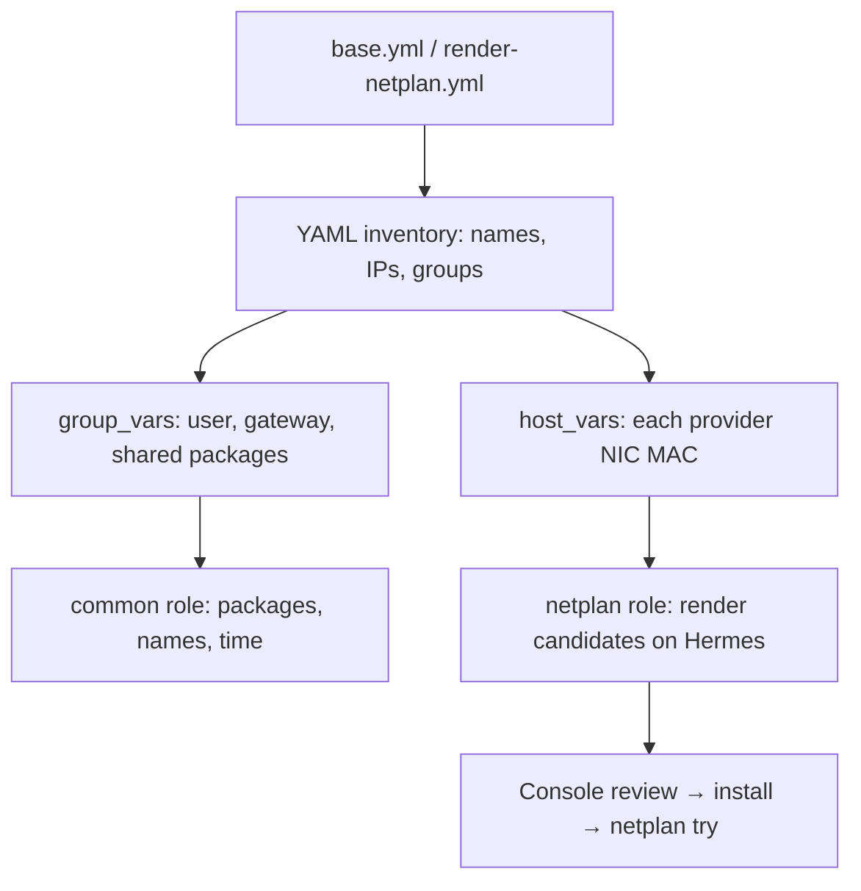

# Stage 2 — Ansible roles, YAML inventory, and node rebuilding

**Prerequisite:** complete [Stage 1's SSH-key lesson](01-openstack-foundation.md#ssh-access-for-ansible) and review `SSH_READY` before the commands below. Host inventories select `~/.ssh/openstack-iac-lab-ansible`; keep that key unlocked in Hermes's current `ssh-agent`. Key login and sudo authorization are separate.

## Check Ansible administrator access

**Current result:** node1 and node3 passed; node2's sudo password was rejected. [Review the result and retry node2 only](#reviewed-result-node2-sudo-password). The all-node command below explains the completed first check.

**Stage 1 host preparation, using this stage's Ansible files.** SSH already lets Hermes log in as `joe`. Installing packages and configuring system services later require administrator privileges. This check proves that Ansible can use `sudo` before we apply the common role.

**The new word is `become`:** Ansible logs in as `joe`, then uses `sudo` to run the selected task as `root`. Linux identifies root with user ID **`0`**.



| Project file | Its job |
|---|---|
| `ansible/inventory/hosts.yml` | Lists the three node names, preserved IPs and groups |
| `ansible/inventory/group_vars/all.yml` | Supplies the `joe` account and selected SSH key |
| `ansible/playbooks/check-admin.yml` | YAML task list: read effective user ID and hostname, then check the results |
| `scripts/check-admin.sh` | Runs that playbook once per selected node and saves one combined report |

**Exactly what runs on each node:**

| Command | Expected result | Effect |
|---|---|---|
| `id -u` after sudo | `0` | Reads the effective user ID |
| `hostname -s` | `node1`, `node2` or `node3`, matching the selected host | Reads the hostname |

This step installs no package and edits no node configuration. Normal Ansible temporary files and SSH/sudo logging can still occur. It uses the tracked preparation inventory; no cloud VIP, floating-IP pool or storage approval is needed for these identity reads.

**Prompt:** `BECOME password:` means **that selected node's Ubuntu `joe` sudo password**. The SSH key handles login. The wrapper asks separately for node1, node2 and node3, so passwords do not have to be identical. Characters stay hidden; the entered passwords are not written into the reports.

**Run on Hermes from `~/git/openstack-iac-lab`:**

```bash
git pull --ff-only
bash scripts/check-admin.sh joe --node all
```

The summary prints at the end and is saved as **`build/admin-access-summary.txt`**. Detailed output is in `build/admin-access-report.txt`; timestamped history and the resolved inventory snapshot stay in private, ignored `build/` files.

| Summary output | Meaning |
|---|---|
| `node1: PASSED; UID 0 and expected hostname verified` | Ansible used sudo successfully on the intended node; the same rule applies to node2/node3 |
| `RESULT: ADMIN_ACCESS_OK for all` | All three identity checks passed |
| A node says `FAILED`, final result `REVIEW` | Read that node's error in the detailed output; do not apply host configuration yet |
| `STOP` before node checks | Local prerequisites or the resolved inventory did not match; no node command was attempted |

An ordinary node failure is recorded and the read-only checks continue to the other selected nodes. Cancelling stops later checks. `--node node2` selects only that node for a targeted check when needed.

**Review the short summary before host configuration.** A pass proves Ansible's sudo access. The next lesson will explain the common role's packages and proposed changes before applying it. The first live result is recorded below.

### Reviewed result: node2 sudo password

Report start: **`2026-10-22T10:04:51Z`**. Final result: **`REVIEW`**.

| Node | Preserved address | Observed result | Meaning |
|---|---|---|---|
| node1 | `192.168.0.200` | `ADMIN_OK`; UID `0`; hostname matched | Ansible used sudo successfully |
| node2 | `192.168.0.201` | `Incorrect sudo password` | SSH reached the node; sudo rejected the password before the identity commands ran |
| node3 | `192.168.0.202` | `ADMIN_OK`; UID `0`; hostname matched | Ansible used sudo successfully |

**Cause → effect:** node2 rejected the supplied sudo password, so its first task failed. The independent read-only checks continued to node3 as designed. The final `REVIEW` means the administrator-access checkpoint is incomplete. All nodes report `changed=0`; no host configuration was applied.

The log does not establish whether the password was mistyped or a different credential was entered. At `BECOME password:`, use **node2's Ubuntu `joe` account password**. Typing stays hidden.

**Retry on Hermes, from `~/git/openstack-iac-lab`:**

```bash
git pull --ff-only
bash scripts/check-admin.sh joe --node node2
```

This runs the same identity reads on node2 only. The expected final line is:

```text
RESULT: ADMIN_ACCESS_OK for node2; identity checks passed.
```

**Share the printed summary.** It is also saved to `build/admin-access-summary.txt`. The latest report files will describe this node2-only run; the earlier all-node report remains in timestamped history. We will review the new result alongside the recorded node1/node3 passes before applying the common role. If sudo rejects the password again, share the error text so we can investigate node2's local sudo authentication.

<details>
<summary>Two error details explained</summary>

| Output | Meaning |
|---|---|
| `Origin: .../check-admin.yml:9:7` | Location of the failed task in the YAML file; the reported failure is sudo authentication |
| `ansible_exit=2; log_exit=0` | Ansible reported failure; the command saving its output succeeded |

</details>

Source: [Ansible become and sudo-password prompts](https://docs.ansible.com/projects/ansible-core/devel/playbook_guide/playbooks_privilege_escalation.html).

## Why roles?

A playbook describes which hosts to work on. A role packages one responsibility: tasks, templates, handlers, and defaults. Inventory says where hosts belong; group_vars contains shared settings; host_vars contains differences such as a USB NIC's MAC address.

The supplied common and Netplan examples can be used during Stage 1's preparation. This stage explains and validates that structure before extending it to applications.



<details>
<summary>Later command reference: inventory, common role, Netplan and Kolla sudo</summary>

Complete the current administrator-access check and review its summary before using this later reference.

## 1. Examine the supplied inventory

Run from the repository root in the kolla-iac virtual environment:

```bash
ansible-inventory --graph
ansible lab_nodes --list-hosts
ansible control --list-hosts
ansible lab_nodes -m ansible.builtin.ping -e '{"ansible_become":false}'
```

Expected: exactly node1/node2/node3 in lab_nodes and control. Hermes is not a managed lab node. Ansible's ping module tests SSH/Python operation; it is not an ICMP ping. The extra variable disables sudo for this login test; later privileged playbooks use `--ask-become-pass`.

The preparation inventory is intentionally smaller than Kolla's service inventory. Stage 1 generates the latter from the full installed sample, preserving its child groups. Do not use the small preparation inventory as a substitute for Kolla's complete inventory.

When using the central private/lab.yml configuration, use `-i build/inventory.yml` with the commands in this stage, or use labctl's entry points. The tracked inventory/host_vars files show the source structure; the generated inventory embeds the reviewed values so you do not maintain two copies of live input.

## 2. Inspect hosts, then apply common

```bash
ansible-playbook ansible/playbooks/preflight.yml --ask-become-pass
ansible-playbook ansible/playbooks/base.yml --syntax-check
ansible-playbook ansible/playbooks/base.yml --check --diff --ask-become-pass
ansible-playbook ansible/playbooks/base.yml --ask-become-pass
ansible-playbook ansible/playbooks/base.yml --ask-become-pass
```

The common role installs explicit packages, sets hostnames, writes a marked /etc/hosts block, and enables Chrony. It does not reset Ceph, edit storage, or deploy OpenStack. On the second normal run, configuration tasks should report no changes unless the machine changed between runs. A check-mode run is a preview, not proof that a real run will succeed.

If the last command repeatedly changes something, inspect the particular task before proceeding. Avoid tasks such as an unconditional `echo >> /etc/hosts`, which append another duplicate on each run.

## 3. Render networking without cutting off SSH

At each node, read `ip -br link` and the actual provider NIC MAC. Fill the corresponding host_vars file. Check management-interface names and set verified DNS servers in group_vars. Then:

```bash
ansible-playbook ansible/playbooks/render-netplan.yml --syntax-check
ansible-playbook ansible/playbooks/render-netplan.yml
cat build/netplan/node1.yaml
cat build/netplan/node2.yaml
cat build/netplan/node3.yaml
```

The role fails if a provider MAC is still a placeholder or DNS is empty. It writes candidates under build/netplan on Hermes, not /etc/netplan on the nodes.

For a freshly installed node, compare the candidate with **all** files in /etc/netplan. Back up the existing configuration privately. From its local console, install one reviewed definition, remove conflicting definitions only after reviewing their ownership, and run:

```bash
sudo netplan generate
sudo netplan try --timeout 120
```

Test SSH, the default route, DNS, and the expected interface addresses from another terminal before accepting the change. Verify the actual rollback state if it times out. Repeat one host at a time. Keep provider ext0 free of a host IP; Kolla will attach it to OVS.

## 4. Sudo and Kolla

The confirmed account is `joe` on all three reinstalled nodes; both preparation and generated Kolla inventories use it. Discovery succeeded with SSH passwords. The report's "passwordless sudo is unavailable" message is expected with normal Ubuntu sudo and is not a discovery failure. Regular ansible-playbook commands use `--ask-become-pass` for sudo; unattended SSH access must be prepared separately before running them. Kolla's selected Python CLI does not expose that same flag; use Ansible's environment setting when needed:

```bash
export ANSIBLE_BECOME_ASK_PASS=True
```

Run the Kolla command normally; the underlying Ansible process prompts. Do not set this to an actual password. Alternatively, explicitly review a lab deployment-account sudo policy. Passwordless sudo is a permission choice, not a prerequisite for understanding roles.

</details>

## 5. Rebuild a node without confusing the layers

| Layer | Correct operation | What it does not do |
|---|---|---|
| Terraform workload | Review destroy plan → apply → recreate | Does not reinstall physical Ubuntu |
| Physical host | Reinstall Ubuntu → restore identity/network → common role | Does not recreate old VMs or volumes |
| OpenStack services | Follow Kolla's host lifecycle/recovery procedure | Does not restore a lost LVM disk |

On this layout every physical node is a controller. A host reset therefore removes a controller as well as any compute/storage roles it carries. Do not start with a random live `--limit node2` Kolla deployment: Kolla documents limitations around --limit, and full service-group context matters.

First complete the requested **full lab rebuild**. For a later controlled one-host exercise:

1. Record controller/database/message health and take recoverable private control-plane backups.
2. Evacuate or deliberately delete disposable instances on the chosen compute. Verify that it is not the only Glance/LVM host needed by the exercise.
3. Follow the selected Kolla release's removal/replacement procedure for that host; decide how the database and RabbitMQ member identities will be removed/re-enrolled.
4. Reinstall Ubuntu with its same hostname/IP, verify its new SSH fingerprint, apply preparation roles, then follow the reviewed Kolla rejoin procedure.
5. Check quorum and service health before doing anything to a second controller.

That final controller rejoin depends on the observed cluster state; it is not represented as a generic one-command promise here.

## Finish line and recovery

Understand the graph, obtain repeatable common-role results, and render the same Netplan candidate from the same inputs. Keep the console available during networking changes. Restore the saved configuration from the console if the candidate loses connectivity. Do not continue into Kolla with unresolved interface or hostname resolution problems.

## Sources

- [Ansible roles](https://docs.ansible.com/ansible/latest/playbook_guide/playbooks_reuse_roles.html)
- [Ansible inventory](https://docs.ansible.com/ansible/latest/inventory_guide/intro_inventory.html)
- [Netplan try](https://netplan.readthedocs.io/en/stable/netplan-try/)
- [Kolla operations and --limit caveats](https://docs.openstack.org/kolla-ansible/2026.1/user/operating-kolla.html)
- [Ansible become_ask_pass setting](https://docs.ansible.com/ansible/latest/reference_appendices/config.html#default-become-ask-pass)

Next: [Stage 3](03-terraform-modules.md).
