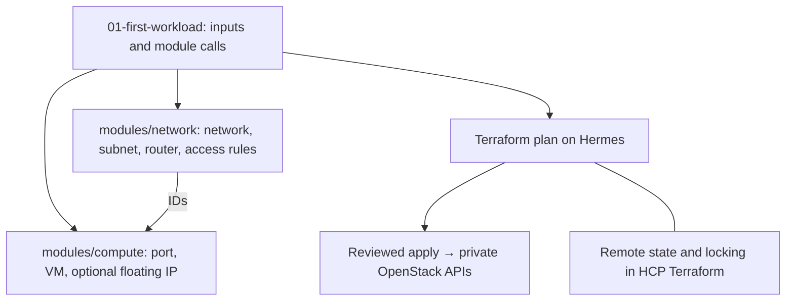

# Stage 3 — Terraform modules and remote state

## Cause and effect

Terraform calls OpenStack APIs to create networks, ports, routers, floating IPs, instances, and volumes. It does not reinstall the physical nodes or configure PostgreSQL. Its state maps resource addresses in code to real OpenStack IDs.

A module is a reusable collection of resources with inputs and outputs. The root configuration calls the network and compute modules and supplies environment-specific values. Each workload has separate state so deleting the first learning VM does not delete the application.



## 1. Establish prerequisites

`labctl configure` creates each root's ignored terraform.tfvars.json and backend.tf.json from private/lab.yml. In that workflow, **do not also copy** the .tfvars or backend.tf examples: duplicate variable/backend definitions are unnecessary and can conflict. The copy steps below describe the manual alternative.

Stage 1 must already have a working `public` external network, `ubuntu-24.04` image, `lab.small` flavor, `lab-key` key pair, and enough project quota. These names are lab conventions created in Stage 1; they are not discoveries about the existing cloud.

Keep Terraform execution on Hermes because it can reach the private APIs. Use a project-scoped OpenStack application credential through your private clouds.yaml or OS_* environment variables. Confirm `openstack server list` works in the intended project before Terraform. Do not use the old cluster's credentials or state.

Use Horizon's Identity project/user administration with the fresh admin identity to create project `iac-lab` and a normal member user. Sign in as that user and create an application credential under Identity → Application Credentials. Put the returned ID/secret into private/clouds.yaml using config/clouds.yaml.example, then export OS_CLIENT_CONFIG_FILE and OS_CLOUD as README.md shows. These are new lab credentials, never the old cluster's cached credentials. Grant only the roles needed for the workload and verify quotas before applying.

On Hermes:

```bash
terraform version
openstack network show public
openstack image show ubuntu-24.04
openstack flavor show lab.small
openstack keypair show lab-key
openstack quota show
```

Use an installed Terraform version satisfying `>=1.11,<2.0`; the old Hermes installation may already do so. The examples constrain the OpenStack provider to the inspected 3.4 series. `terraform init` resolves a patch release and writes .terraform.lock.hcl; review and commit that lock file. Changing a module path or a resource's Terraform address can propose recreation even if its display name stays the same.

## 2. Set up remote state before the first real apply

Suggested backend: HCP Terraform, with the workspace's **Execution Mode set to Local**. It holds state/locks; Hermes runs the provider and API requests. This requires your agreement to store state, which can include sensitive values, with that service. Do not build the backend inside the same lab you intend to destroy.

In your own browser, create an HCP organization and a workspace named `openstack-iac-first`. Choose local execution. Then on Hermes:

```bash
cd ~/git/openstack-iac-lab/terraform/01-first-workload
cp backend.tf.example backend.tf
```

Replace the organization placeholder. Authenticate using `terraform login` in your own session; never commit its token. Then:

```bash
terraform init
```

If state already exists locally, back it up privately and use `terraform init -migrate-state` after reviewing the destination. Do not migrate old OpenStack cluster state into this fresh cloud. Never force-unlock an active colleague/process's state lock.

## 3. Configure and inspect the first workload

```bash
cp terraform.tfvars.example terraform.tfvars
```

Replace DNS with verified addresses, restrict admin_cidr to the intended management clients, and verify that the proposed workload_cidr does not overlap existing networks/routes. The example 10.42.10.0/24 is a teaching choice requiring review, not a discovered free range.

```bash
terraform fmt -recursive ..
terraform validate
terraform plan -out=tfplan
terraform show tfplan
```

Expect resources only for the first workload. Review project, network CIDRs, image/flavor, security rules, floating IP allocation, and any replacement/deletion actions. If the plan includes shared infrastructure or unrelated resources, stop and check the selected workspace and directory.

## 4. Apply and verify

After reviewing this exact plan:

```bash
terraform apply tfplan
terraform output -raw floating_ip
terraform state list
terraform plan -detailed-exitcode
```

For the final command, exit 0 means no changes, 2 means proposed changes, and 1 means an error. OpenStack's server status ACTIVE alone does not prove cloud-init or networking finished. SSH to the returned IP as `ubuntu` using the imported key, verify its fingerprint through an independent trusted channel, then run:

```bash
cloud-init status --wait
ip -br address
ip route
```

An empty Ubuntu VM does not run a web server automatically, so `curl` is not the test yet. That comes in Stage 4.

## 5. Practice destroy → deploy on this disposable workload

Do this only in `terraform/01-first-workload`, after confirming the state contains only its disposable resources:

```bash
terraform plan -destroy -out=destroy.tfplan
terraform show destroy.tfplan
```

After approving the listed deletions:

```bash
terraform apply destroy.tfplan
terraform plan -out=recreate.tfplan
terraform show recreate.tfplan
terraform apply recreate.tfplan
```

The second floating IP may differ. Always read outputs again. This destroys cloud workload resources, not the three physical controller nodes.

## Finish line and recovery

Know which module creates each object, find it in state, and obtain a no-change plan after deployment. A provider/API failure can leave some resources already created; inspect `terraform state list` and OpenStack before retrying. Do not delete state to make an error disappear. Keep state backups private.

Stage 4 uses another root configuration and workspace. Stage 5 uses a third workspace; its monitoring VM intentionally depends on the application's network, so remove monitoring before removing that network.

## Sources

- [Terraform modules](https://developer.hashicorp.com/terraform/language/modules)
- [HCP state with local execution](https://developer.hashicorp.com/terraform/language/backend/remote)
- [State locking](https://developer.hashicorp.com/terraform/language/state/locking)
- [OpenStack provider source v3.4.0](https://github.com/terraform-provider-openstack/terraform-provider-openstack/tree/v3.4.0)

Next: [Stage 4](04-application-deployment.md).
