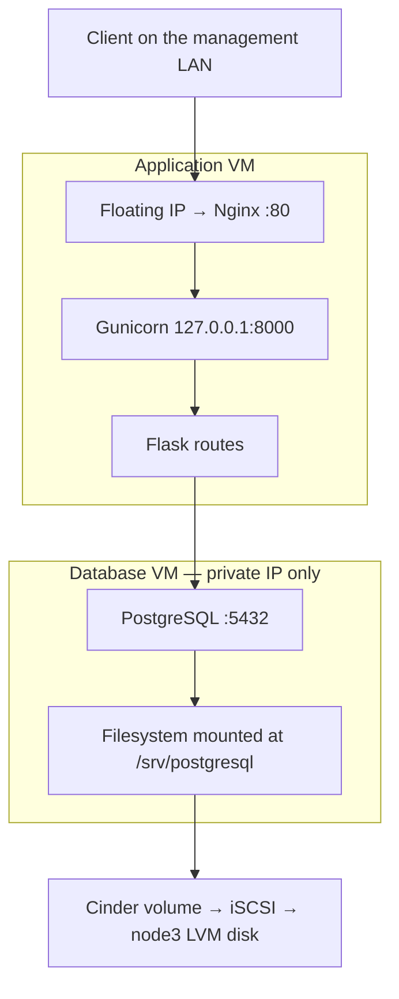

# Stage 4 — Deploy PostgreSQL, Flask, Gunicorn, and Nginx

## Understand the request path

Terraform builds the VMs and their network. Ansible installs and configures software inside them. Nginx accepts HTTP, Gunicorn runs Python workers, Flask handles routes, and PostgreSQL stores rows. Gunicorn listens on localhost; PostgreSQL uses the private workload network. Only the app VM gets a floating IP.



The volume survives a VM reboot and is independent of the VM's root disk. It still has no storage replication. Deleting the volume or losing its only physical disk loses that data unless a usable backup exists.

## 1. Provision the application infrastructure

With the central configuration, use `labctl terraform app init`, `plan`, and `apply`. The wrapper exports the inventory automatically. Do not also copy manual backend/variable examples when generated .tf.json settings already exist. The commands below are the equivalent low-level workflow.

Use a new HCP workspace `openstack-iac-app` with local execution. Set its organization in a copied backend.tf.example. Use the same project-scoped OpenStack authentication as Stage 3.

```bash
cd ~/git/openstack-iac-lab/terraform/02-application
cp backend.tf.example backend.tf
cp terraform.tfvars.example terraform.tfvars
```

Edit both files: verified DNS, non-overlapping workload CIDR, correct admin clients, HCP organization. Confirm the two VM sizes and 5 GiB volume fit available resources/quota.

```bash
terraform init
terraform fmt
terraform validate
terraform plan -out=tfplan
terraform show tfplan
terraform apply tfplan
terraform output -raw app_floating_ip
terraform output -raw app_private_ip
terraform output -raw database_volume_id
```

The plan must contain two VMs, one app floating IP, an application network/router, access rules, and one database volume/attachment. The DB has no floating IP. Its data volume has prevent_destroy enabled: a broad destroy is intentionally blocked until that protection is explicitly reviewed and changed.

## 2. Generate Ansible inventory from actual outputs

From the root configuration directory above:

```bash
mkdir -p ../../build
terraform output -json ansible_inventory > ../../build/application.inventory.json
cd ../..
ansible-inventory -i build/application.inventory.json --graph
```

Use the private key matching Stage 1's `lab-key`. Load it in your SSH agent with `ssh-add /path/to/the/correct/private-key`; substitute the actual path. The DB connection uses the app VM as an SSH jump host. The app VM need not hold your private key; the SSH connections are initiated on Hermes.

Verify both new SSH host fingerprints through an independent trusted route such as the VM console before accepting them. Wait for `cloud-init status --wait` on both VMs. Then:

```bash
ansible -i build/application.inventory.json all -m ansible.builtin.ping
```

Ubuntu cloud images use user ubuntu here. The physical nodes continue using openstack. Do not apply the physical-host Netplan or hostname role to the application VMs.

## 3. Identify and prepare the database's data filesystem

On db1, inspect `lsblk -o NAME,PATH,SIZE,TYPE,FSTYPE,MOUNTPOINTS,SERIAL` and `/dev/disk/by-id/`. Match the new 5 GiB disk to the attached Cinder volume ID. Formatting is destructive: confirm it is the blank data volume, not the VM root disk, before creating an ext4 filesystem.

The supplied helper makes that operation explicit. Copy scripts/guest-volume.py **and** scripts/storage-target.py to /tmp on db1 using your SSH jump-host connection. On db1, use the actual by-id path, actual serial from lsblk, and the volume UUID from Terraform output:

```bash
sudo python3 /tmp/guest-volume.py --target /dev/disk/by-id/VERIFIED_ID --serial OBSERVED_SERIAL --volume-id TERRAFORM_VOLUME_UUID
```

This is inspection only. For the reviewed blank candidate, repeat with `--format`; the helper requires typing format: followed by the observed serial. It refuses mounted disks, wrong serials, nonblank ownership, and serials that do not match the Cinder volume UUID prefix. If the hypervisor exposes another serial format, stop for an attachment review rather than bypassing the check. An existing matching unmounted ext4 filesystem is retained and its UUID reported.

After that reviewed one-time formatting, use `sudo blkid` to record its filesystem UUID. The playbook only mounts an already prepared filesystem; it never guesses `/dev/vdb` and never formats a disk automatically.

Create a private encrypted variable file on Hermes:

```bash
mkdir -p private
chmod 700 private
ansible-vault create private/application.vault.yml
```

In the editor put `database_data_uuid: <the observed UUID>` and `lab_db_password: <a new strong password of at least 20 characters>`. Generate/store the password locally. Do not commit the vault file/password or paste either secret into chat. The public repository excludes private/ entirely.

## 4. Configure using the reusable roles

```bash
ansible-galaxy collection install -r ansible/requirements.yml
ansible-playbook -i build/application.inventory.json ansible/playbooks/application.yml --syntax-check
ansible-playbook -i build/application.inventory.json ansible/playbooks/application.yml -e @private/application.vault.yml --ask-vault-pass
```

The postgres role mounts the verified filesystem, seeds the newly installed empty PostgreSQL cluster there once, points PostgreSQL to it, and creates the app database/user/table. On later runs it preserves an existing data directory. This seeding logic is for a fresh lab VM; do not use it as an unreviewed migration tool for an existing populated database.

The flask role creates a Python virtual environment and systemd service. The nginx role proxies to Gunicorn. Password-bearing tasks use no_log and the environment file is root-readable only. Do not add `--diff` to the secret-bearing deployment.

The initial dependency constraints allow compatible patches. Record `pip freeze` from the deployed app venv privately and pin the reviewed versions for the next repeatable build; they are not represented as a fully locked application release yet.

## 5. Verify behavior, not just processes

Use the actual app floating IP from Terraform:

```bash
curl -fsS http://APP_FLOATING_IP/health
curl -fsS -X POST http://APP_FLOATING_IP/visits
curl -fsS http://APP_FLOATING_IP/visits
```

Replace APP_FLOATING_IP with the observed output. Expect health status ok, HTTP 201 for POST, and a count that increases after each POST. GET /visits reads data; it does not insert a row.

On the app VM:

```bash
sudo systemctl status labapp nginx --no-pager
sudo journalctl -u labapp -n 50 --no-pager
sudo tail -n 50 /var/log/nginx/error.log
```

On the DB VM:

```bash
findmnt /srv/postgresql
sudo -u postgres psql -Atc 'show data_directory;'
sudo systemctl status postgresql@16-main --no-pager
```

Expect data_directory `/srv/postgresql/16/main` on the verified Cinder filesystem. Reboot the DB VM during the agreed lab window; wait for it and verify health plus the saved count again. Do not call an empty newly created database a persistence success.

## Finish line and recovery

Capture the successful HTTP checks, database mount/path, and persistence result. If HTTP fails, trace Nginx → Gunicorn → Flask → PostgreSQL. A 503 from /health means the app could not query the database; inspect the app log, DB process, pg_hba, security group, and volume availability before changing random components.

If storage fails to mount, recover the volume connection first; do not start an empty replacement database and assume the data is gone. Keep database backups outside this single storage host. Recreating a VM is not a database-backup strategy.

Cleanup order later: remove monitoring first, export/verify database backups, review removal of the data volume's protection, then review a Terraform destroy plan. No broad automatic destroy is part of this lesson.

## Sources

- [Provider volume attachment](https://github.com/terraform-provider-openstack/terraform-provider-openstack/blob/v3.4.0/docs/resources/compute_volume_attach_v2.md)
- [Flask production deployment](https://flask.palletsprojects.com/en/stable/deploying/)
- [Gunicorn deployment](https://docs.gunicorn.org/en/stable/deploy.html)
- [PostgreSQL configuration](https://www.postgresql.org/docs/16/runtime-config-file-locations.html)
- [Ansible PostgreSQL collection](https://docs.ansible.com/ansible/latest/collections/community/postgresql/)

Next: [Stage 5](05-monitoring.md).
