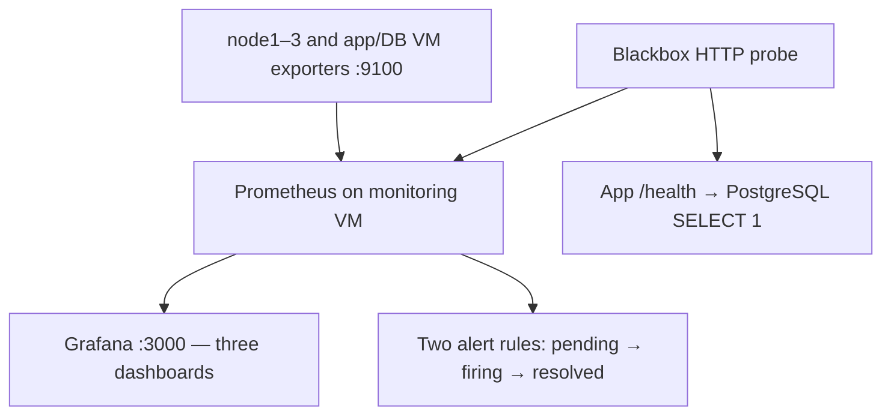

# Stage 5 — Prometheus, Grafana, three dashboards, two alerts

## What the components do

Node exporter exposes host/kernel metrics. Prometheus periodically reads them and evaluates alert rules. The blackbox exporter tests an HTTP endpoint from the monitoring VM. Grafana queries Prometheus and displays dashboards.



This workload runs **inside** OpenStack. A complete cloud outage can also take monitoring down. It is a learning deployment, not an independent external outage detector.

## 1. Provision the monitoring VM

With the central configuration, use `labctl terraform monitor init`, `plan`, and `apply`. It supplies the actual app private IP and exports the monitoring inventory. Do not copy manual backend/variable examples on top of generated settings. The lower-level commands below explain the same operations.

The application network must already exist. This Terraform root deliberately reuses it and has its own HCP workspace/state, `openstack-iac-monitor`, with local execution. It adds a separate monitoring access group and allows that group to read application metrics and probe HTTP. It does not open PostgreSQL to the monitoring group.

```bash
cd ~/git/openstack-iac-lab/terraform/03-monitoring
cp backend.tf.example backend.tf
cp terraform.tfvars.example terraform.tfvars
```

Set the HCP organization and admin clients. Set app_private_ip to the observed output of `terraform -chdir=../02-application output -raw app_private_ip`. Do not substitute a node management IP.

```bash
terraform init
terraform fmt
terraform validate
terraform plan -out=tfplan
terraform show tfplan
terraform apply tfplan
terraform output -json ansible_inventory > ../../build/monitoring.inventory.json
terraform output -raw floating_ip
cd ../..
```

Verify the VM SSH identity and wait for cloud-init as in Stage 4. Add a private `grafana_admin_password` to an Ansible Vault file at private/monitoring.vault.yml. Use at least 48 hex characters, e.g. generate it locally with `openssl rand -hex 24`. The role requires hex to keep INI parsing predictable. Do not paste it into chat or Git.

## 2. Deploy exporters and monitoring

```bash
ansible-playbook -i ansible/inventory/hosts.yml -i build/application.inventory.json -i build/monitoring.inventory.json ansible/playbooks/monitoring.yml --syntax-check
ansible-playbook -i ansible/inventory/hosts.yml -i build/application.inventory.json -i build/monitoring.inventory.json ansible/playbooks/monitoring.yml -e @private/monitoring.vault.yml --ask-vault-pass --ask-become-pass
```

The merged inventory uses `joe` for the physical hosts and `ubuntu` for the VMs. Targets include all three physical hosts, app1, db1, and monitor1. The node_exporter role is reused across them. Port 9100 must not already belong to another exporter; Kolla's monitoring services are disabled in this design to avoid duplication.

Physical-host metrics use 192.168.0.200–.202. Verify routing/firewall access from the monitoring VM. Tenant SNAT can change the source address observed on those physical hosts; observe it before narrowing host-firewall rules. VM metrics use private workload IPs and the explicit security-group permission.

Prometheus and the blackbox exporter listen only on monitoring-VM localhost. Grafana listens on 3000; its security group permits only the reviewed admin CIDR. Do not forward these ports through your internet router.

## 3. Verify targets before trusting dashboards

On the monitoring VM:

```bash
sudo systemctl status prometheus prometheus-blackbox-exporter grafana-server --no-pager
sudo promtool check config /etc/prometheus/prometheus.yml
curl -fsS http://127.0.0.1:9090/api/v1/targets
curl -fsS http://127.0.0.1:9090/api/v1/rules
```

Expect six exporter targets and one HTTP probe with successful recent scrapes. The Cinder host supplies read-only volume-group capacity metrics through a textfile collector. Ordinary filesystem metrics do not measure unused LVM extents, so they cannot replace that collector.

If Cinder uses thin provisioning, VG free extents alone do not measure free space inside the thin pool. Check `lvs -a -o lv_name,lv_size,data_percent,metadata_percent cinder-volumes` separately; a full thin pool can block writes even when other capacity numbers look acceptable.

Open `http://MONITOR_FLOATING_IP:3000` in your own browser. Sign in as admin with the private password set on the first deployment. Grafana stores credentials internally after creation; changing admin_password in INI is not a general existing-user password rotation method.

## 4. Exactly three provisioned dashboards

| Dashboard | What it teaches |
|---|---|
| Hosts | Exporter reachability, CPU utilization, available-memory percentage |
| Storage and network | Mounted-filesystem free space, Cinder VG free space, disk and network throughput |
| Application | HTTP probe success, probe duration, and firing alert count |

No panel means 'all of OpenStack is healthy'. Exporter availability, HTTP availability, VM availability, and storage redundancy are different measurements. These panels use observed metrics; an empty series means inspect collection/labels before concluding a value is zero.

## 5. Test exactly two alert rules

The rules are visible in Prometheus; this starter does not send email, Slack, or phone notifications. Add a notification destination later only after choosing it explicitly.

Test HostTargetDown by stopping **only the exporter service** on a disposable application VM:

```bash
sudo systemctl stop prometheus-node-exporter
```

After at least two minutes plus evaluation time, the target's alert should fire. Restart the service and verify resolution:

```bash
sudo systemctl start prometheus-node-exporter
```

Test ApplicationHTTPDown by stopping only labapp on the app VM during the agreed test window. The HTTP probe should fail; after the rule delay the alert should fire. Start labapp again, verify /health, and verify the alert resolves. This tests detection and recovery without shutting down a controller or risking its quorum.

## Finish line and recovery

Record all targets, three populated dashboards, and each alert's firing/resolution evidence. If a physical-host target is down, try its metrics URL from the monitoring VM, inspect route/source address, check the node's listener, and then inspect firewall rules. Do not label an exporter failure as proven hardware failure.

Distribution packages and Grafana's stable repository can evolve. Record `dpkg-query -W` versions after the first reviewed deployment and pin the tested versions for repeat builds. Limit retention to the configured seven days initially and inspect the monitoring VM's filesystem use.

Destroy the monitoring workload **before** destroying its application's shared network. Monitoring in its own state is not independent of that network's lifecycle.

## Sources

- [Prometheus node exporter guide](https://prometheus.io/docs/guides/node-exporter/)
- [Prometheus configuration](https://prometheus.io/docs/prometheus/latest/configuration/configuration/)
- [Prometheus alerting rules](https://prometheus.io/docs/prometheus/latest/configuration/alerting_rules/)
- [Grafana installation on Ubuntu](https://grafana.com/docs/grafana/latest/setup-grafana/installation/debian/)
- [Grafana provisioning](https://grafana.com/docs/grafana/latest/administration/provisioning/)
